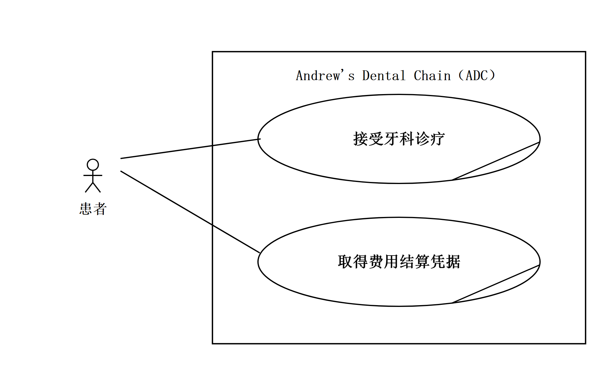
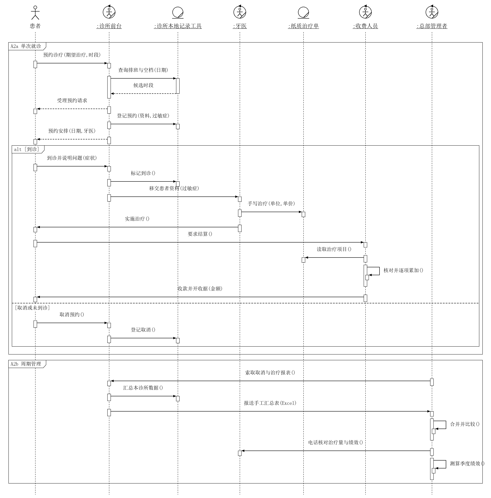
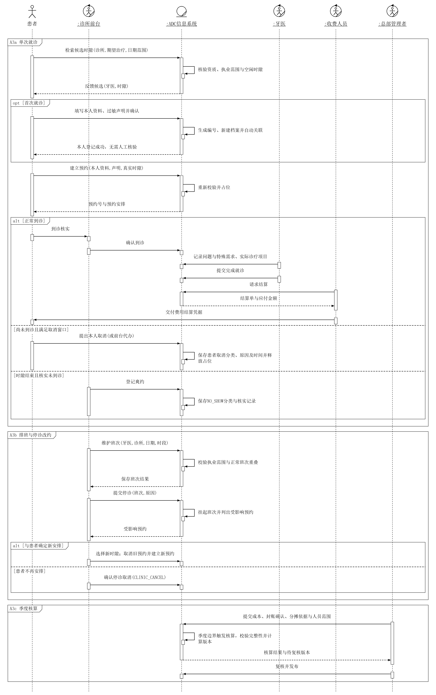

# A 业务建模

> 来源：当前正式 Word。正文、表格和图按原顺序转换；编号保留。Word 为业务规则权威，Markdown 为检索副本。

<!-- word-block:47 -->

## 一、业务建模

<!-- word-block:48 -->

安德鲁牙科连锁管理系统面向总部、诊所和患者，覆盖预约、排班、治疗记录、费用结算与季度绩效核算。患者可以根据诊所、治疗项目和日期选择可用时隙；诊所岗位围绕同一次就诊连续登记到诊、治疗与结算信息；总部利用这些记录比较各诊所的运营情况。本系统的建设重点是将上述业务连接起来，使诊所数量增加后，患者资料、治疗依据和核算口径仍能保持一致。

<!-- word-block:49 -->

### （一）愿景

<!-- word-block:50 -->

ADC在广东经营15家牙科诊所，并计划在三年内扩展至约30家。随着诊所和牙医数量增加，总部需要了解各诊所的服务能力、预约取消情况以及牙医的收入和成本构成。对于诊所，患者资料能否复用、排班是否可执行、实际治疗能否及时进入结算，直接影响日常接诊。因此，系统以统一业务记录为基础，解决预约安排、治疗追踪和季度核算之间的信息衔接问题。

<!-- word-block:51 -->

表 A1  ADC 信息系统的愿景

<!-- word-block:52 -->

| 要素 | 内容 |

| --- | --- |

| 系统 | ADC信息系统（Andrew’s Dental Chain 连锁管理信息系统） |

| 目标组织 | Andrew’s Dental Chain总部及其连锁诊所 |

| 主要涉众 | 首席执行官兼首席牙医Andrew Chen，关注连锁扩张过程中的运营管控、季度核算效率与牙医个人贡献。 |

| 主要目标 | 在连锁规模扩大的过程中，缩短总部季度核算与复核发布周期，并保持资料一致和结果可追溯。 |

| 主要度量指标 | 季度核算工作日数：从当期全部诊所封账确认及分摊依据齐备，至本轮所有可发布结果完成复核发布所经历的工作日数。资料等待时长另列。 |

| 辅助指标 | 统一资料覆盖率、治疗记录可追溯率，用于检查核算提速所依赖的数据条件。 |

| 对比范围与时间 | 受控虚构完整自然季度演练，按统一诊所范围和工作日历评价；资料齐备后1个工作日内完成季度核算及复核发布。 |

| 预期改进与约束 | 统一核心资料覆盖率和有效治疗可追溯率均达到100%；核算提速须保持成本完整、复核充分和结果可追溯。 |

<!-- word-block:53 -->

表A1a按“主要目标—支撑条件—运营监测”区分指标。季度核算工作日数为主要指标，资料覆盖和治疗可追溯为辅助指标；取消率及技能时隙覆盖继续用于运营分析。

<!-- word-block:54 -->

表 A1a  业务指标的用途与度量口径

<!-- word-block:55 -->

| 用途 | 指标 | 计算口径与取数范围 | 项目目标与评价时点 |

| --- | --- | --- | --- |

| 主指标 | 季度核算工作日数 | 从当期全部诊所封账确认及分摊依据齐备，至本轮所有可发布结果完成复核发布的工作日数。资料等待时长另行记录。 | 资料齐备后不超过1个工作日；在受控虚构完整自然季度演练评价。 |

| 辅助指标 | 统一资料覆盖率 | 期间内使用统一患者、预约和治疗记录的营业诊所数÷期间营业诊所总数。以营业诊所名单和接入记录取数。 | 覆盖率100%；核对评价季度内全部营业诊所的接入及使用情况。 |

| 辅助指标 | 治疗记录可追溯率 | 具有患者、就诊、实际实施牙医、治疗项目、单位数、历史单价及实施时间的有效治疗记录数÷有效治疗总数。缺任一要素不计入分子。 | 可追溯率100%；按七项追踪要素检查投入使用后的有效治疗记录。 |

| 运营监测 | 患者取消率 | 以预约应诊期间及已结束时隙为范围，剔除CLINIC_CANCEL和CLINIC_RESCHEDULE。主动取消率及爽约率分别计算，并展示二者合计的未履约率；定义见表B13。 | 用于监测诊所之间及不同时期的差异；分母为零时显示不可计算，未处理记录单列。 |

| 运营监测 | 有效技能时隙覆盖率 | 对选定治疗，资质及执业关系在当日有效的正常班次时隙数÷正常班次时隙总数。不等于未占用时隙比例。 | 按所选治疗、期间及诊所范围展示实际覆盖率，不预设所有治疗均须满覆盖；分母为零显示不可计算。 |

<!-- word-block:56 -->

本系统采用受控虚构完整自然季度演练验收，不将演练结果表述为真实营业结果。初始历史资料为明确标记的虚构夹具，核算、独立复核发布和分析通过真实后端与数据库执行；模拟业务时钟与实际执行耗时分开说明。资料齐备后核算及复核发布不超过1个工作日，统一资料覆盖率及有效治疗七项要素可追溯率均为100%；工作日历及缺项按表A1a处理。

<!-- word-block:57 -->

### （二）业务用例图

<!-- word-block:58 -->

业务用例以ADC为组织边界，患者通过牙科诊疗服务和费用结算凭据获得直接价值。前台、牙医、收费人员及总部管理者作为内部业务工人，共同完成预约安排、治疗记录、费用核对及运营管理。

<!-- word-block:59 -->

<!-- word-block:60 -->

图 A1  ADC 业务用例图

<!-- word-block:61 -->

“接受牙科诊疗”涵盖预约安排、到诊和实际治疗；“取得费用结算凭据”以治疗记录为依据形成费用明细。岗位协作流程见图A2。

<!-- word-block:62 -->

### （三）现状业务序列图

<!-- word-block:63 -->

现状业务包括单次就诊和周期管理两个场景。单次就诊由患者预约触发，依次完成安排、到诊、治疗和结算；周期管理由总部按管理期间发起，汇集诊所记录并核对运营及绩效。两类场景按各自业务时点独立开展。

<!-- word-block:64 -->

治疗单记录实际治疗项目、单位数和单价。收费人员读取治疗记录、逐项核对并累加金额，再向患者出具费用凭据；纸质治疗单承担记录和传递治疗信息的作用。诊所汇总资料后提交总部，差异通过电话核对。需求获取过程见第二章。

<!-- word-block:65 -->

<!-- word-block:66 -->

图 A2  现状业务序列图

<!-- word-block:67 -->

单次就诊的交接发生在前台安排、牙医治疗和收费结算之间；周期管理则需要总部取得完整的期间记录。如果同一治疗在诊疗记录和收费资料中分别填写，项目、单位数或价格便可能不一致。系统需要让结算引用已经确认的实际治疗，并使总部能够沿结算明细回查其来源。预约取消、爽约和停诊改约也应分别保留，以免不同原因造成的变更被混在一起比较。

<!-- word-block:68 -->

### （四）改进业务序列图

<!-- word-block:69 -->

改进流程支持患者首次登记后直接预约；前台负责已有档案关联、换号和到诊核实，牙医确认实际治疗，收费人员核对单据，总部复核绩效。系统负责资料关联、可约时隙筛选、费用计算和记录汇总。正常接诊、患者取消、登记爽约和停诊改约按相应条件分别触发；取消及爽约仅处理未到诊的已预约记录。排班维护和季度核算独立开展，共享诊所、牙医、治疗及费用数据。

<!-- word-block:70 -->

<!-- word-block:71 -->

图 A3  改进业务序列图

<!-- word-block:72 -->

表 A2  改进业务序列图的改进点与业务结果

<!-- word-block:73 -->

| 改进点 | 业务结果 |

| --- | --- |

| 统一患者与过敏症资料 | 患者跨诊所就诊时仍可使用一致的个人资料和风险信息。 |

| 按资质与可用性安排牙医 | 预约责任与牙医技能组合建立可追踪联系。 |

| 按实际治疗记录单位与价格 | 诊疗事实、结算明细和牙医收入采用同一来源。 |

| 统一记录到诊或取消 | 各诊所取消率可以按一致口径比较。 |

| 季度绩效集中核算 | 激励计算能追溯到收入、医疗用品成本和运营费用。 |

<!-- word-block:74 -->

系统执行资质有效期、执业范围、班次冲突、费用计算和记录完整性校验。前台核实患者身份并办理到诊与改约，牙医判断临床适宜性并确认实际治疗，收费人员核对结算凭据，总部管理者确认成本资料、费用分摊与绩效发布。人员确认不能绕过系统的业务约束。
