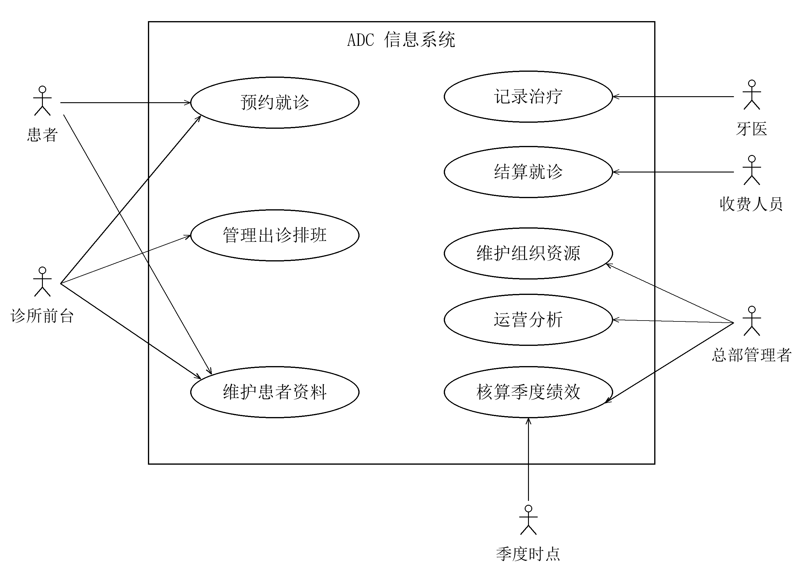

# B 需求分析

> 来源：当前正式 Word。正文、表格和图按原顺序转换；编号保留。Word 为业务规则权威，Markdown 为检索副本。

<!-- word-block:75 -->

## 二、需求

<!-- word-block:76 -->

系统围绕患者预约、诊所接诊及总部运营管理提供服务。患者查询可约时隙、提交预约及取消请求；前台维护排班并办理到诊，牙医记录治疗，收费人员核定费用，总部维护资源并复核运营及季度绩效。本章先说明需求获取方法，再定义执行者、系统用例、用例规约和质量要求。

<!-- word-block:77 -->

### （一）需求来源与获取方法

<!-- word-block:78 -->

本项目采用资料研究和现场观察获取需求。资料研究用于梳理连锁诊所的组织结构、管理目标及信息需求；现场观察用于了解业务记录的载体、流转及岗位交接。2026年10月下旬在齿邦口腔开展的观察涉及前台与收费岗位，内容包括纸质治疗单、Excel汇总及电话核对。这些资料用于补充记录流转、费用核对和岗位交接的分析，不直接代表ADC全部业务现状。

<!-- word-block:79 -->

资料研究便于把握整体业务，但对实际操作和交接细节的描述有限；现场观察能够补充可见流程，但受观察时段及岗位范围限制。调研结论限于实际观察内容。

<!-- word-block:80 -->

需求兼顾患者便利、诊所接诊安排、收费效率与总部追溯要求：患者可在预约开始前自助取消，开始后由前台核实处理；结算复用实际治疗记录并保存历史价格，减少重复录入并支持费用追溯。具体处理见UC01、UC04及表B13。

<!-- word-block:81 -->

表 B0  需求来源与适用范围

<!-- word-block:82 -->

| 编号 | 需求来源与获取方式 | 获取内容与用途 |

| --- | --- | --- |

| C01 | 资料研究：《Andrew’s Dental Chain：数据建模》（Ivey W44694）。 | 组织背景、患者与牙医资料、治疗、到诊、专业资质、季度业绩和结算需求。用于确定系统范围、核心概念及业务目标。 |

| D01 | 现场观察：2026年10月下旬，齿邦口腔，接触前台与收费人员。 | 纸质治疗单、Excel汇总及电话核对。用于分析记录流转、费用核对及岗位交接。 |

<!-- word-block:83 -->

### （二）系统责任边界和执行者

<!-- word-block:84 -->

直接交互者包括患者、诊所前台、牙医、收费人员、总部管理者和季度时点。患者自助查询、预约及提出取消请求；前台办理代客预约、确认到诊、爽约和停诊改约。季度时点触发核算，总部管理者负责核算资料准备、复核及发布。

<!-- word-block:85 -->

患者可自行完成首次本人资料登记和预约，无需提前取得患者编号或等待人工核验。已有档案关联、换号、受保护资料更正和疑似重复资料处理由前台安全核实；本人过敏声明与医护核实分开保存和展示。前台限于授权诊所办理业务；牙医只维护其负责的治疗；收费人员只办理授权诊所结算；总部管理者维护连锁资源并查看跨诊所结果。越权请求不改变任何业务记录。

<!-- word-block:86 -->

表 B1  系统执行者与目标

<!-- word-block:87 -->

| 执行者 | 类型 | 目标 |

| --- | --- | --- |

| 患者 | 主执行者 | 查询本人候选时段、提交预约及本人取消请求；涉及身份冲突或受保护资料更正转前台核实。 |

| 诊所前台 | 主执行者 | 代客预约、排班与停诊、维护患者资料、确认到诊与爽约、办理停诊改约。 |

| 牙医 | 主执行者 | 记录问题、特殊需求和实际治疗，完成就诊。 |

| 收费人员 | 主执行者 | 结算一次就诊的费用并出具标准结算单。 |

| 总部管理者 | 主执行者 | 维护组织与治疗目录；准备并确认成本资料、分摊依据及核算人员范围，复核发布绩效，查询跨诊所指标。 |

| 季度时点 | 时间触发者 | 在季度边界触发绩效核算。 |

<!-- word-block:88 -->

### （三）系统用例图

<!-- word-block:89 -->

系统用例图按照主要业务目标划分，包括预约就诊、管理出诊排班、维护患者资料、记录治疗、结算就诊、维护组织资源、运营分析和核算季度绩效八项业务。患者通过系统办理预约与取消；诊所前台负责预约及到诊事务、出诊排班和患者资料维护；牙医记录治疗情况；收费人员办理就诊结算；总部管理者维护组织资源、开展运营分析并核算季度绩效，系统也可在季度时点触发绩效核算。

<!-- word-block:90 -->

UC01“预约就诊”包含创建预约、确认到诊、患者取消、登记爽约和停诊改约五个场景，编号为UC01-S1—S5。各场景按业务事件独立触发，共享就诊状态规则，并分别规定执行权限、前置条件和处理结果。

<!-- word-block:91 -->

<!-- word-block:92 -->

图 B1  系统用例图

<!-- word-block:93 -->

### （四）用例优先级

<!-- word-block:94 -->

UC07直接实现缩短季度核算与复核发布周期的主要愿景，业务价值排序最前。表B2列示实现优先级：预约、排班、治疗和结算构成核算的数据基础，UC01—UC04先行完成，UC01覆盖创建预约及后续处理场景；UC05与UC06提供患者和组织资源，UC07在数据齐备后实现个人绩效核算，均列为高；UC08依赖完整业务数据，列为中。

<!-- word-block:95 -->

表 B2  系统用例实现优先级

<!-- word-block:96 -->

| 编号 | 系统用例 | 实现优先级 | 愿景贡献 |

| --- | --- | --- | --- |

| UC01 | 预约就诊 | 最高 | 覆盖UC01-S1创建预约、S2确认到诊、S3取消预约、S4登记爽约和S5停诊改约；保留统一状态规则与处理轨迹。 |

| UC02 | 管理出诊排班 | 最高 | 使各诊所的牙医可用时段进入统一口径，支撑跨诊所预约与技能组合。 |

| UC03 | 记录治疗 | 最高 | 形成治疗标准、结算和绩效核算的共同事实来源。 |

| UC04 | 结算就诊 | 最高 | 落实标准化开票并避免费用明细重复录入。 |

| UC05 | 维护患者资料 | 高 | 保留跨诊所患者资料和全部已知过敏症。 |

| UC06 | 维护组织资源 | 高 | 支撑诊所、牙医、专业资质与服务关系的统一维护。 |

| UC07 | 核算季度绩效 | 高 | 按每位牙医个人季度核算净利润的10%计算激励，保留来源与计算版本。 |

| UC08 | 运营分析 | 中 | 比较诊所取消率、治疗标准、技能结构和绩效。 |

<!-- word-block:97 -->

### （五）系统用例规约

<!-- word-block:98 -->

各用例统一适用本章“质量需求与设计约束”中的要求，质量目标及验收标准见表B12，前后端分工、接口和事务设计见第四章；业务特有的要求在相应用例规约中说明。

<!-- word-block:99 -->

1. UC01 预约就诊

<!-- word-block:100 -->

表 B3  UC01 预约就诊用例规约

<!-- word-block:101 -->

| 项目 | 内容 |

| --- | --- |

| 执行者 | 主执行者：患者、诊所前台 |

| 前置条件 | 创建预约要求诊所营业、微信或员工会话有效、检索日期有效；患者可在登记前浏览候选，提交前须完成首次本人登记或已有档案关联；后续场景要求存在可操作的预约，并分别满足身份、时点和旧状态条件。具体条件见各场景规约。 |

| 后置条件 | 各场景成功后保存相应业务事实及状态事件：创建形成已预约就诊，到诊进入进行中，取消或爽约保存取消分类，停诊改约保存新旧预约联系。失败不产生部分变更；各场景的具体结果分别规定。 |

| 涉众利益 | 患者希望自主查询时段、避免过敏风险并在需要时取消；诊所前台希望代客操作与排班一致；牙医希望安排与资质和排班匹配；ADC 管理层希望跨诊所使用统一资料与可比较的取消率。 |

<!-- word-block:102 -->

场景 UC01-S1 创建预约（基本路径）

<!-- word-block:103 -->

患者或诊所前台提交诊所、期望治疗和可接受的日期时间范围。

<!-- word-block:104 -->

系统按治疗所需资质、有效执业关系、正常班次与有效预约占用情况检索候选牙医和时隙。

<!-- word-block:105 -->

系统反馈可安排的牙医、日期、时段和诊所。

<!-- word-block:106 -->

患者或诊所前台选定时隙，提交本人资料并确认全部已知过敏信息。首次登记的过敏声明区分无已知、有过敏史和不确定，标明本人填报及待医护复核，不作为人工核验结果。

<!-- word-block:107 -->

首次患者自行填写姓名、出生日期、联系电话和本人过敏声明并确认，系统生成唯一患者编号、新建本人档案并自动关联当前微信账号，不要求人工批准。地址、邮箱及紧急联系人后补。已有档案按当前有效关联或前台核实结果识别；受保护资料冲突或疑似重复不得自动覆盖、合并或认领。

<!-- word-block:108 -->

系统校验必填项，重新核对资质、班次和时隙占用，在同一事务中建立已预约的就诊、登记期望治疗并写入预约事件。

<!-- word-block:109 -->

系统反馈预约号、诊所、牙医和预约时间，完成预约创建。

<!-- word-block:110 -->

预约建立后，到诊、取消、爽约或停诊改约按UC01-S2—S5的条件分别办理。

<!-- word-block:111 -->

扩展路径

<!-- word-block:112 -->

2a 无符合条件的牙医或时隙：系统反馈无候选；发起方调整条件后重新检索，或结束交互，不建立预约。

<!-- word-block:113 -->

4a 发起方放弃候选：系统不建立预约，不占用时隙，结束交互。

<!-- word-block:114 -->

6a 资料不完整或时隙已被占用：系统说明缺失项或冲突；本次建立事务不提交。补齐资料后重新校验；时隙冲突时返回候选检索。

<!-- word-block:115 -->

6b 同一建立请求重复提交：系统按请求标识返回已建立的预约；请求内容与原请求冲突时拒绝覆盖。

<!-- word-block:116 -->

表 B4  UC01 的补充约束

<!-- word-block:117 -->

| 补充约束 | 内容 |

| --- | --- |

| 字段列表 | 预约条件＝诊所＋{期望治疗}*＋日期范围；患者资料＝姓名＋出生日期＋电话＋账单地址＋紧急联系人姓名及电话＋[邮箱]；过敏资料＝本人声明及说明＋本人确认＋医护核实状态及{已核实过敏症＋程度说明}*；创建请求携带请求标识。后续处理字段见UC01-S2—S5。 |

| 业务规则 | 患者微信登录后可检索真实候选时隙。首次就诊填写本人必填资料、过敏声明并确认，由系统生成患者编号、新建档案并建立当前本人关联，无需提前取得患者编号或等待人工核验，即可自助预约。已有历史档案的关联与换号由前台安全核实，不按姓名或手机号自动认领。候选时隙必须同时满足治疗所需资质、有效执业关系和正常班次。提交时重新检查占位；失败不保留预约。到诊与取消等生命周期规则见UC01-S2—S5及就诊状态机。 |

| 质量需求 | 按表B12的负载条件，候选检索95%的请求在3秒内反馈；缺失必填项逐项指出，冲突请求不保留预约。 |

| 设计约束 | 平台入口和服务端分工见第四章；业务状态和计价规则由统一服务端执行。 |

<!-- word-block:118 -->

UC01-S2—S5 后续处理场景

<!-- word-block:119 -->

场景 UC01-S2 确认到诊

<!-- word-block:120 -->

表 B4a UC01-S2 确认到诊场景规约

<!-- word-block:121 -->

| 项目 | 内容 |

| --- | --- |

| 执行者 | 诊所前台 |

| 前置条件 | 预约处于已预约，班次正常，前台获诊所授权并核实患者身份。 |

| 后置条件 | 登记到诊时点，状态为进行中，保存ATTEND事件。 |

| 涉众利益 | 患者得到正确接诊，牙医取得真实到诊依据。 |

<!-- word-block:122 -->

基本路径

<!-- word-block:123 -->

1. 前台检索预约并核实患者。

<!-- word-block:124 -->

2. 提交到诊确认及请求标识。

<!-- word-block:125 -->

3. 系统复核班次和当前状态，保存到诊事实并反馈。

<!-- word-block:126 -->

扩展路径：1a 身份不符拒绝；3a 班次挂起或预约已取消拒绝。相同请求返回既有结果，不重复迁移。

<!-- word-block:127 -->

字段列表：预约号、核实人、身份核验结果、请求标识。

<!-- word-block:128 -->

业务规则：只允许SCHEDULED迁移至IN_PROGRESS，不能先记录治疗再补到诊。

<!-- word-block:129 -->

场景 UC01-S3 取消预约

<!-- word-block:130 -->

表 B4b UC01-S3 取消预约场景规约

<!-- word-block:131 -->

| 项目 | 内容 |

| --- | --- |

| 执行者 | 患者、诊所前台 |

| 前置条件 | 已完成本人绑定或前台代办核验；预约为SCHEDULED。患者自助取消还要求当前时间早于预约开始且所属班次正常；开始后由前台按本场景核实处理。 |

| 后置条件 | 保存PATIENT_CANCEL分类、原因及取消时间，写CANCEL事件并释放占位。 |

| 涉众利益 | 患者可取消未开始的安排；诊所能区分主动取消和自身停诊。 |

<!-- word-block:132 -->

基本路径

<!-- word-block:133 -->

1. 患者选择本人预约，或前台查找经核实的代办预约。

<!-- word-block:134 -->

2. 提交取消原因及请求标识。

<!-- word-block:135 -->

3. 系统检查当前状态、班次、服务端时间及执行权限；满足取消规则后保存分类、原因、取消时点和CANCEL事件，并释放占位。

<!-- word-block:136 -->

扩展路径：3a 已到预约开始时点：关闭患者自助取消，提示联系前台；前台在时隙结束前核实未到诊且仍为SCHEDULED时可代办PATIENT_CANCEL。3b 时隙已结束且核实未到诊：转UC01-S4登记NO_SHOW。3c 班次挂起：转UC01-S5。3d 预约时点或状态无法核实：不提交取消，转前台核实资料。状态已改变则拒绝；同请求复用原结果。

<!-- word-block:137 -->

字段列表：预约号、取消原因、核实依据、请求标识。

<!-- word-block:138 -->

业务规则：患者自助取消限预约开始前；开始至时隙结束的未到诊取消由前台核实。只允许SCHEDULED迁移至CANCELLED，进行中、已完成和已结算均拒绝取消；停诊原因使用独立分类。

<!-- word-block:139 -->

场景 UC01-S4 登记爽约

<!-- word-block:140 -->

表 B4c UC01-S4 登记爽约场景规约

<!-- word-block:141 -->

| 项目 | 内容 |

| --- | --- |

| 执行者 | 诊所前台 |

| 前置条件 | 预约为已预约，时隙已结束，前台核实患者未到诊。 |

| 后置条件 | 状态为已取消，分类NO_SHOW，保留核实人和CANCEL事件。 |

| 涉众利益 | 诊所保留未到诊事实，患者避免被定时任务误记。 |

<!-- word-block:142 -->

基本路径

<!-- word-block:143 -->

1. 前台检索已经超过时隙结束时间的未到诊预约。

<!-- word-block:144 -->

2. 核实患者未到诊，提交原因和请求标识。

<!-- word-block:145 -->

3. 系统复核时点和旧状态后登记爽约并反馈。

<!-- word-block:146 -->

扩展路径：1a 时隙未结束拒绝；3a 并发确认到诊已提交则拒绝爽约，保留先提交结果。

<!-- word-block:147 -->

字段列表：预约号、时隙结束时间、核实人、原因、请求标识。

<!-- word-block:148 -->

业务规则：时隙结束时间由预约时间和班次粒度计算；NO_SHOW属于取消分类，不增设第六种就诊状态。

<!-- word-block:149 -->

场景 UC01-S5 停诊改约

<!-- word-block:150 -->

表 B4d UC01-S5 停诊改约场景规约

<!-- word-block:151 -->

| 项目 | 内容 |

| --- | --- |

| 执行者 | 诊所前台 |

| 前置条件 | 预约为已预约且所属班次挂起；前台具有授权，已与患者确定处理方式。 |

| 后置条件 | 旧预约取消；改约时新预约为已预约并引用旧记录，两端事件齐备。失败全部回滚。 |

| 涉众利益 | 患者取得可执行的新安排；诊所能追溯变更原因而不污染患者取消率。 |

<!-- word-block:152 -->

基本路径

<!-- word-block:153 -->

1. 前台选择受停诊影响的预约并确认患者意向。

<!-- word-block:154 -->

2. 选择新的正常班次与时隙，系统检查资质、执业和占位。

<!-- word-block:155 -->

3. 系统同时取消旧预约、建立新预约与来源关联，反馈新旧预约号。

<!-- word-block:156 -->

扩展路径：2a 无合适时隙则保留待处理预约。患者不再安排时按CLINIC_CANCEL直接取消。3a 任一步失败回滚；已有改约后继时返回原处理结果。

<!-- word-block:157 -->

字段列表：旧预约号、新班次与时隙、原因、确认依据、请求标识、rescheduled_from_id。

<!-- word-block:158 -->

业务规则：旧分类CLINIC_RESCHEDULE；新旧患者一致，不形成环。同一旧预约至多一个直接后继。

<!-- word-block:159 -->

2. UC03 记录治疗

<!-- word-block:160 -->

本项目的治疗目录统一登记检查、咨询和治疗等诊疗项目，施用治疗记录实际提供的服务。仅检查、咨询或决定暂缓治疗时，按已提供的项目登记后完成就诊；免费项目单价为0，未实施的治疗不登记。

<!-- word-block:161 -->

表 B5  UC03 记录治疗用例规约

<!-- word-block:162 -->

| 项目 | 内容 |

| --- | --- |

| 执行者 | 主执行者：牙医。 |

| 前置条件 | 发起者具有牙医角色，并获本次就诊的治疗记录权限；就诊已登记到诊，处于进行中。每项治疗记录其实际实施牙医。 |

| 后置条件 | 实际治疗保存单位数、历史单位价格、实施牙医和实施时间；完成请求成功后，就诊为已完成，completed_at非空且至少有一项有效诊疗项目。 |

| 涉众利益 | 患者希望实际治疗和特殊需求得到准确记录；牙医希望其工作量和收入可追踪；ADC 管理层希望治疗标准可以比较。 |

<!-- word-block:163 -->

基本路径

<!-- word-block:164 -->

牙医提交待治疗的就诊，系统确认该就诊已登记到诊。

<!-- word-block:165 -->

系统提供该次就诊记录，牙医提交患者的问题或特殊需求。

<!-- word-block:166 -->

牙医提交治疗项目、实际标准单位数和实施时间。

<!-- word-block:167 -->

系统核对治疗项目、实施牙医的有效资质及诊所执业关系，以目录当前默认单价确定本次价格，保存治疗及小计。该单位价格随治疗记录冻结，不随后续目录调价改变。

<!-- word-block:168 -->

牙医可在本次就诊进行中继续提交实际治疗，系统逐项执行同样的校验。

<!-- word-block:169 -->

牙医提交完成就诊。

<!-- word-block:170 -->

系统确认至少一项实际诊疗项目有效，登记完成时点，将就诊置为已完成并反馈结果。

<!-- word-block:171 -->

扩展路径

<!-- word-block:172 -->

1a 就诊未到诊、已取消或已结算：系统拒绝进入记录治疗，说明当前不允许执行的原因，不改变状态。

<!-- word-block:173 -->

3a 项目停用、牙医资质无效或单位数不大于零：系统拒绝保存该项治疗，反馈原因；更正后重新提交。单价由目录确定，不接受牙医自行覆盖。

<!-- word-block:174 -->

7a 尚未提供任何诊疗服务：系统不完成就诊，状态保持进行中；本次交互结束或由牙医继续记录治疗。已经完成的就诊不得继续增加治疗。

<!-- word-block:175 -->

表 B6  UC03 的补充约束

<!-- word-block:176 -->

| 补充约束 | 内容 |

| --- | --- |

| 字段列表 | 就诊：问题与特殊需求；施用治疗：项目、标准单位数、历史单位价格、实施牙医、实施时间；完成请求：就诊号与请求标识。 |

| 业务规则 | 只在进行中记录治疗；单价取治疗目录并冻结，牙医不得自行覆盖。单位数大于零，金额逐项舍入后累加；至少有一项实际诊疗项目才可完成就诊，检查、咨询按同一目录记录。价格纠错须在开票前经授权核实并留痕。 |

| 质量需求 | 按表B12的测试条件，治疗保存95%的请求在3秒内反馈；无有效单位数、历史单价或实施牙医的治疗不得进入结算。 |

<!-- word-block:177 -->

3. UC04 结算就诊

<!-- word-block:178 -->

就诊结算核定实际治疗费用并生成唯一费用凭据，同时形成独立待缴账单。INVOICED不表示已付款。挂号费由门店按医生配置，收费预约先短时保留号源，支付成功后正式建立预约。本系统在明确的虚构测试门店提供演示缴费和全额退款，始终标识“演示支付，不扣真实款”，不调用微信扣款。真实微信支付及渠道对账须另行接入商户服务；演示金额不计入真实收款，R1继续按实际诊疗开票口径计算。

<!-- word-block:179 -->

表 B7  UC04 结算就诊用例规约

<!-- word-block:180 -->

| 项目 | 内容 |

| --- | --- |

| 执行者 | 主执行者：收费人员 |

| 前置条件 | 该就诊已完成并已记录至少一项实际诊疗项目。 |

| 后置条件 | 同一就诊有且仅有一张结算单，明细完整且总价一致；状态为已结算，已写入结算事件。重复请求返回原单，不产生新单或重复明细。 此状态不证明实际收款。 |

| 涉众利益 | 患者希望费用清楚且可核对；收费人员希望避免重复录入；ADC 管理层希望各诊所按统一口径开票。 |

<!-- word-block:181 -->

基本路径

<!-- word-block:182 -->

收费人员提交需要结算的就诊。

<!-- word-block:183 -->

系统确认就诊已完成且至少有一项有效诊疗项目，核对治疗所属就诊、历史单位价格及实施牙医。结算金额使用治疗价格快照；收入按表B13逐项归实际实施牙医。

<!-- word-block:184 -->

系统按施用治疗的单位数和已保存单价计算各项小计，并建立逐项开票快照。

<!-- word-block:185 -->

系统汇总明细小计作为结算总价；金额按两位小数统一舍入，逐项先舍入后求和。

<!-- word-block:186 -->

系统在同一事务中生成唯一结算单号、保存结算单与明细，并将就诊置为已结算。

<!-- word-block:187 -->

系统向收费人员反馈单号、开票时间、逐项明细和总价，收费人员据此向患者交付凭据。

<!-- word-block:188 -->

扩展路径

<!-- word-block:189 -->

1a 已存在结算单：系统返回原单及其明细，不再开单。1b 就诊尚未完成、缺少治疗或明细归属不一致：系统拒绝结算。任一保存失败时回滚结算单、明细与状态变更，允许使用同一请求重试。

<!-- word-block:190 -->

表 B8  UC04 的补充约束

<!-- word-block:191 -->

| 补充约束 | 内容 |

| --- | --- |

| 字段列表 | 结算单 = 就诊 + 单号 + 总价 + {明细}*；明细 = 治疗名称 + 单位数 + 单位价格 + 小计。 |

| 业务规则 | 每次已完成就诊只开一张结算单，每项实际治疗对应一行明细。明细须属于同一就诊，小计为单位数乘历史单价，总价为明细小计之和。开票、明细和状态变更原子保存，开票后明细只读。费用按治疗单位数及单价直接计算，不计税费或折扣；通过独立患者账单、演示支付订单及退款订单记录缴费事实，演示不扣真实款。 |

| 质量需求 | 按表B12的负载条件，结算95%的请求在3秒内反馈；同一就诊的重复请求返回同一张结算单及其明细。 |

| 设计约束 | 平台入口和服务端分工见第四章；业务状态和计价规则由统一服务端执行。 |

<!-- word-block:192 -->

4. UC07 核算季度绩效

<!-- word-block:193 -->

表 B9  UC07 核算季度绩效用例规约

<!-- word-block:194 -->

| 项目 | 内容 |

| --- | --- |

| 执行者 | 触发者：季度时点；总部管理者准备成本资料、复核系统生成的核算人员范围及结果并发布。 |

| 前置条件 | 指定季度已结束；管理者有核算权限；系统可获取当期结算、治疗和来源成本。资料缺失允许生成不完整草稿，但不允许发布。计算与发布分别校验条件。 |

| 后置条件 | 范围内每位牙医形成带版本、输入快照和核算状态的结果；资料完整且金额校验通过后可发布，包括激励为零的结果。资料不足时标明具体缺失项，历史版本可查。 |

| 涉众利益 | 牙医希望贡献得到准确、公平计算；ADC 管理层希望激励口径一致、可追溯、可复核。 |

<!-- word-block:195 -->

基本路径

<!-- word-block:196 -->

季度时点触发指定季度的核算；总部管理者也可在补齐资料后发起重新核算。每次计算记录资料截止时点与输入版本。

<!-- word-block:197 -->

系统纳入任职期间与核算季度有交集的牙医，包括当季离职或无收入人员；当季有收入或成本归属的其他牙医（含此前已离职人员）按来源明细补入。总部复核名单及任职资料，离职日计入任职区间，停用账号不删除历史核算。

<!-- word-block:198 -->

系统检查诊所成本封账与明确零成本的确认记录。收入按开票时间归入季度、按每项实际治疗的实施牙医归属；成本按发生时间归季。直接成本按凭证归属，公共运营费用按同诊所同季度有效排班时长比例分摊。

<!-- word-block:199 -->

系统计算每位牙医的个人季度核算净利润，即个人归属收入减去个人归属医疗用品成本和分摊运营费用，保存来源结算明细、成本凭证、分摊结果及规则版本快照。

<!-- word-block:200 -->

系统按个人季度净利润计算激励：净利润大于零时，激励为净利润的10%；净利润不大于零时，激励为0，不产生负激励或跨季扣减。金额保留两位小数，采用十进制四舍五入。

<!-- word-block:201 -->

系统按牙医、季度和计算版本保存结果。总部复核输入完整性、分摊守恒、金额及版本后发布；资料完整的零激励结果可以发布，未满足发布条件的结果仅供内部核查。

<!-- word-block:202 -->

扩展路径

<!-- word-block:203 -->

3a 成本未封账、零成本范围未核实、直接医疗用品成本缺少实施牙医归属，或存在公共费用但有效排班总时长为0：状态为INCOMPLETE，列明原因，不发布；不得把缺少记录当作零成本。补齐资料后重新计算。

<!-- word-block:204 -->

5a 净利润不大于零：保存激励0，资料完整时继续复核发布。收入、成本或分摊合计不一致：保留原版本并反馈差异，修正来源资料后重新计算。

<!-- word-block:205 -->

6a 重新核算：系统保留原输入快照与结果，建立新计算版本；同一输入摘要的重复请求返回已有版本。发布新版本后，旧发布版本转为已替代，旧金额与依据保持可查。

<!-- word-block:206 -->

表 B10  UC07 的补充约束

<!-- word-block:207 -->

| 补充约束 | 内容 |

| --- | --- |

| 字段列表 | 季度范围、牙医范围、资料截止时点、来源凭证、封账确认、分摊项、计算版本、收入、医疗用品成本、运营费用、净利润、激励额、输入摘要与发布状态。 |

| 业务规则 | 自然季度按Asia/Shanghai计算，起点包含、终点不含。收入以Invoice.issued_at归季，通过InvoiceItem对应AppliedTreatment.dentist_id归属；成本以CostEntry.incurred_at归季。公共运营费用按有效排班时长比例分摊。net_profit＝revenue－medical_supply_cost－operating_expense；incentive_amount＝ROUND(MAX(net_profit,0)×0.10,2)。人员范围、分摊及发布条件见表B13。 |

| 质量需求 | 输入不足不默认为零；原始凭证、分摊结果及人员范围随版本冻结；重复输入不重复出结果；同一牙医季度至多有一个当前发布版本。 |

<!-- word-block:208 -->

### （六）其他系统用例规约

<!-- word-block:209 -->

表 B11 其他用例的核心条件摘要

<!-- word-block:210 -->

| 用例 | 前置条件与后置条件 | 涉众利益与核心规则 |

| --- | --- | --- |

| UC02 管理出诊排班 | 前置：前台获本诊所授权，牙医有有效服务关系。后置：合法班次可供预约，停诊班次保留且受影响预约可查询。 | 患者避免安排失效，牙医避免跨诊所冲突，前台能办理改约。班次区间不得重叠；已引用班次不覆盖归属与时间；停诊后原预约仍保留，前台逐项改约或确认停诊取消。 |

| UC05 维护患者资料 | 前置：患者首次登记须微信登录、本人资料完整并确认；前台维护已有资料须获授权并核实本人。后置：首次登记生成编号并关联新档案，已有资料和医护过敏记录的更正保留核实链。 | 患者资料准确且仅被授权查阅；前台避免重复建档。邮箱可缺省，姓名、出生日期、电话、账单地址及紧急联系人姓名和电话为建档必填。过敏症误记允许撤销但不删除历史。 |

| UC06 维护组织资源 | 前置：总部管理者身份有效。后置：诊所、牙医、资质、执业关系、治疗目录与治疗所需资质可被后续业务使用。 | 总部维护统一口径，牙医知道可执业范围。资质须核验且在有效期；目录停用不删除历史引用；治疗目录改价只影响之后创建的实际治疗。 |

| UC08 运营分析 | 前置：管理者获跨诊所分析权限，选择指标、范围和业务期间。后置：返回指标结果、统计口径、样本量、数据截止时间及异常提示。 | 管理者可解释诊所差异，牙医贡献按一致口径比较。采用本节指标口径；绩效只读取最新已发布版本；数据不足返回不可计算原因，不用零替代。 |

<!-- word-block:211 -->

1. UC02 管理出诊排班

<!-- word-block:212 -->

前台按牙医、诊所和日期维护具体出诊时段。系统在保存前核对有效执业关系以及该牙医当天全部诊所的正常班次，只有区间不重叠、时隙可完整划分的班次才可用于预约。以下规约分别说明登记班次和停诊两个处理场景。

<!-- word-block:213 -->

停诊仅改变班次的可安排状态，不直接取消其所有预约。系统先返回受影响预约，由前台与患者确定后通过UC01-S5处理。已经进入治疗的就诊不按未到诊预约自动取消。

<!-- word-block:214 -->

已被预约引用的班次不覆盖其牙医、诊所、日期和时段。需要调整时先挂起旧班次，再建立新班次，保留旧班次及其引用关系，使历史预约仍能说明当时的安排。

<!-- word-block:215 -->

表 B11a UC02 管理出诊排班用例规约

<!-- word-block:216 -->

| 项目 | 内容 |

| --- | --- |

| 执行者 | 诊所前台 |

| 前置条件 | 前台已获目标诊所授权，所选牙医有覆盖班次日期的有效执业关系。 |

| 后置条件 | 合法班次可用于预约；或班次被挂起并列出受影响预约。失败保留原记录。 |

| 涉众利益 | 患者避免无效安排；牙医避免跨诊所时间冲突；前台能够处理停诊影响。 |

<!-- word-block:217 -->

基本路径

<!-- word-block:218 -->

1. 前台提交牙医、诊所、出诊日期、开始和结束时间、时隙分钟数。

<!-- word-block:219 -->

2. 系统核对执业关系、日期及时间范围，检查同一牙医跨诊所的正常班次。

<!-- word-block:220 -->

3. 系统验证班次长度可按时隙长度完整划分，保存正常班次并反馈。

<!-- word-block:221 -->

扩展路径：2a 执业失效或时间重叠：指出冲突班次，不保存。3a 已被引用班次要求改时段：拒绝覆盖，改建班次。停诊分支保存原因并挂起班次，返回待处理预约。

<!-- word-block:222 -->

字段列表：牙医、诊所、schedule_date、start_time、end_time、slot_minutes、schedule_status、停诊原因。

<!-- word-block:223 -->

业务规则：班次为半开区间；开始早于结束，时隙为正且整除班次长度。停诊班次不接受新预约；仅NORMAL班次参加重叠校验与起点唯一性检查，挂起历史可保留多版；跨诊所重叠须在同一牙医锁定范围内复核。

<!-- word-block:224 -->

2. UC05 维护患者资料

<!-- word-block:225 -->

表 B11b UC05 维护患者资料用例规约

<!-- word-block:226 -->

| 项目 | 内容 |

| --- | --- |

| 执行者 | 患者（仅首次本人登记）、诊所前台 |

| 前置条件 | 首次本人登记要求微信登录、无当前本人关联、必填资料与本人声明完整；已有资料维护要求前台获诊所服务权限并核实本人。 |

| 后置条件 | 当前资料保存；过敏新增、更正和撤销有原值、核实人、原因及时间。 |

| 涉众利益 | 患者避免重复建档和身份误认；医护获得准确的过敏信息；前台能定位更正依据。 |

<!-- word-block:227 -->

基本路径

<!-- word-block:228 -->

1. 前台按患者编号检索，核对姓名、出生日期及联系资料。

<!-- word-block:229 -->

2. 系统展示当前资料及过敏确认状态，前台录入需要修改的字段。

<!-- word-block:230 -->

3. 前台按目录登记已知过敏症，或填写更正、撤销原因及核实依据。

<!-- word-block:231 -->

4. 系统校验并保存当前资料和更正记录，反馈患者编号及处理结果。

<!-- word-block:232 -->

扩展路径：0a 首次本人登记：患者填写必填资料、过敏声明并确认，系统查重、生成患者编号、新建档案并关联当前微信账号，即可直接预约；声明保持待医护复核。1a 前台无匹配资料：查重后新建。1b 多条疑似同一患者：人工核实，不按手机号自动合并。3a 过敏情况不明：保留未核实状态并提示复核；撤销误记不删除历史。

<!-- word-block:233 -->

字段列表：患者编号、姓名、出生日期、联系电话；联系地址、邮箱及紧急联系人可在后续就诊补充；本人过敏声明、过敏目录项、程度、备注、确认状态、核实人和原因。

<!-- word-block:234 -->

业务规则：首次登记不要求已有患者编号、短信或人工核验；患者编号由系统生成，登记来源为SELF_DECLARED。本人过敏声明不写成已核实结果，NOT_REVIEWED允许以服务端声明快照确认本人预约。电话不是唯一身份键。NO_KNOWN表示经询问无已知过敏，不能从空关联推导；RECORDED须有有效过敏关联。共享过敏目录由UC06维护。

<!-- word-block:235 -->

3. UC06 维护组织资源

<!-- word-block:236 -->

表 B11c UC06 维护组织资源用例规约

<!-- word-block:237 -->

| 项目 | 内容 |

| --- | --- |

| 执行者 | 总部管理者 |

| 前置条件 | 登录者具有资源维护权限，变更内容及有效日期完整。 |

| 后置条件 | 诊所、牙医、目录和有效关系按所选内容更新；历史业务引用不被删除。 |

| 涉众利益 | 总部保持统一目录；诊所能识别可排班人员；牙医资质及执业范围有据可查。 |

<!-- word-block:238 -->

基本路径

<!-- word-block:239 -->

1. 总部选择诊所、牙医、执业关系、专业资质、治疗或过敏目录。

<!-- word-block:240 -->

2. 提交基本资料、编码及有效日期；涉及资质时录入证书和核验结果。

<!-- word-block:241 -->

3. 系统检查编码唯一、日期先后、引用关系及受影响未来安排。

<!-- word-block:242 -->

4. 系统保存变更和操作记录，反馈处理结果及需要后续处理的业务。

<!-- word-block:243 -->

扩展路径：3a 编码重复或有效期不合法：拒绝保存。3b 停用被引用目录：保留历史，只阻止新业务选择。3c 缩短执业或资质有效期影响未来预约：列出影响，不静默破坏已有安排。

<!-- word-block:244 -->

字段列表：诊所编码、地址、联系方式；牙医员工号、任职日期；执业关系起止日期；证书号、有效期与核验状态；治疗编码、默认单价、所需资质。

<!-- word-block:245 -->

业务规则：资格须核验后用于匹配；空到期日仅表示已核实的长期有效。默认单价变更仅影响之后新建治疗；历史单价不重算。

<!-- word-block:246 -->

4. UC08 运营分析

<!-- word-block:247 -->

表 B11d UC08 运营分析用例规约

<!-- word-block:248 -->

| 项目 | 内容 |

| --- | --- |

| 执行者 | 总部管理者 |

| 前置条件 | 登录者具有所选诊所范围的分析权限，期间、指标及口径版本有效。 |

| 后置条件 | 返回指标、期间、数据截止时间和来源；或说明不可计算及缺失原因，不修改原业务。 |

| 涉众利益 | 总部能解释诊所差异；牙医贡献按相同期间和口径比较，患者隐私不进入普通汇总。 |

<!-- word-block:249 -->

基本路径

<!-- word-block:250 -->

1. 管理者选择指标、诊所、起止期间及治疗或牙医筛选条件。

<!-- word-block:251 -->

2. 系统验证范围权限和口径版本，取得统一截止时间的数据。

<!-- word-block:252 -->

3. 系统计算所选指标，列出分子、分母、样本数及排除和缺失数量。

<!-- word-block:253 -->

4. 系统展示结果与来源标识；经授权可下钻至相应业务依据。

<!-- word-block:254 -->

扩展路径：2a 越权：拒绝查询。3a 分母为零：返回不可计算；来源不足：标记不完整，不补零。绩效未发布或只有旧口径版本时说明状态，不混合比较。

<!-- word-block:255 -->

字段列表：指标、范围、start/end、cutoff、rule_version；结果值、分子、分母、样本数、排除量、缺失原因及来源标识。

<!-- word-block:256 -->

业务规则：取消、爽约和停诊变更分别保留；治疗价格采用同单位下加权单价。绩效默认读取当前已发布版本，历史版本查询须复核权限。

<!-- word-block:257 -->

### （七）质量需求与设计约束

<!-- word-block:258 -->

表B12规定质量目标、验证条件和通过标准，覆盖易用性、扩展性、性能、一致性、恢复、权限及审计。验收记录应包含测试环境、数据集、操作步骤、实际结果和核验人员。

<!-- word-block:259 -->

表 B12  质量需求的度量表述

<!-- word-block:260 -->

| 类别与标识 | 适用场景与目标 | 验收方法与测试条件 | 通过标准 |

| --- | --- | --- | --- |

| Q01 易用性 | 页面入口清楚，登录与本人资料状态明确；完成预约不超过4次业务提交或确认，保存治疗不超过3次。 | 通过组件交互、接口及实际页面自动化检查，验证导航、表单提示、预约、治疗保存及结果读回。保留模拟接口与真实环境的验证边界；负责人日常使用确认体验，不强制招募参与者、培训或提交人工记录。 | 自动化指定场景通过，业务提交与确认次数符合目标，成功及错误提示明确；结果与后台一致，无权限绕过。不将自动化结果描述为人工实验。 |

| Q02 扩展性 | 新增诊所、治疗、过敏症及资质目录可由授权配置完成；新增核算公式属于规则变更。 | 新增配置后完成候选筛选与业务录入，并核对历史记录未被新配置改写。 | 由总部通过UC06新增诊所、治疗、过敏及资质目录各1项，前台通过UC02新增合法班次；新配置可用，历史价格与已引用记录不改变。 |

| Q03 性能 | 在小规模部署的实测负载下，候选检索、治疗保存及结算保持可用，响应及时，保存与结算结果一致。 | 30诊所、100牙医、1万患者、10万预约、20万治疗。隔离Linux容器合计CPU上限2核、内存上限2GB，独立负载进程；10并发持续20分钟，每用户约2秒一次请求，候选检索/治疗保存/结算占60%/20%/20%。另在现有2核2GB云端执行5并发5分钟只读验证。 | 隔离测试不少于5000次实际成功请求，各类P95≤3秒，非预期错误率<1%，配比误差≤0.5个百分点；云端不少于600次只读请求，P95≤3秒且错误率<1%。保存原始样本、资源和落库核对，不推断100并发或云端大规模写入容量。 |

| Q04 一致性 | 同一时隙不重复占用，同一就诊不重复开单；事务中断不留下部分业务记录。 | 并发争用同一时隙，重复提交结算，在保存中注入故障；按原请求标识重试并核对状态、明细与事件。 | 通过标准：每组冲突最多一个有效占位；同一就诊至多一张单；无部分提交。 |

| Q05 备份恢复 | 业务库及身份、授权、审计数据均纳入恢复范围；恢复点之间的关联保持一致。 | 按恢复演练方案从备份恢复，核对数量、关键金额、患者绑定和权限，记录丢失时间跨度与恢复耗时。 | 每天全量备份、每15分钟保存增量，保留30天；RPO不超过15分钟，RTO不超过4小时。恢复演练使用隔离环境，关键金额、绑定及权限引用核对一致。 |

| Q06 身份会话 | 无效或过期身份不得调用受保护接口；注销、停用和撤权按规定使访问失效。 | 使用无效、过期及注销凭据调用接口；停用账号、撤销诊所授权后再次访问，记录结果与生效耗时。 | 会话空闲30分钟或建立满8小时失效；连续5次认证失败限制15分钟。注销、停用、撤权后下一次受保护请求即拒绝；凭据经加密通道传输，日志不记录认证秘密。 |

| Q07 权限与敏感资料 | 按角色、诊所和本人绑定范围访问；返回字段限于岗位所需。 | 患者甲请求患者乙资料；诊所A前台操作未授权诊所；收费账号查询无关临床资料；直接调用接口绕过页面限制。 | 通过标准：越权请求全部拒绝，无敏感数据泄露或业务变更；允许访问的样本按权限表通过。 |

| Q08 审计 | 资料更正、绑定授权、取消、成本冲销和绩效发布记录可信主体、对象、范围、时间、请求标识、结果及原因。 | 逐项执行业务并检查审计证据；用普通账号尝试修改或删除日志；检查日志不含认证秘密。 | 规定操作均可追溯，普通账号不能修改或删除日志；审计记录保存1年，仅获审计权限的总部人员查询。 |

| Q09 可维护性 | 在基本资料齐备后，授权总部人员1个工作日内完成新增诊所配置；规则集中维护，规则变更执行相关回归场景。 | 登记配置和变更耗时，检查改动范围，回归预约冲突、历史价格、个人提成及版本发布场景。 | 从接收齐备资料至配置可用于排班和预约不超过1个工作日；历史价格、预约冲突、个人提成及版本发布回归全部通过。 |

<!-- word-block:261 -->

1. 身份识别与访问权限

<!-- word-block:262 -->

患者先完成微信登录。首次就诊自行填写姓名、出生日期、联系电话、过敏声明并确认，系统生成患者编号、新建本人档案并自动关联当前微信账号，随后即可预约，不要求已有编号或人工批准。已有历史档案由前台安全核实后关联；仅凭姓名或手机号不能认领旧病历。疑似重复、冲突、换号、解绑和重绑由前台核实并留痕；患者仅操作当前有效关联的本人资料和预约。

<!-- word-block:263 -->

工作人员使用个人账号登录。前台和收费人员按授权诊所办理业务，牙医只能记录本人实施且获授权的治疗，总部按被授予的资源维护、分析和绩效复核权限访问跨诊所数据。患者过敏记录供实际接诊岗位使用，收费页面仅显示结算必需信息，总部日常分析默认展示汇总。敏感查询、资料更正、取消、成本冲销及绩效发布保存操作者、范围、时间、请求标识和原因。

<!-- word-block:264 -->

表 B12a 角色与主要操作范围

<!-- word-block:265 -->

| 角色 | 可执行用例 | 数据范围 |

| --- | --- | --- |

| 患者 | UC01-S1、UC01-S3；SF01、SF02 | 当前有效关联的本人资料与预约；首次自助登记仅创建新档案，不取得他人历史资料。 |

| 前台 | UC01-S1—S5、UC02、UC05；SF01及SF02核验 | 授权诊所服务范围；跨诊所复用患者资料需服务依据。 |

| 牙医 | UC03；SF01 | 获授权的本次就诊、风险资料及本人实施治疗。 |

| 收费人员 | UC04；SF01 | 授权诊所的已完成就诊及结算必要资料。 |

| 总部管理者 | UC06—UC08；SF01，另行授权后执行SF03、SF04 | 获授诊所范围；成本核验、绩效发布和敏感下钻分别授权。 |

<!-- word-block:266 -->

身份认证与授权由独立身份组件提供，业务服务校验可信主体、岗位权限和诊所范围。账号管理与授权管理分别授予相应权限，具体功能见表B12b。

<!-- word-block:267 -->

表 B12b 身份与授权支撑功能

<!-- word-block:268 -->

| 功能标识 | 执行者及条件 | 基本处理与结果 | 异常及边界 |

| --- | --- | --- | --- |

| SF01 登录与退出 | 患者及工作人员；账号可用。 | 患者使用小程序身份登录，员工使用个人账号登录；身份组件校验后建立会话，退出时注销会话。 | 凭据无效、账号停用或会话过期：拒绝受保护操作，不修改业务记录。 |

| SF02 登记与关联本人档案 | 首次本人登记须微信登录及资料声明完整；已有档案关联须授权前台核验。 | 首次本人登记由系统生成编号、新建Patient并自动保存subject_id与patient_id映射，无需人工批准；过敏声明保留待医护复核。已有档案申请提供线索，由前台核实本人及既有资料后关联。 | 首次登记不认领或覆盖历史档案，疑似重复返回通用提示；已有档案身份不能确认或关联冲突时不关联。换号、解绑和重绑须人工核实并留痕，旧账号立即失去原档案访问权。 |

| SF03 管理员工账号 | 具有账号管理权限的总部管理者。 | 核实工作人员身份后创建或关联个人账号，办理启用、停用及凭据恢复；离职或调岗同步调整访问资格。 | 员工资料不等于登录账号；不得自动授予总部业务权限，停用后按失效规则拒绝访问。 |

| SF04 分配诊所权限 | 具有授权管理权限的总部管理者。 | 选择账号、角色、诊所范围及有效期，身份组件保存授权；业务服务据此校验每次请求。 | 超出自身可授予范围的请求拒绝；撤权或过期后不再允许原范围操作，记录授权变更。 |

<!-- word-block:269 -->

2. 指标口径与业务决策

<!-- word-block:270 -->

各项统计均指定开始、结束及数据截止时点，同一比较任务保存口径版本。取消率按应诊期间取数，治疗比较按实施期间取数，季度绩效按收入与成本的归季规则取数。

<!-- word-block:271 -->

取消统计按预约应诊期间及所选诊所形成队列，仅纳入截止时点已结束时隙的预约，剔除CLINIC_RESCHEDULE和CLINIC_CANCEL。PATIENT_CANCEL数÷队列数为主动取消率，NO_SHOW数÷队列数为爽约率，两项之和为未履约率。队列中仍为SCHEDULED的记录单列为未处理数，存在未处理时结果标为暂定，不把其视作已到诊；分母为0显示不可计算。

<!-- word-block:272 -->

统一资料覆盖率＝使用统一患者、预约和治疗记录的营业诊所数÷期间营业诊所总数。治疗可追溯率＝具备患者、就诊、实际实施牙医、项目、单位数、历史单价及实施时间的有效治疗记录数÷有效治疗总数。

<!-- word-block:273 -->

治疗比较：按 performed_at 的业务期间、诊所和治疗项目统计次数、标准单位数以及加权单位价格；加权单位价格为小计合计除以单位数合计。同一治疗目录和单位定义下才进行跨诊所比较。

<!-- word-block:274 -->

技能与时隙覆盖：已核验且当日有效的资质匹配治疗要求，服务关系和正常班次同时有效时，该时隙才计入可安排供给；对选定治疗和期间，覆盖率为具备有效资质的正常时隙数除以正常时隙总数。至少一项必需资质缺失则不匹配；非必需资质仅作为展示信息。

<!-- word-block:275 -->

核算耗时从当期全部诊所成本封账、有效排班及直接成本归属资料齐备起，至本轮全部可发布结果完成复核发布为止，目标不超过1个工作日；资料等待时长另列。评价时点和工作日口径见表A1a及其说明。

<!-- word-block:276 -->

表B13汇总预约取消、季度核算及绩效发布的关键业务规则。核算前应核实任职资料、成本封账及收入成本来源；资料不足时按异常流程处理，记录具体缺失项及原因。

<!-- word-block:277 -->

表 B13  关键业务规则

<!-- word-block:278 -->

| 事项 | 业务规则 | 影响范围 | 业务使用与复核岗位 |

| --- | --- | --- | --- |

| 取消窗口 | SCHEDULED且班次正常时，患者可在预约开始前自助取消；开始至时隙结束由前台核实代办。结束后未到诊记NO_SHOW；停诊另行分类。 | UC01-S3；Appointment/Event | 总部运营 |

| 取消率口径 | 按应诊期间及已结束时隙取数，剔除诊所停诊取消及改约旧预约。分别列主动取消率、爽约率及合计未履约率；未处理数单列，分母0不计算。 | UC08；Appointment | 总部运营 |

| 收入成本归期与归属 | 收入按开票时点归季，逐项归实施牙医。成本按发生时点归季；医疗用品归实施牙医或实际治疗，直接运营费用直接归属。 | UC07；Invoice/AppliedTreatment/QuarterlyPerformance | 财务及医疗负责人 |

| 公共费用分摊 | 每诊所季度公共运营费用净额，按任职及执业有效区间内NORMAL班次分钟数分摊；SUSPENDED班次不计入，分摊依据随结果保存。存在公共费用但有效排班总时长为0时，标记INCOMPLETE并禁止发布。 | UC07；CostEntry/QuarterlyPerformance | 总部财务 |

| 非正净利润激励 | 个人激励＝ROUND(MAX(个人净利润,0)×0.10,2)。非正净利润激励0，资料完整即可复核发布；不产生负激励或跨季扣减。 | UC07；QuarterlyPerformance | 总部管理者 |

| 季度人员范围 | 任职期间与季度有交集的牙医全部纳入，包括当季离职及无收入人员；当季存在收入或成本归属的其他牙医（含此前已离职人员）一并纳入。系统生成名单，总部复核任职资料。 | UC07；Dentist/QuarterlyPerformance | 人事及财务 |

<!-- word-block:279 -->

季度核算规则使用版本标识R1。计算结果保存适用规则、来源资料、人员范围及分摊快照；规则变更或输入修正时生成新的计算版本，经复核后发布，历史结果及依据保持可查。
