# C 系统分析

> 来源：当前正式 Word。正文、表格和图按原顺序转换；编号保留。Word 为业务规则权威，Markdown 为检索副本。

<!-- word-block:280 -->

## 三、分析

<!-- word-block:281 -->

预约、治疗和结算围绕同一次就诊展开，但不同岗位承担的责任不同。分析模型将这些业务概念表示为实体，由边界对象接收用户请求，再由控制对象组织协作。例如，预约时的候选筛选由牙医和排班对象协作完成，治疗小计由施用治疗计算，结算单负责汇总明细。这样可以在两个前端入口之间复用相同的业务判断。

<!-- word-block:282 -->

### （一）分析类图

<!-- word-block:283 -->

实体类包括患者、过敏症、牙医、诊所、专业资质、治疗项目、出诊排班、就诊、施用治疗、结算单、成本凭证和季度绩效12个概念。6个业务边界类对应患者、前台、牙医、收费、总部及季度时点。控制类按交互场景协调业务：UC01-S1—S5分别由预约、到诊、取消、爽约和改约控制负责，其他控制对应UC02—UC08，共12个控制类。

<!-- word-block:284 -->

边界类接收输入、反馈结果并执行格式校验。控制类协调对象与事务，不计算费用。实体类检查领域条件并完成计价、状态保护、收入与成本汇总。成本凭证作为核算的独立事实来源，与季度汇总结果分开。

<!-- word-block:285 -->

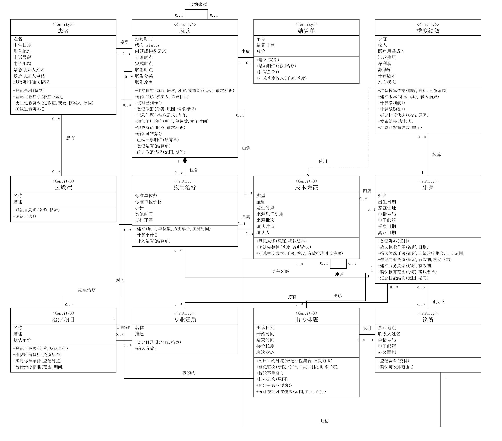

<!-- word-block:286 -->

图 C1  ADC 信息系统实体类图

<!-- word-block:287 -->

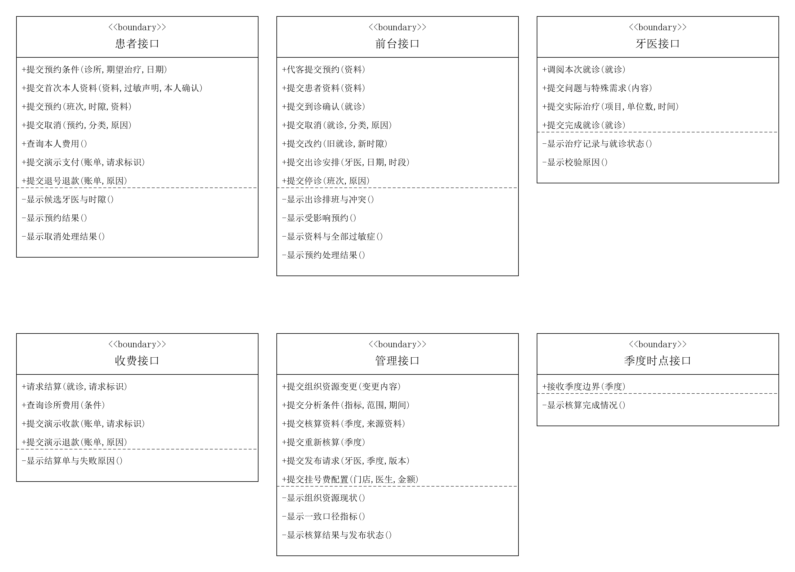

<!-- word-block:288 -->

图 C2  ADC 信息系统边界类图

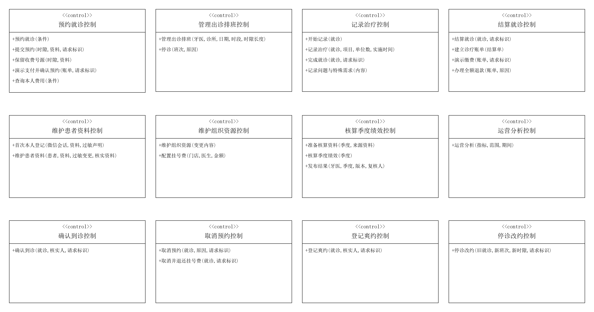

<!-- word-block:289 -->

图 C3  ADC 信息系统控制类

<!-- word-block:290 -->

### （二）类职责说明

<!-- word-block:291 -->

表C1说明实体、边界和控制类的职责。UC01的五个场景通过各自控制对象协调，共享就诊实体的生命周期操作；身份与授权功能通过前端入口、业务服务和身份组件协作。实体操作的输入和职责见下文契约。分析类操作以“+”表示公有、“−”表示私有。边界类对外接收请求的操作为公有，仅在对象内部使用的显示辅助操作为私有；控制类通过公有操作承担用例协作。序列图以激活框表示执行，自调用使用与父激活框部分重叠的嵌套激活框。

<!-- word-block:292 -->

表 C1  分析类及其主要责任

<!-- word-block:293 -->

| 构造型 | 分析类 | 主要责任 |

| --- | --- | --- |

| 边界 | 患者接口 | 接收精简首次登记、看牙或洗牙需求、真实时段预约、取消及本人费用请求，显示医生资料、预约与演示缴费退款结果。 |

| 边界 | 前台接口 | 接收代客预约、到诊与取消、出诊安排与停诊，显示出诊排班与受影响就诊。 |

| 边界 | 牙医接口 | 调阅本次就诊，接收实际治疗，显示治疗记录与就诊状态。 |

| 边界 | 收费接口 | 核定实际诊疗费用并开具费用凭据，按授权范围查询账单、办理演示收款及全额退款。 |

| 边界 | 管理接口 | 维护组织资源和医生展示资料、配置门店医生挂号费，按授权执行运营分析及季度绩效。 |

| 边界 | 季度时点接口 | 接收季度边界事件，显示核算完成情况。 |

| 控制 | 预约就诊控制 | 复核本人、真实排班、资质及占用；免费直接预约，收费先保留号源，演示支付后原子确认预约。 |

| 控制 | 管理出诊排班控制 | 控制 UC02 的路径，协调牙医执业范围、班次登记与停诊。 |

| 控制 | 记录治疗控制 | 控制 UC03 的路径，让就诊登记问题与施用治疗，不承担小计计算。 |

| 控制 | 结算就诊控制 | 核定实际诊疗并保存唯一费用凭据和待缴账单，独立办理受控演示支付与退款，不改写开票历史或R1。 |

| 控制 | 维护患者资料控制 | 协调首次本人登记及已有资料安全维护，区分本人声明与医护核实。 |

| 控制 | 维护组织资源控制 | 协调诊所、牙医、资质、治疗目录及其匹配关系的维护。 |

| 控制 | 核算季度绩效控制 | 接收资料准备、季度触发、重新核算和复核发布请求，协调实体并组织事务。 |

| 控制 | 运营分析控制 | 控制 UC08 的查询路径，协调跨诊所指标口径。 |

| 控制 | 确认到诊控制 | 协调UC01-S2场景的请求、授权、就诊状态检查及对应事务，共用就诊生命周期规则。 |

| 控制 | 取消预约控制 | 按原时点、状态和权限校验取消，并同事务记录适用的全额挂号费演示退款。 |

| 控制 | 登记爽约控制 | 协调UC01-S4场景的请求、授权、就诊状态检查及对应事务，共用就诊生命周期规则。 |

| 控制 | 停诊改约控制 | 协调UC01-S5场景的请求、授权、就诊状态检查及对应事务，共用就诊生命周期规则。 |

| 实体 | 患者 | 维护个人资料与联系方式，登记并保留其全部已知过敏症。 |

| 实体 | 过敏症 | 由总部维护共享过敏症目录，提供患者登记所需的合法目录项。 |

| 实体 | 牙医 | 维护员工身份与联系方式，确认执业范围、可用性与资质，登记服务关系。 |

| 实体 | 诊所 | 维护执业地点、联系方式和可安排范围。 |

| 实体 | 专业资质 | 提供可复用的资质名称目录。 |

| 实体 | 治疗项目 | 提供标准治疗名称目录与默认单价，作为治疗核对与计价的依据。 |

| 实体 | 出诊排班 | 维护牙医在诊所的出诊班次，给出可约时段，挂起停诊班次。 |

| 实体 | 就诊 | 聚合一次预约、到诊或取消、特殊需求与实际治疗，并保护生命周期。 |

| 实体 | 施用治疗 | 表达某次就诊实际采用的治疗、单位数、单价与小计。 |

| 实体 | 结算单 | 协调就诊提供开票明细，汇总总价并冻结凭据；按开票期间与实际实施牙医汇总收入。 |

| 实体 | 季度绩效 | 保存个人收入、成本、净利润、10%个人激励及来源快照，检查完整性、规则版本和发布状态。 |

| 实体 | 成本凭证 | 登记已核验来源、保护原始金额，按发生期间及有效排班时长比例归集成本；提供可追溯核算依据。 |

<!-- word-block:294 -->

就诊通过状态及到诊、取消和完成时点限定可执行行为。患者过敏症、牙医资质、执业关系及期望治疗通过关联表达；业务编号与存储主键分别定义，共享目录独立维护。

<!-- word-block:295 -->

1. 核心实体操作契约

<!-- word-block:296 -->

患者：登记资料(资料)；登记过敏症(过敏症,程度)；更正过敏资料(过敏症,变更,核实人,原因)；确认过敏资料()。

<!-- word-block:297 -->

过敏症：登记目录项(名称,描述)；确认可选()。

<!-- word-block:298 -->

牙医：登记资料(资料)；确认执业范围(诊所,日期)；筛选候选牙医(诊所,期望治疗集合,日期范围)；登记专业资质(资质,有效期,核验状态)；建立服务关系(诊所,有效期)；确认核算范围(季度,确认名单)；汇总技能结构(范围,期间)。

<!-- word-block:299 -->

诊所：登记资料(资料)；确认可安排范围()。

<!-- word-block:300 -->

专业资质：登记目录项(名称,描述)；确认有效()。

<!-- word-block:301 -->

治疗项目：登记目录项(名称,默认单价)；维护所需资质(资质集合)；确定标准单价(登记时点)；统计治疗标准(范围,期间)。

<!-- word-block:302 -->

出诊排班：列出可约时隙(候选牙医集合,日期范围)；登记班次(牙医,诊所,日期,时段,时隙长度)；校验不重叠()；挂起班次(原因)；列出受影响预约()；统计技能时隙覆盖(范围,期间,治疗)。

<!-- word-block:303 -->

就诊：建立预约(患者,班次,时隙,期望治疗集合,请求标识)；确认到诊(核实人,请求标识)；核对已到诊()；登记取消(分类,原因,请求标识)；记录问题与特殊需求(内容)；增加施用治疗(项目,单位数,实施时间)；完成就诊(时点,请求标识)；确认可结算()；组织开票明细(结算单)；登记结算(结算单)；统计取消情况(范围,期间)。

<!-- word-block:304 -->

施用治疗：建立(项目,单位数,历史单价,实施时间)；计算小计()；计入结算(结算单)。其中，责任牙医为该项治疗的实际实施者，与预约责任牙医分别保存；收入按相应开票明细逐项归属实际实施牙医。

<!-- word-block:305 -->

结算单：建立(就诊)；增加明细(施用治疗)；计算总价()；汇总季度收入(牙医,季度)。

<!-- word-block:306 -->

成本凭证：登记来源(凭证,确认资料)；确认完整性(季度,诊所确认)；汇总季度成本(牙医,季度,有效排班时长快照)。

<!-- word-block:307 -->

季度绩效：准备核算依据(季度,资料,人员范围)；建立版本(牙医,季度,输入摘要)；计算净利润()；计算激励额()；标记核算状态(状态,原因)；发布结果(复核人)；汇总已发布绩效(季度)。

<!-- word-block:308 -->

### （三）分析序列图

<!-- word-block:309 -->

图C4对应创建预约，图C13—C16对应到诊、取消、爽约及停诊改约，图C5—C11对应UC02—UC08。各图描述相应场景的对象协作：边界接收输入并显示结果，控制协调流程，实体执行业务操作。完整操作参数见“核心实体操作契约”。

<!-- word-block:310 -->

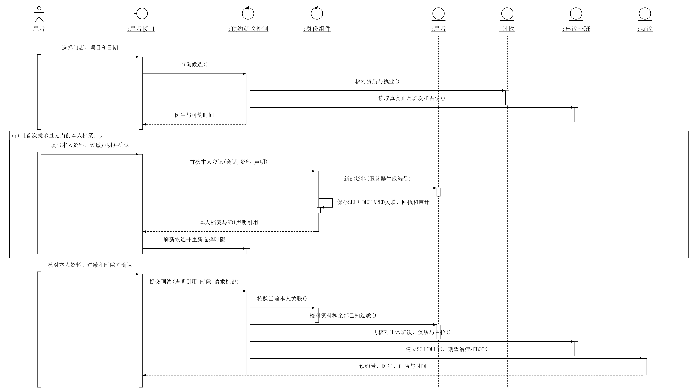

<!-- word-block:311 -->

图 C4  UC01-S1 创建预约分析序列图

<!-- word-block:312 -->

患者接口接收预约条件后，预约就诊控制调用牙医对象筛选具有有效资质和执业关系的候选集合，再由排班对象列出可约时隙。患者选定时隙后，系统复核资料并建立就诊。患者首次登记后由系统自动关联新本人档案并可直接预约；已有档案须安全关联，前台仍可代办建档预约。

<!-- word-block:313 -->

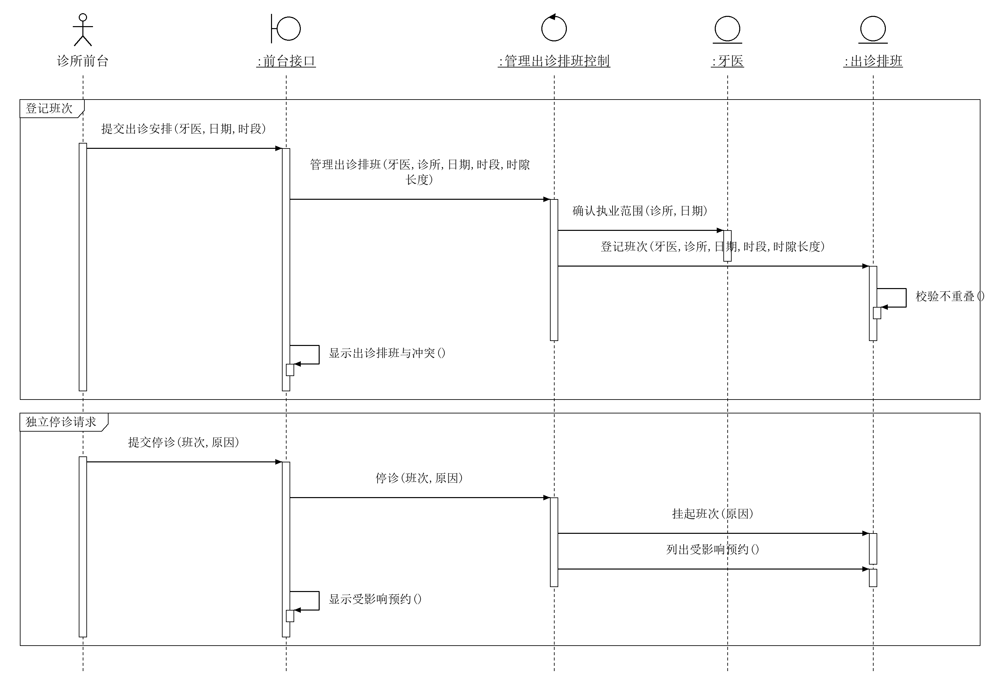

<!-- word-block:314 -->

图 C5  UC02 管理出诊排班分析序列图

<!-- word-block:315 -->

排班控制协调牙医执业范围与出诊班次。正常班次检查同一牙医跨诊所的时间重叠；已被预约引用的班次保留原日期、诊所和牙医，调整时先挂起旧班次再建立新班次。“已预约且所属班次已挂起”的就诊列入待改约清单，由前台逐项处理。

<!-- word-block:316 -->

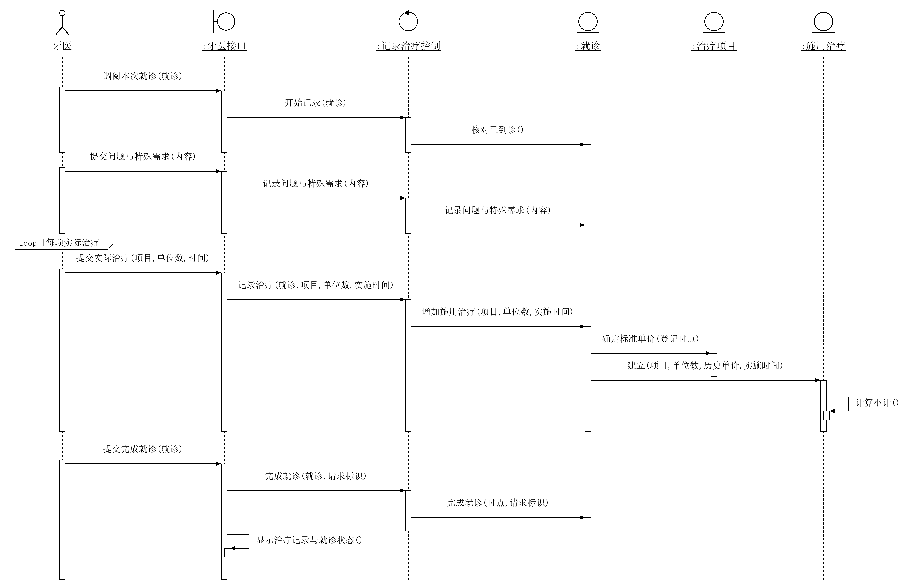

<!-- word-block:317 -->

图 C6  UC03 记录治疗分析序列图

<!-- word-block:318 -->

牙医发起记录，控制将到诊核对、问题记录和施用治疗增加交给就诊。治疗项目提供有效目录价，施用治疗冻结单位价格并计算自身小计。牙医可重复增加治疗，明确提交完成后，就诊检查至少存在一项实际诊疗项目并登记完成时点。

<!-- word-block:319 -->

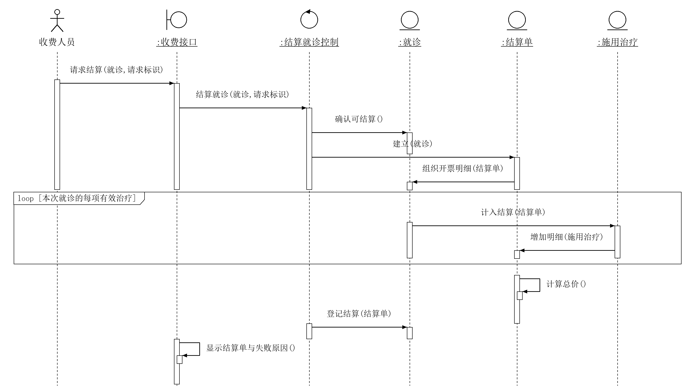

<!-- word-block:320 -->

图 C7  UC04 结算就诊分析序列图

<!-- word-block:321 -->

结算控制先让就诊确认可结算，再创建结算单。结算单委托就诊组织有效施用治疗，每项施用治疗将历史价格与单位数计入结算明细，结算单汇总总价。唯一结算单、开票快照、独立诊疗待缴账单和INVOICED状态同事务保存，重复请求返回原单。缴费与退款是独立事务，不把费用凭据状态冒充已付款，不覆盖历史诊疗价格。

<!-- word-block:322 -->

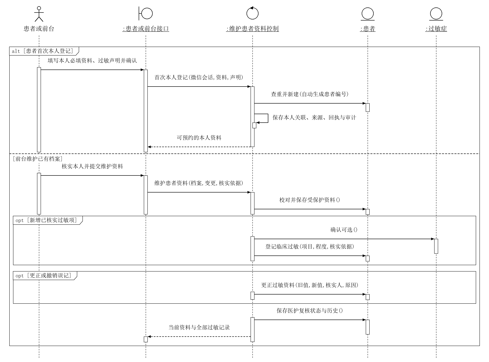

<!-- word-block:323 -->

图 C8  UC05 维护患者资料分析序列图

<!-- word-block:324 -->

患者对象维护当前个人资料与全部已知过敏症。新增过敏症建立关联；更正严重程度或撤销误记时，保留原值、原因、时间和核实人。过敏症目录由总部维护，前台只选择目录项或提交新增申请，不在患者资料维护中直接改变共享目录。

<!-- word-block:325 -->

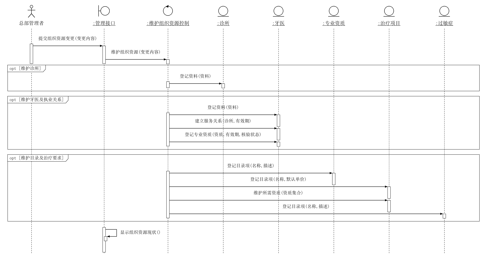

<!-- word-block:326 -->

图 C9  UC06 维护组织资源分析序列图

<!-- word-block:327 -->

总部通过组织资源控制维护诊所、牙医、专业资质、治疗项目及其所需资质。牙医登记服务关系和已核验资质，治疗项目维护未来采用的默认单价。目录或执业资料变化只影响后续匹配；历史施用治疗价格和已发布班次归属保持不变。

<!-- word-block:328 -->

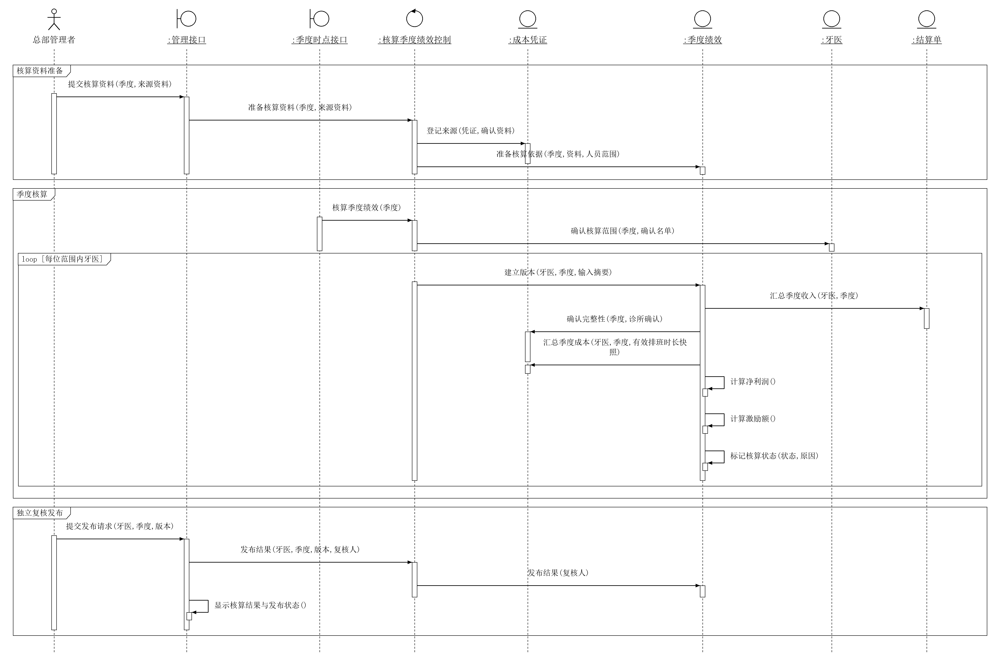

<!-- word-block:329 -->

图 C10  UC07 核算季度绩效分析序列图

<!-- word-block:330 -->

总部准备核算资料后，由季度时点或管理者发起计算，复核发布作为独立交互执行。系统按开票收入、发生期间成本及有效排班分摊依据计算个人净利润和激励，非正净利润激励为0。核算时校验规则版本及来源资料，版本依据或输入不完整时保存INCOMPLETE及原因，复核通过后发布并冻结版本。

<!-- word-block:331 -->

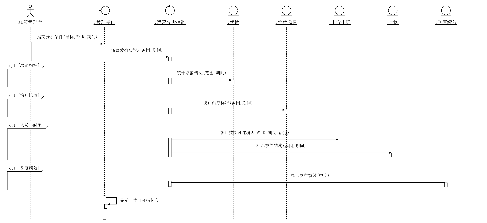

<!-- word-block:332 -->

图 C11  UC08 运营分析序列图

<!-- word-block:333 -->

运营分析按第二章指标定义开展只读查询。就诊统计患者取消与诊所停诊变更，治疗项目组织施用治疗的单位数和成交单位价格统计，牙医汇总有效技能，出诊排班计算可用时隙覆盖，季度绩效返回所选季度的最新已发布版本。

<!-- word-block:334 -->

UC01-S2 确认到诊场景的对象协作

<!-- word-block:335 -->

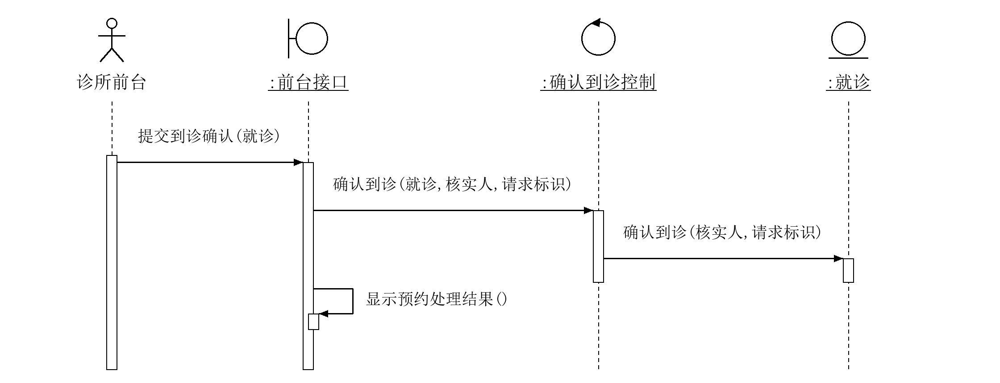

<!-- word-block:336 -->

图 C13 UC01-S2 确认到诊分析序列图

<!-- word-block:337 -->

前台接口将确认请求交给确认到诊控制，就诊在身份核实和班次正常的条件下保存到诊时点并进入进行中。

<!-- word-block:338 -->

UC01-S3 取消预约场景的对象协作

<!-- word-block:339 -->

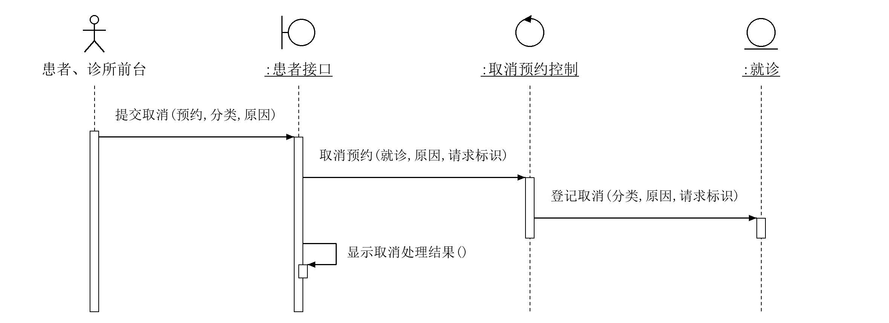

<!-- word-block:340 -->

图 C14 UC01-S3 取消预约分析序列图

<!-- word-block:341 -->

取消预约控制根据服务端时间、预约时点、班次和当前状态核验取消条件；患者入口检查本人绑定，前台入口检查岗位及诊所权限。就诊保存取消分类、原因和时点。无法核实时不提交取消，由前台核实资料；停诊预约按UC01-S5处理。

<!-- word-block:342 -->

UC01-S4 登记爽约场景的对象协作

<!-- word-block:343 -->

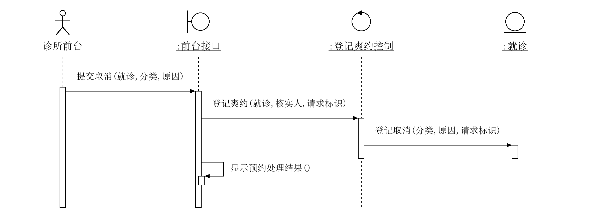

<!-- word-block:344 -->

图 C15 UC01-S4 登记爽约分析序列图

<!-- word-block:345 -->

前台在时隙结束后核实未到诊，登记爽约控制将NO_SHOW分类传给就诊。若到诊已经提交，爽约不能覆盖该结果。

<!-- word-block:346 -->

UC01-S5 停诊改约场景的对象协作

<!-- word-block:347 -->

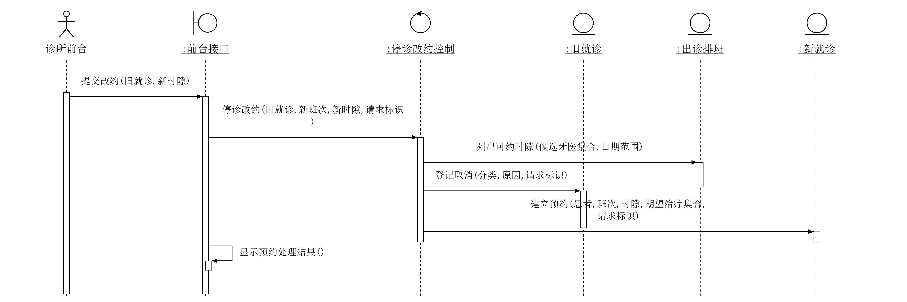

<!-- word-block:348 -->

图 C16 UC01-S5 停诊改约分析序列图

<!-- word-block:349 -->

停诊改约控制协调旧就诊与新就诊；旧记录保留停诊原因，新记录保存来源关联。两次写入属于同一事务，任何一步失败均保留原安排。

<!-- word-block:350 -->

### （四）就诊分析状态机图

<!-- word-block:351 -->

就诊是取消率、治疗记录与结算的共同载体，它的状态直接决定哪些操作被允许：未登记到诊不得记录治疗，未完成不得生成结算单，已结算不得重复开单，因此单独建立状态机。

<!-- word-block:352 -->

就诊具有已预约、进行中、已完成、已结算和已取消五个状态。确认到诊使已预约进入进行中，已登记至少一项实际诊疗项目后方可完成，完成后方可结算。取消仅允许发生在已预约状态。爽约和停诊属于取消原因分类；改约创建新的就诊对象，不使旧对象从已取消恢复为已预约。各迁移与事实时点、状态事件共同保存。

<!-- word-block:353 -->

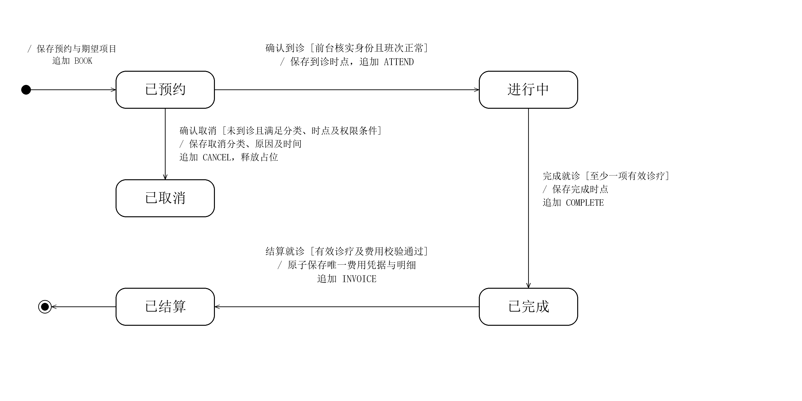

<!-- word-block:354 -->

图 C12  就诊分析状态机图

<!-- word-block:355 -->

表 C2  就诊状态的业务含义与不变式

<!-- word-block:356 -->

| 状态或迁移 | 不变式或业务含义 |

| --- | --- |

| 已预约 | 正常班次下占用一个有效时隙；未到诊、未取消、未完成，无实际治疗与结算单。挂起班次下的已预约记录列入待改约清单，不再提供新预约。 |

| 已取消 | 取消分类、原因和时点非空；无实际治疗及结算单；旧记录不可恢复，重新安排建立新预约。 |

| 进行中 | 到诊时点非空，可以记录问题与治疗；治疗尚未保存时也允许处于进行中。 |

| 已完成 | 完成时点非空且至少存在一项有效诊疗项目；可以结算，不再增加治疗。 |

| 已结算 | 存在唯一结算单；治疗和开票明细只读，重复结算返回原单。 该状态不表示已付款。 |

<!-- word-block:357 -->

### （五）需求与分析模型追踪

<!-- word-block:358 -->

表C3建立用例、交互场景、责任对象、状态及数据设计之间的追踪关系。UC01按五个业务场景分别追踪，SF01—SF04通过身份与授权接口契约追踪。

<!-- word-block:359 -->

表 C3 需求与分析设计追踪

<!-- word-block:360 -->

| 用例或支撑功能 | 规约及交互依据 | 分析责任对象与协作 | 状态及数据设计 |

| --- | --- | --- | --- |

| UC01-S1 创建预约 | UC01；表B3—B4；图C4 | 患者接口、预约就诊控制、患者、牙医、出诊排班、就诊 | 建立SCHEDULED；Patient及过敏关联、资质/执业/班次、Appointment及期望治疗、AppointmentEvent |

| UC01-S2 确认到诊 | UC01；表B4a；图C13 | 前台接口、确认到诊控制、就诊 | SCHEDULED→IN_PROGRESS；Appointment、DentistSchedule、AppointmentEvent |

| UC01-S3 取消预约 | UC01；表B4b；图C14 | 患者/前台接口、取消预约控制、就诊 | SCHEDULED→CANCELLED；PATIENT_CANCEL；Appointment、AppointmentEvent |

| UC01-S4 登记爽约 | UC01；表B4c；图C15 | 前台接口、登记爽约控制、就诊 | SCHEDULED→CANCELLED；NO_SHOW；Appointment、DentistSchedule、AppointmentEvent |

| UC01-S5 停诊改约 | UC01；表B4d；图C16 | 前台接口、停诊改约控制、旧/新就诊、出诊排班 | 旧预约CANCELLED，新预约SCHEDULED；Appointment及期望治疗、DentistSchedule、AppointmentEvent |

| UC02 出诊排班 | 表B11a；图C5 | 前台接口、排班控制、牙医、出诊排班 | Dentist、DentistClinicAssignment、DentistSchedule；停诊后转UC01-S5 |

| UC03 记录治疗 | 表B5—B6；图C6 | 牙医接口、记录治疗控制、就诊、治疗项目、施用治疗 | IN_PROGRESS→COMPLETED；Appointment、AppliedTreatment、Treatment、牙医资质/执业、AppointmentEvent |

| UC04 结算就诊 | 表B7—B8；图C7 | 收费接口、结算控制、就诊、结算单、施用治疗 | COMPLETED→INVOICED；Invoice、InvoiceItem、AppliedTreatment、Appointment及事件；另建诊疗待缴账单，演示缴费及退款不覆盖费用快照 |

| UC05 患者资料 | 表B11b；图C8 | 患者或前台接口、患者资料控制、患者、过敏症 | Patient、Allergy、PatientAllergy；SF02支持首次本人登记及已有档案安全关联；受保护资料更正仍由授权前台办理 |

| UC06 组织资源 | 表B11c；图C9 | 管理接口、组织资源控制、诊所、牙医及目录对象 | Clinic、Dentist、Qualification、DentistQualification、DentistClinicAssignment、Treatment及资质关联、Allergy |

| UC07 个人绩效 | 表B9—B10；图C10 | 管理/季度接口、绩效控制、季度绩效、成本凭证、牙医、结算单 | Invoice/InvoiceItem、AppliedTreatment、CostEntry、QuarterlyPerformance、Dentist；个人净利润10% |

| UC08 运营分析 | 表B11d；图C11 | 管理接口、分析控制及指标责任实体 | 只读Appointment、AppliedTreatment、班次/资质/执业、Dentist、QuarterlyPerformance等；保留口径与来源 |

| SF01 登录退出 | 表B12b；表D26 | 前端登录入口→身份组件校验会话→业务服务验证身份 | 身份组件保存账号与会话；不改变就诊状态 |

| SF02 本人登记与关联 | 表B12b；表D26 | 首次登记→新档案自动关联；已有档案→前台核验→当前关联→业务服务读取 | 首次本人登记创建新Patient并自动保存subject_id与patient_id映射；既有档案关联及维护按人工核实流程处理 |

| SF03 员工账号 | 表B12b；表D26 | 授权管理入口→身份组件维护账号→业务服务校验状态 | 账号由身份组件保存；Dentist只在牙医身份适用时关联 |

| SF04 诊所授权 | 表B12b；表D26 | 授权管理入口→身份组件保存授权→业务服务检查对象范围 | 角色和clinic_scope由身份组件保存；业务表为24张 |

<!-- word-block:361 -->

主要业务目标为缩短季度核算工作日数，对应UC07，并由UC08提供核算耗时的监测与比较。两项辅助指标中，统一资料覆盖对应UC05、UC06，治疗可追溯对应UC01、UC03、UC04。患者取消率作为运营监测，对应UC01-S3—S5及UC08；有效技能时隙覆盖对应UC01-S1、UC02、UC06及UC08。图C12与表D22、D23统一约束各场景的就诊状态；Q01—Q09的验证覆盖范围见表B12。
