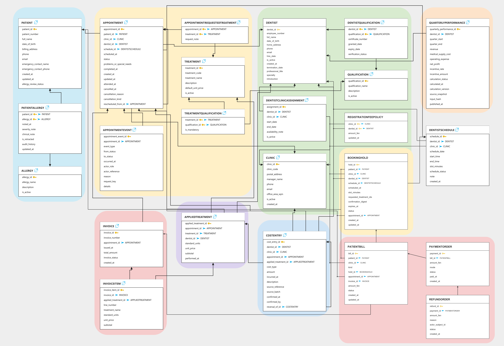
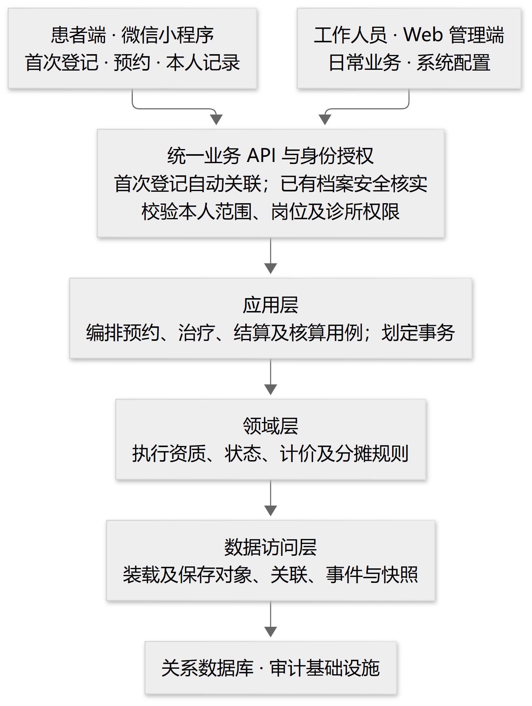

# D 系统设计

> 来源：当前正式 Word。正文、表格和图按原顺序转换；编号保留。Word 为业务规则权威，Markdown 为检索副本。

<!-- word-block:362 -->

## 四、设计

<!-- word-block:363 -->

数据设计需要保留一次服务从预约到结算的完整联系，也要使季度结果可以追溯到当时的输入。系统业务数据库由24张表组成：患者、牙医和目录表保存共享资料，就诊组织预约与实际治疗，结算明细冻结收费依据，成本凭证保存独立费用事实，季度绩效保存分次计算的结果。下面结合这些业务对象说明关系映射、约束和服务端处理。

<!-- word-block:364 -->

### （一）从分析类到数据表

<!-- word-block:365 -->

原有实体和多对多关联按既定关系映射，InvoiceItem保存开票快照，AppointmentEvent保存就诊状态事件。另由挂号费策略、号源保留、患者账单、支付订单及退款订单保存预约收费和费用办理事实，共形成24张业务表。边界类和控制类不直接映射为业务表。

<!-- word-block:366 -->

DentistClinicAssignment 表示执业范围的有效区间，DentistSchedule 表示具体出诊班次，二者分别支持执业资格和时隙安排。CostEntry 对应成本凭证实体，不由季度汇总结果反推。当前业务对象以关联和组合协作，不存在需要统一多态行为的实体继承关系，因此不采用继承映射。

<!-- word-block:367 -->

表 D1  分析类与数据表的对应

<!-- word-block:368 -->

| 分析类或来源 | 表 | 映射方式 | 可追溯用例 |

| --- | --- | --- | --- |

| 患者 | Patient | 实体类 → 表 | UC01、UC05 |

| 过敏症 | Allergy | 实体类 → 表 | UC01、UC05 |

| 患者—过敏症 | PatientAllergy | 多对多 → 关联表 | UC01、UC05 |

| 诊所 | Clinic | 实体类 → 表 | UC01、UC06 |

| 牙医 | Dentist | 实体类 → 表 | UC01、UC06 |

| 专业资质 | Qualification | 实体类 → 表 | UC06 |

| 牙医—专业资质 | DentistQualification | 多对多 → 关联表 | UC06 |

| 牙医—诊所 | DentistClinicAssignment | 多对多（带有效期）→ 关联表 | UC02、UC06 |

| 出诊排班 | DentistSchedule | 实体类 → 表 | UC01、UC02 |

| 治疗项目 | Treatment | 实体类 → 表 | UC03 |

| 治疗—所需资质 | TreatmentQualification | 多对多 → 关联表 | UC01、UC06 |

| 就诊 | Appointment | 实体类 → 表 | UC01、UC03 |

| 就诊—期望治疗 | AppointmentRequestedTreatment | 多对多 → 关联表 | UC01 |

| 施用治疗 | AppliedTreatment | 组合（就诊 1:N）→ 非空外键 | UC03 |

| 结算单 | Invoice | 实体类 → 表；与就诊 1:0..1 | UC04 |

| 开票明细快照 | InvoiceItem | 设计细化 → 非空外键 | UC04 |

| 成本凭证 | CostEntry | 实体类 → 表 | UC07 |

| 季度绩效 | QuarterlyPerformance | 实体类 → 表 | UC07 |

| 就诊状态事件 | AppointmentEvent | 审计细化 → 事件表 | UC01、UC03、UC04 |

| 挂号费策略 | RegistrationFeePolicy | 设计细化 → 非空或条件外键 | UC01、UC04 |

| 预约号源保留 | BookingHold | 设计细化 → 非空或条件外键 | UC01、UC04 |

| 患者账单 | PatientBill | 设计细化 → 非空或条件外键 | UC01、UC04 |

| 支付订单 | PaymentOrder | 设计细化 → 非空或条件外键 | UC01、UC04 |

| 退款订单 | RefundOrder | 设计细化 → 非空或条件外键 | UC01、UC04 |

<!-- word-block:369 -->

### （二）映射策略与键的选择

<!-- word-block:370 -->

当前实体之间以关联和组合为主，没有需要统一多态行为的继承层次，因此各实体分别映射，不为相似的名称、描述字段设置公共父表。若以后出现带专有属性的治疗子类，可以采用单表加类型列，或父子表共享主键：前者读取简单但容易产生大量空列，后者表达清楚但需要连接。当前治疗目录无需专有子类属性，继续使用Treatment表。

<!-- word-block:371 -->

一对多关联一律把外键放在多端，父表不保存子集合。外键是否可空由业务基数决定：Invoice.appointment_id 非空且唯一，表示结算单从属于一次就诊的 1:0..1；CostEntry.dentist_id 允许为空，表示公共费用在分摊前不归属具体牙医。多对多关联分解为两个一对多，并引入关联表；关联自身的属性随关联行落库，例如 PatientAllergy 记录过敏程度与更正链、DentistQualification 记录核验状态与有效期、DentistClinicAssignment 记录执业区间，这些属性既不放进两端目录，也不重复出现在业务表中。

<!-- word-block:372 -->

改约和冲销均采用同表自反引用。Appointment.rescheduled_from_id指向被替代的旧就诊，新的预约再次改约时引用最近前驱，形成可追踪的链；该字段唯一且允许空，保证一个旧就诊至多一个直接后继。CostEntry.reversal_of_id唯一且允许空，表示一条原凭证最多被完整冲销一次。自反外键只保证记录存在，同一患者、无循环、冲销金额及归属仍由业务事务检查。

<!-- word-block:373 -->

过敏症、专业资质及治疗项目作为共享目录解释术语并限定取值，停用不删除历史引用。19张业务表采用单列代理主键，5张表采用复合主键，包含原4张关联表及门店—医生挂号费策略，具体见“主键、范式与受控冗余”。业务编号另设唯一约束，改号不改变对象引用，键按唯一与恒定两条要求检查。

<!-- word-block:374 -->

### （三）数据库 ER 图

<!-- word-block:375 -->

图D1给出24张业务表的关系，字段定义见表D3—D21及D27—D31；完整性和业务基数结合表D22—D24阅读。挂号费策略位于资源区，号源保留位于预约区，账单、支付及退款位于费用区。全库包含209个字段和44条外键，普通和条件唯一约束共同保证当前事实与历史记录一致。

<!-- word-block:376 -->

Appointment关联患者、诊所、牙医、班次、实际治疗、结算及状态事件。InvoiceItem保存开票明细快照，CostEntry记录成本来源，QuarterlyPerformance保存版本化结果及输入快照。医疗用品成本归属实际实施牙医或治疗，诊所公共运营费用按有效排班时长比例分摊。

<!-- word-block:378 -->

<!-- word-block:379 -->

图 D1  ADC 数据库 ER 图

<!-- word-block:380 -->

### （四）关系模式总览

<!-- word-block:381 -->

表D2列出24张业务表。表D3—D21及D27—D31给出字段定义，表D22—D24给出约束、状态和主要关系。

<!-- word-block:382 -->

表 D2  关系模式总览

<!-- word-block:383 -->

| 表名 | 用途 |

| --- | --- |

| Patient | 存储患者唯一且长期有效的身份与联系资料。 |

| Allergy | 定义可复用的过敏症目录。 |

| PatientAllergy | 解析患者与过敏症之间的多对多关系。 |

| Clinic | 存储各牙科诊所及其经营地点信息。 |

| Dentist | 存储牙医作为稳定员工身份的信息。 |

| Qualification | 定义用于人员配置与预约排班的专业资质。 |

| DentistQualification | 解析牙医与专业资质之间的多对多关系。 |

| DentistClinicAssignment | 记录牙医可执业的诊所及其有效期限。 |

| DentistSchedule | 记录牙医在各诊所的具体出诊日期、时段与接诊粒度，是预约可约时段的来源。 |

| Treatment | 定义牙科治疗项目的标准目录。 |

| TreatmentQualification | 定义开展各项治疗所需的专业资质。 |

| Appointment | 表示一次预约就诊的完整生命周期。 |

| AppointmentRequestedTreatment | 记录预约时患者期望接受的治疗项目。 |

| AppliedTreatment | 记录一次就诊中实际实施的各项治疗。 |

| Invoice | 存储为已完成就诊生成的一张结算单。 |

| InvoiceItem | 保存由实际治疗生成、可供审计的结算单明细快照。 |

| CostEntry | 提供交易级的医疗用品成本与运营费用凭证。 |

| QuarterlyPerformance | 保存牙医季度核算的版本、输入快照、状态与发布结果。 |

| AppointmentEvent | 追加保存就诊生命周期与幂等请求事件。 |

| RegistrationFeePolicy | 按门店、医生配置挂号费，单位为整数分。 |

| BookingHold | 保存收费预约短时号源、本人确认摘要及最终预约引用。 |

| PatientBill | 保存挂号或实际诊疗待缴账单及金额快照。 |

| PaymentOrder | 保存受控演示缴费结果，每账单至多一次成功。 |

| RefundOrder | 保存全额演示退款、原支付、原因及操作者。 |

<!-- word-block:384 -->

### （五）数据表定义

<!-- word-block:385 -->

下列24张业务表列明字段、类型、主键、外键、可空性和唯一性。UNIQUE表示单列唯一，UNIQUE(组合)表示共同构成唯一约束，条件组合仅对指定状态生效。JSON用于不可分离的审计、核算及短时预约意向快照，不代替应有的实体关联。

<!-- word-block:386 -->

表 D3  Patient（患者）表结构

<!-- word-block:387 -->

| 字段名 | 数据类型 | 主键 | 外键 | 是否为空 | 是否唯一 |

| --- | --- | --- | --- | --- | --- |

| patient_id | BIGINT | Yes | No | NOT NULL | UNIQUE |

| patient_number | VARCHAR(30) | No | No | NOT NULL | UNIQUE |

| full_name | VARCHAR(100) | No | No | NOT NULL | - |

| date_of_birth | DATE | No | No | NOT NULL | - |

| billing_address | VARCHAR(255) | No | No | NULL | - |

| phone | VARCHAR(30) | No | No | NOT NULL | - |

| email | VARCHAR(254) | No | No | NULL | - |

| emergency_contact_name | VARCHAR(100) | No | No | NULL | - |

| emergency_contact_phone | VARCHAR(30) | No | No | NULL | - |

| created_at | TIMESTAMP | No | No | NOT NULL | - |

| updated_at | TIMESTAMP | No | No | NOT NULL | - |

| allergy_review_status | VARCHAR(20) | No | No | NOT NULL | - |

<!-- word-block:388 -->

存储患者唯一且长期有效的身份与联系资料。patient_number 是业务编号，与代理主键分离，改号不影响外键。

<!-- word-block:389 -->

表 D4  Allergy（过敏症）表结构

<!-- word-block:390 -->

| 字段名 | 数据类型 | 主键 | 外键 | 是否为空 | 是否唯一 |

| --- | --- | --- | --- | --- | --- |

| allergy_id | BIGINT | Yes | No | NOT NULL | UNIQUE |

| allergy_name | VARCHAR(100) | No | No | NOT NULL | UNIQUE |

| description | VARCHAR(255) | No | No | NULL | - |

| is_active | BOOLEAN | No | No | NOT NULL | - |

<!-- word-block:391 -->

定义可复用的过敏症目录，避免各诊所自由填写造成口径分裂。

<!-- word-block:392 -->

表 D5  PatientAllergy（患者过敏症）表结构

<!-- word-block:393 -->

| 字段名 | 数据类型 | 主键 | 外键 | 是否为空 | 是否唯一 |

| --- | --- | --- | --- | --- | --- |

| patient_id | BIGINT | Yes | FK:Patient.patient_id | NOT NULL | UNIQUE(组合) |

| allergy_id | BIGINT | Yes | FK:Allergy.allergy_id | NOT NULL | UNIQUE(组合) |

| noted_at | TIMESTAMP | No | No | NOT NULL | - |

| severity_note | VARCHAR(100) | No | No | NULL | - |

| clinical_note | VARCHAR(255) | No | No | NULL | - |

| is_retracted | BOOLEAN | No | No | NOT NULL | - |

| audit_history | JSON | No | No | NOT NULL | - |

| updated_at | TIMESTAMP | No | No | NOT NULL | - |

<!-- word-block:394 -->

患者与过敏症采用复合主键。当前程度、临床备注和撤销标记用于临床查阅；audit_history 追加保存每次新增、更正与撤销的原值、新值、核实人、时间和原因。撤销误记保留历史关联，不物理删除。

<!-- word-block:395 -->

表 D6  Clinic（诊所）表结构

<!-- word-block:396 -->

| 字段名 | 数据类型 | 主键 | 外键 | 是否为空 | 是否唯一 |

| --- | --- | --- | --- | --- | --- |

| clinic_id | BIGINT | Yes | No | NOT NULL | UNIQUE |

| clinic_code | VARCHAR(20) | No | No | NOT NULL | UNIQUE |

| postal_address | VARCHAR(255) | No | No | NOT NULL | - |

| manager_name | VARCHAR(100) | No | No | NULL | - |

| phone | VARCHAR(30) | No | No | NOT NULL | - |

| email | VARCHAR(254) | No | No | NULL | - |

| office_area_sqm | DECIMAL(8,2) | No | No | NULL | - |

| is_active | BOOLEAN | No | No | NOT NULL | - |

| created_at | TIMESTAMP | No | No | NOT NULL | - |

<!-- word-block:397 -->

存储各牙科诊所及其执业地点、联系人与营业面积。

<!-- word-block:398 -->

表 D7  Dentist（牙医）表结构

<!-- word-block:399 -->

| 字段名 | 数据类型 | 主键 | 外键 | 是否为空 | 是否唯一 |

| --- | --- | --- | --- | --- | --- |

| dentist_id | BIGINT | Yes | No | NOT NULL | UNIQUE |

| employee_number | VARCHAR(30) | No | No | NOT NULL | UNIQUE |

| full_name | VARCHAR(100) | No | No | NOT NULL | - |

| date_of_birth | DATE | No | No | NOT NULL | - |

| home_address | VARCHAR(255) | No | No | NULL | - |

| phone | VARCHAR(30) | No | No | NOT NULL | - |

| email | VARCHAR(254) | No | No | NULL | - |

| hire_date | DATE | No | No | NOT NULL | - |

| is_active | BOOLEAN | No | No | NOT NULL | - |

| created_at | TIMESTAMP | No | No | NOT NULL | - |

| termination_date | DATE | No | No | NULL | - |

| professional_title | VARCHAR(40) | No | No | NULL | - |

| specialty | VARCHAR(255) | No | No | NULL | - |

| introduction | VARCHAR(1000) | No | No | NULL | - |

<!-- word-block:400 -->

牙医资料以 employee_number 作为稳定业务编号。hire_date 与 termination_date 描述任职区间；停用账号或离职不删除历史治疗、结算和绩效资料。

<!-- word-block:401 -->

表 D8  Qualification（专业资质）表结构

<!-- word-block:402 -->

| 字段名 | 数据类型 | 主键 | 外键 | 是否为空 | 是否唯一 |

| --- | --- | --- | --- | --- | --- |

| qualification_id | BIGINT | Yes | No | NOT NULL | UNIQUE |

| qualification_name | VARCHAR(120) | No | No | NOT NULL | UNIQUE |

| description | VARCHAR(255) | No | No | NULL | - |

| is_active | BOOLEAN | No | No | NOT NULL | - |

<!-- word-block:403 -->

定义用于排班与预约匹配的专业资质目录。

<!-- word-block:404 -->

表 D9  DentistQualification（牙医专业资质）表结构

<!-- word-block:405 -->

| 字段名 | 数据类型 | 主键 | 外键 | 是否为空 | 是否唯一 |

| --- | --- | --- | --- | --- | --- |

| dentist_id | BIGINT | Yes | FK:Dentist.dentist_id | NOT NULL | UNIQUE(组合) |

| qualification_id | BIGINT | Yes | FK:Qualification.qualification_id | NOT NULL | UNIQUE(组合) |

| certificate_number | VARCHAR(60) | No | No | NOT NULL | - |

| granted_date | DATE | No | No | NOT NULL | - |

| expiry_date | DATE | No | No | NULL | - |

| verification_status | VARCHAR(20) | No | No | NOT NULL | - |

<!-- word-block:406 -->

解析牙医与专业资质之间的多对多关系，记录取得日期、有效期与核验状态。

<!-- word-block:407 -->

表 D10  DentistClinicAssignment（牙医诊所委派）表结构

<!-- word-block:408 -->

| 字段名 | 数据类型 | 主键 | 外键 | 是否为空 | 是否唯一 |

| --- | --- | --- | --- | --- | --- |

| assignment_id | BIGINT | Yes | No | NOT NULL | UNIQUE |

| dentist_id | BIGINT | No | FK:Dentist.dentist_id | NOT NULL | - |

| clinic_id | BIGINT | No | FK:Clinic.clinic_id | NOT NULL | - |

| start_date | DATE | No | No | NOT NULL | - |

| end_date | DATE | No | No | NULL | - |

| availability_note | VARCHAR(255) | No | No | NULL | - |

| is_active | BOOLEAN | No | No | NOT NULL | - |

<!-- word-block:409 -->

记录牙医可执业的诊所及有效期，用日期区间而不是布尔标记表达“随时间”的关系。

<!-- word-block:410 -->

表 D11  DentistSchedule（出诊排班）表结构

<!-- word-block:411 -->

班次规定某牙医在某诊所某日的出诊区间和固定时隙长度。slot_minutes 为正，区间必须能够划分为完整时隙。已被预约引用的班次只允许挂起，不覆盖其日期、诊所、牙医、时间或时隙粒度；变更时先挂起旧班次再创建新班次。NORMAL班次按牙医、日期及开始时间保持唯一；SUSPENDED历史不参与该唯一性及重叠校验。

<!-- word-block:412 -->

| 字段名 | 数据类型 | 主键 | 外键 | 是否为空 | 是否唯一 |

| --- | --- | --- | --- | --- | --- |

| schedule_id | BIGINT | Yes | No | NOT NULL | UNIQUE |

| dentist_id | BIGINT | No | FK:Dentist.dentist_id | NOT NULL | UNIQUE(条件组合) |

| clinic_id | BIGINT | No | FK:Clinic.clinic_id | NOT NULL | - |

| schedule_date | DATE | No | No | NOT NULL | UNIQUE(条件组合) |

| start_time | TIME | No | No | NOT NULL | UNIQUE(条件组合) |

| end_time | TIME | No | No | NOT NULL | - |

| slot_minutes | SMALLINT | No | No | NOT NULL | - |

| schedule_status | VARCHAR(20) | No | No | NOT NULL | - |

| note | VARCHAR(255) | No | No | NULL | - |

| created_at | TIMESTAMP | No | No | NOT NULL | - |

<!-- word-block:413 -->

表 D12  Treatment（治疗项目）表结构

<!-- word-block:414 -->

| 字段名 | 数据类型 | 主键 | 外键 | 是否为空 | 是否唯一 |

| --- | --- | --- | --- | --- | --- |

| treatment_id | BIGINT | Yes | No | NOT NULL | UNIQUE |

| treatment_code | VARCHAR(30) | No | No | NOT NULL | UNIQUE |

| treatment_name | VARCHAR(120) | No | No | NOT NULL | - |

| description | VARCHAR(255) | No | No | NULL | - |

| default_unit_price | DECIMAL(12,2) | No | No | NOT NULL | - |

| is_active | BOOLEAN | No | No | NOT NULL | - |

<!-- word-block:415 -->

治疗目录包含检查、咨询及治疗，按实际提供的项目记录，免费项目默认单价为0。目录维护未来使用的默认单价和有效标记。牙医不得自行覆盖目录单价；每项施用治疗在创建时保存当时单价，后续目录调整不改写历史价格。

<!-- word-block:416 -->

表 D13  TreatmentQualification（治疗所需资质）表结构

<!-- word-block:417 -->

| 字段名 | 数据类型 | 主键 | 外键 | 是否为空 | 是否唯一 |

| --- | --- | --- | --- | --- | --- |

| treatment_id | BIGINT | Yes | FK:Treatment.treatment_id | NOT NULL | UNIQUE(组合) |

| qualification_id | BIGINT | Yes | FK:Qualification.qualification_id | NOT NULL | UNIQUE(组合) |

| is_mandatory | BOOLEAN | No | No | NOT NULL | - |

<!-- word-block:418 -->

定义开展各项治疗所需的专业资质，是 UC01 匹配候选牙医的依据。

<!-- word-block:419 -->

表 D14  Appointment（就诊）表结构

<!-- word-block:420 -->

| 字段名 | 数据类型 | 主键 | 外键 | 是否为空 | 是否唯一 |

| --- | --- | --- | --- | --- | --- |

| appointment_id | BIGINT | Yes | No | NOT NULL | UNIQUE |

| patient_id | BIGINT | No | FK:Patient.patient_id | NOT NULL | - |

| clinic_id | BIGINT | No | FK:Clinic.clinic_id | NOT NULL | - |

| dentist_id | BIGINT | No | FK:Dentist.dentist_id | NOT NULL | - |

| schedule_id | BIGINT | No | FK:DentistSchedule.schedule_id | NOT NULL | - |

| scheduled_at | TIMESTAMP | No | No | NOT NULL | - |

| status | VARCHAR(20) | No | No | NOT NULL | - |

| problems_or_special_needs | TEXT | No | No | NULL | - |

| completed_at | TIMESTAMP | No | No | NULL | - |

| created_at | TIMESTAMP | No | No | NOT NULL | - |

| updated_at | TIMESTAMP | No | No | NOT NULL | - |

| attended_at | TIMESTAMP | No | No | NULL | - |

| cancelled_at | TIMESTAMP | No | No | NULL | - |

| cancellation_reason | VARCHAR(255) | No | No | NULL | - |

| cancellation_kind | VARCHAR(30) | No | No | NULL | - |

| rescheduled_from_id | BIGINT | No | FK:Appointment.appointment_id | NULL | UNIQUE |

<!-- word-block:421 -->

就诊以status记录业务状态，attended_at、cancelled_at和completed_at记录事实时点。查询中的到诊布尔值由attended_at是否非空生成：非空为true，表示已到诊；为空为false，表示尚无到诊事实。取消原因由cancellation_kind分类，rescheduled_from_id记录改约的直接前驱。

<!-- word-block:422 -->

表 D15  AppointmentRequestedTreatment（就诊期望治疗）表结构

<!-- word-block:423 -->

| 字段名 | 数据类型 | 主键 | 外键 | 是否为空 | 是否唯一 |

| --- | --- | --- | --- | --- | --- |

| appointment_id | BIGINT | Yes | FK:Appointment.appointment_id | NOT NULL | UNIQUE(组合) |

| treatment_id | BIGINT | Yes | FK:Treatment.treatment_id | NOT NULL | UNIQUE(组合) |

| request_note | VARCHAR(255) | No | No | NULL | - |

<!-- word-block:424 -->

记录预约时患者期望接受的治疗项目，与实际治疗分开保存。

<!-- word-block:425 -->

表 D16  AppliedTreatment（施用治疗）表结构

<!-- word-block:426 -->

| 字段名 | 数据类型 | 主键 | 外键 | 是否为空 | 是否唯一 |

| --- | --- | --- | --- | --- | --- |

| applied_treatment_id | BIGINT | Yes | No | NOT NULL | UNIQUE |

| appointment_id | BIGINT | No | FK:Appointment.appointment_id | NOT NULL | - |

| treatment_id | BIGINT | No | FK:Treatment.treatment_id | NOT NULL | - |

| dentist_id | BIGINT | No | FK:Dentist.dentist_id | NOT NULL | - |

| standard_units | DECIMAL(10,2) | No | No | NOT NULL | - |

| unit_price | DECIMAL(12,2) | No | No | NOT NULL | - |

| subtotal | DECIMAL(14,2) | No | No | NOT NULL | - |

| performed_at | TIMESTAMP | No | No | NOT NULL | - |

<!-- word-block:427 -->

施用治疗保存实际项目、实施牙医、标准单位数、历史单价及实施时间。实施牙医必须具有当时有效的资质和诊所执业关系，但不要求与预约责任牙医相同。收入通过开票明细关联本项治疗，按表B13归实际实施牙医；收入归季使用开票时间，不使用治疗实施时间。

<!-- word-block:428 -->

表 D17  Invoice（结算单）表结构

<!-- word-block:429 -->

| 字段名 | 数据类型 | 主键 | 外键 | 是否为空 | 是否唯一 |

| --- | --- | --- | --- | --- | --- |

| invoice_id | BIGINT | Yes | No | NOT NULL | UNIQUE |

| invoice_number | VARCHAR(40) | No | No | NOT NULL | UNIQUE |

| appointment_id | BIGINT | No | FK:Appointment.appointment_id | NOT NULL | UNIQUE |

| issued_at | TIMESTAMP | No | No | NOT NULL | - |

| total_amount | DECIMAL(14,2) | No | No | NOT NULL | - |

| invoice_status | VARCHAR(20) | No | No | NOT NULL | - |

| created_at | TIMESTAMP | No | No | NOT NULL | - |

<!-- word-block:430 -->

每次已完成就诊至多生成一张结算单，结算单总价等于明细小计之和。Invoice与InvoiceItem保存核定费用及其明细快照。INVOICED表示费用凭据已生成，缴费和退款由独立账单及订单记录，演示不扣真实款。

<!-- word-block:431 -->

表 D18  InvoiceItem（结算单明细）表结构

<!-- word-block:432 -->

| 字段名 | 数据类型 | 主键 | 外键 | 是否为空 | 是否唯一 |

| --- | --- | --- | --- | --- | --- |

| invoice_item_id | BIGINT | Yes | No | NOT NULL | UNIQUE |

| invoice_id | BIGINT | No | FK:Invoice.invoice_id | NOT NULL | UNIQUE(组合) |

| applied_treatment_id | BIGINT | No | FK:AppliedTreatment.applied_treatment_id | NOT NULL | UNIQUE |

| line_number | INT | No | No | NOT NULL | UNIQUE(组合) |

| treatment_name | VARCHAR(120) | No | No | NOT NULL | - |

| standard_units | DECIMAL(10,2) | No | No | NOT NULL | - |

| unit_price | DECIMAL(12,2) | No | No | NOT NULL | - |

| subtotal | DECIMAL(14,2) | No | No | NOT NULL | - |

<!-- word-block:433 -->

每条InvoiceItem引用一项实际治疗，applied_treatment_id为非空且单列唯一，防止同一治疗跨单重复引用；invoice_id与line_number组成明细行号唯一键。开票时复制治疗名称、标准单位数、历史单价及小计，且引用的治疗必须属于该单对应就诊。目录后续改价不更新开票快照。

<!-- word-block:434 -->

表 D19  CostEntry（成本凭证）表结构

<!-- word-block:435 -->

| 字段名 | 数据类型 | 主键 | 外键 | 是否为空 | 是否唯一 |

| --- | --- | --- | --- | --- | --- |

| cost_entry_id | BIGINT | Yes | No | NOT NULL | UNIQUE |

| dentist_id | BIGINT | No | FK:Dentist.dentist_id | NULL | - |

| clinic_id | BIGINT | No | FK:Clinic.clinic_id | NOT NULL | - |

| appointment_id | BIGINT | No | FK:Appointment.appointment_id | NULL | - |

| applied_treatment_id | BIGINT | No | FK:AppliedTreatment.applied_treatment_id | NULL | - |

| cost_type | VARCHAR(30) | No | No | NOT NULL | - |

| amount | DECIMAL(14,2) | No | No | NOT NULL | - |

| incurred_at | TIMESTAMP | No | No | NOT NULL | - |

| description | VARCHAR(255) | No | No | NULL | - |

| source_reference | VARCHAR(100) | No | No | NOT NULL | UNIQUE |

| source_batch | VARCHAR(60) | No | No | NOT NULL | - |

| confirmed_at | TIMESTAMP | No | No | NOT NULL | - |

| confirmed_by | VARCHAR(100) | No | No | NOT NULL | - |

| reversal_of_id | BIGINT | No | FK:CostEntry.cost_entry_id | NULL | UNIQUE |

<!-- word-block:436 -->

成本凭证由总部提交经核验的结构化记录，保留来源批次、外部凭证引用、确认时间和确认人。已确认凭证不可覆盖，修正使用引用原凭证的冲销记录再提交正确记录。公共费用允许未指定牙医，但发布绩效前必须具备完整、已确认的分摊结果。

<!-- word-block:437 -->

表 D20  QuarterlyPerformance（季度绩效）表结构

<!-- word-block:438 -->

| 字段名 | 数据类型 | 主键 | 外键 | 是否为空 | 是否唯一 |

| --- | --- | --- | --- | --- | --- |

| quarterly_performance_id | BIGINT | Yes | No | NOT NULL | UNIQUE |

| dentist_id | BIGINT | No | FK:Dentist.dentist_id | NOT NULL | UNIQUE(组合) |

| quarter_start | DATE | No | No | NOT NULL | UNIQUE(组合) |

| quarter_end | DATE | No | No | NOT NULL | UNIQUE(组合) |

| revenue | DECIMAL(14,2) | No | No | NULL | - |

| medical_supply_cost | DECIMAL(14,2) | No | No | NULL | - |

| operating_expense | DECIMAL(14,2) | No | No | NULL | - |

| net_profit | DECIMAL(14,2) | No | No | NULL | - |

| incentive_rate | DECIMAL(5,4) | No | No | NOT NULL | - |

| incentive_amount | DECIMAL(14,2) | No | No | NULL | - |

| calculation_status | VARCHAR(20) | No | No | NOT NULL | - |

| calculated_at | TIMESTAMP | No | No | NULL | - |

| calculation_version | INT | No | No | NOT NULL | UNIQUE(组合) |

| source_snapshot | JSON | No | No | NOT NULL | - |

| input_hash | CHAR(64) | No | No | NOT NULL | - |

| published_at | TIMESTAMP | No | No | NULL | - |

<!-- word-block:439 -->

牙医、季度和calculation_version共同标识一版结果。input_hash包括输入来源、截止时点、人员及规则版本；同输入复用原结果，新输入生成新版本。revenue、medical_supply_cost、operating_expense和net_profit均为个人当季核算金额；incentive_rate固定0.1000，incentive_amount＝ROUND(MAX(net_profit,0)×0.1000,2)。INCOMPLETE允许金额为空；资料完整且非正净利润时必须保存0激励，可以复核发布。

<!-- word-block:440 -->

表 D21  AppointmentEvent（就诊事件）表结构

<!-- word-block:441 -->

| 字段名 | 数据类型 | 主键 | 外键 | 是否为空 | 是否唯一 |

| --- | --- | --- | --- | --- | --- |

| appointment_event_id | BIGINT | Yes | No | NOT NULL | UNIQUE |

| appointment_id | BIGINT | No | FK:Appointment.appointment_id | NOT NULL | UNIQUE(组合) |

| event_type | VARCHAR(30) | No | No | NOT NULL | UNIQUE(组合) |

| from_status | VARCHAR(20) | No | No | NULL | - |

| to_status | VARCHAR(20) | No | No | NOT NULL | - |

| occurred_at | TIMESTAMP | No | No | NOT NULL | - |

| actor_role | VARCHAR(30) | No | No | NOT NULL | - |

| actor_reference | VARCHAR(100) | No | No | NOT NULL | - |

| reason | VARCHAR(255) | No | No | NULL | - |

| request_key | VARCHAR(64) | No | No | NOT NULL | UNIQUE(组合) |

| details | JSON | No | No | NULL | - |

<!-- word-block:442 -->

记录预约建立、到诊、取消、完成和结算的迁移事实。事件只追加，不覆盖；details 可保存改约关联及请求结果。UNIQUE(appointment_id, event_type, request_key) 防止同一业务请求重复产生事件。

<!-- word-block:443 -->

### （六）主键、范式与受控冗余

<!-- word-block:444 -->

19张表使用无业务含义的BIGINT单列主键；PatientAllergy、DentistQualification、TreatmentQualification、AppointmentRequestedTreatment和RegistrationFeePolicy五张表采用复合主键。患者、门店、员工、费用凭据及治疗项目的业务编号另设唯一约束，业务改号不改变对象引用。

<!-- word-block:445 -->

主资料及核心关联按属性原子性、对完整主键的依赖和消除无关传递依赖组织。派生金额、开票文字、预约归属及审计快照作为受控冗余保存，其计算、写入责任和一致性约束见表D22。

<!-- word-block:446 -->

AppliedTreatment.subtotal 与 InvoiceItem.subtotal 由单位数乘以历史单位价格得到，Invoice.total_amount 由明细累加。历史价格冻结在实际治疗与开票明细，而不是依赖当前目录价。保存派生金额便于核对和查询；金额统一由领域对象计算，同一事务写入，不接受界面直接填入小计或总价。

<!-- word-block:447 -->

source_snapshot保存结构化且不可分离的核算证据，包括规则版本、资料截止时点、人员名单、结算明细ID及金额、成本凭证ID及净额、封账确认和分摊批次。分摊批次记录完整的接收牙医与金额、有效排班时长、R1及尾差处理，同一凭证的份额合计应等于净额。JSON用于冻结当次计算依据；业务查询仍使用原表及外键，不以快照替代正常关联。

<!-- word-block:448 -->

Appointment 同时保存 clinic_id、dentist_id 与 schedule_id，作为创建时的归属快照。由于被引用班次不覆盖归属和时段，三者可以长期保持一致；改排通过新建班次和新预约表达，不在原记录上修改诊所、牙医或预约时间。

<!-- word-block:449 -->

### （七）完整性约束与状态不变式

<!-- word-block:450 -->

数据库使用主键、唯一约束、外键和单行 CHECK 保证局部完整性；跨表归属、区间冲突、事件顺序及原子发布由领域对象和事务共同保证。表 D22 指明约束对象及责任，不能用多个分别有效的外键代替跨表一致性。

<!-- word-block:451 -->

表 D22  完整性约束与派生规则

<!-- word-block:452 -->

| 约束对象 | 规则与负责层 |

| --- | --- |

| 业务编号与目录名称 | 数据库：业务编号以及已声明唯一的目录名称 UNIQUE 且 NOT NULL。 |

| Appointment.status | CHECK：SCHEDULED、CANCELLED、IN_PROGRESS、COMPLETED、INVOICED。 |

| 取消分类 | CHECK：PATIENT_CANCEL、NO_SHOW、CLINIC_RESCHEDULE、CLINIC_CANCEL；只有 CANCELLED 可填写取消资料。 |

| 状态事实时点 | SCHEDULED 时到诊、取消、完成时点为空；进行中及后续状态有到诊时点；完成及结算状态有完成时点；取消状态有取消时点和原因且无到诊时点。 |

| Patient.allergy_review_status | CHECK：NOT_REVIEWED、NO_KNOWN、RECORDED；预约提交时须完成资料确认；临床登记前牙医可再次核实。 |

| PatientAllergy | 复合主键(patient_id, allergy_id)；更正和撤销追加 audit_history，不删除既有证据。 |

| 牙医与资质 | termination_date 不早于 hire_date；资质 expiry_date 不早于 granted_date；只使用 VERIFIED 且治疗日处于有效期的资质。 |

| DentistSchedule | schedule_status为NORMAL或SUSPENDED；仅NORMAL班次的(dentist_id, schedule_date, start_time)组合唯一；SUSPENDED历史可有多版，不参与该唯一性；end_time > start_time，slot_minutes > 0，班次长度为时隙长度整数倍。 |

| 班次冲突与不可变性 | 领域事务：同一牙医同日跨诊所NORMAL班次不得重叠，SUSPENDED历史不参加重叠校验；班次处于有效执业区间；被引用班次不覆盖归属、日期或时段。 |

| 预约时隙占用 | 建立事务锁定目标班次后校验：预约日期、诊所、牙医与班次一致，时刻位于半开区间且对齐时隙。SCHEDULED、IN_PROGRESS、COMPLETED、INVOICED 记录保留占位；CANCELLED 不占用。 |

| 改约来源 | rescheduled_from_id 引用已取消且分类为 CLINIC_RESCHEDULE 的旧预约；UNIQUE(rescheduled_from_id)限制一个直接后继；业务检查同患者和无环，取消和建立在同一事务内完成。 |

| AppliedTreatment | standard_units > 0；unit_price >= 0；subtotal = ROUND(standard_units * unit_price,2)；就诊进行中才能增加，记录实际实施牙医，校验其治疗日资质和诊所执业关系。 |

| Invoice | appointment_id 与 invoice_number 分别唯一且非空；total_amount 等于全部明细小计之和；创建单据、明细、状态事件与已结算状态在同一事务提交。 |

| InvoiceItem | UNIQUE(invoice_id,line_number) 与 UNIQUE(applied_treatment_id)；所引用治疗必须属于该单对应就诊；单位数、价格、小计与当次治疗一致。 |

| CostEntry | cost_type 为 MEDICAL_SUPPLY 或 OPERATING；source_reference 唯一；已确认凭证不可覆盖；冲销记录 amount < 0，reversal_of_id 唯一且指向同归属同类型的正额原记录，绝对金额相等。普通金额非负，零额记录须注明已确认零成本的范围。 |

| 成本归属 | 领域校验：填写 applied_treatment_id 时，其就诊、诊所和牙医与其他已填写归属一致；公共费用必须以 source_snapshot 中按R1计算并复核的分摊项归到牙医，分摊合计等于原凭证金额且不得重复分摊。 |

| QuarterlyPerformance | UNIQUE(dentist_id,quarter_start,quarter_end,calculation_version)；版本为正，季度起点包含、终点不含；数据完整时 net_profit = revenue - medical_supply_cost - operating_expense。 |

| 激励与发布状态 | 个人提成率incentive_rate＝0.1000；资料完整时incentive_amount＝ROUND(MAX(net_profit,0)×incentive_rate,2)。非正净利润保存0，不因净利润非正而拒绝发布；资料不完整时金额可空且不得发布。 |

| 核算状态 | DRAFT为草稿，INCOMPLETE为资料不完整，CALCULATED为计算完成待复核，PUBLISHED为已发布，SUPERSEDED为已被新版替代。发布要求来源、人员、金额及分摊齐备。 |

| 发布版本 | 领域事务：同一牙医同一季度仅一个 PUBLISHED 版本；发布新版时将原版状态置 SUPERSEDED，冻结其金额、输入摘要与来源快照。 |

| AppointmentEvent | UNIQUE(appointment_id,event_type,request_key)；事件类型 BOOK、ATTEND、CANCEL、COMPLETE、INVOICE；from_status 与实际旧状态一致，与主表变化原子保存。 |

| 请求幂等 | 创建预约前以可信主体和请求标识取得互斥锁并查找既有BOOK结果，事件details保存请求摘要。已有事件的组合唯一键只能防同预约重复，不能单独防重复创建预约。 |

| 来源分摊与版本 | 同一分摊批次保存完整份额、有效排班时长及R1；净额守恒且不重复计入。输入摘要含规则、人员、来源和截止时间；发布在稳定牙医行锁内切换当前版本。 |

| 单行与跨表检查 | 枚举、数值正负、日期先后及事实时点可用单行CHECK；资质有效、跨诊所重叠、明细归属和金额汇总、分摊守恒及唯一发布必须由领域服务和事务检查。 |

| 状态事件 | BOOK:NULL→SCHEDULED；ATTEND:SCHEDULED→IN_PROGRESS；CANCEL:SCHEDULED→CANCELLED；COMPLETE:IN_PROGRESS→COMPLETED；INVOICE:COMPLETED→INVOICED。事件与主表原子保存。 |

<!-- word-block:453 -->

状态迁移以Appointment.status为依据，在同一事务中校验旧状态、保存事实时点并追加AppointmentEvent。到诊查询标记由attended_at派生。重复请求按就诊、事件类型及请求标识返回原结果，非法迁移不产生事件或部分更新。

<!-- word-block:454 -->

表 D23  就诊状态的存储约束

<!-- word-block:455 -->

| 状态 | status 取值 | 允许操作 | 数据约束 |

| --- | --- | --- | --- |

| 已预约 | SCHEDULED | 确认到诊、取消；挂起班次下办理改约 | 到诊、取消、完成时点均为空；无实际治疗及结算单。 |

| 进行中 | IN_PROGRESS | 记录问题、增加治疗、完成 | 到诊时点非空；完成和取消时点为空，允许尚无实际治疗。 |

| 已完成 | COMPLETED | 生成结算单 | 到诊与完成时点非空，至少一项实际诊疗项目；无取消资料。 |

| 已结算 | INVOICED | 查询与重复结算返回原单 | 存在唯一结算单；治疗和明细只读；到诊与完成时点保持。 该状态不表示已付款。 |

| 已取消 | CANCELLED | 查询历史；改约建立独立新预约 | 取消分类、原因、时点齐全；无到诊、实际治疗及结算单。 |

<!-- word-block:456 -->

### （八）主要关系与存储访问

<!-- word-block:457 -->

表 D24 列出主要业务关系。全库共 44 条外键，具体引用见各表结构；同一关系的业务基数还受唯一约束、允许空值及状态条件限制。

<!-- word-block:458 -->

表 D24  主要关系

<!-- word-block:459 -->

| 父表 | 子表 | 基数 | 实现方式 |

| --- | --- | --- | --- |

| Patient | Appointment | 1:N | Appointment.patient_id |

| Clinic | Appointment | 1:N | Appointment.clinic_id |

| Dentist | Appointment | 1:N | Appointment.dentist_id |

| Patient | Allergy | M:N | PatientAllergy |

| Dentist | Qualification | M:N | DentistQualification |

| Dentist | Clinic | M:N（随时间） | DentistClinicAssignment |

| Treatment | Qualification | M:N | TreatmentQualification |

| Appointment | Treatment | M:N（预约时） | AppointmentRequestedTreatment |

| Appointment | AppliedTreatment | 1:N | AppliedTreatment.appointment_id |

| Appointment | Invoice | 每次就诊最多对应一张结算单 | Invoice.appointment_id |

| Invoice | InvoiceItem | 1:N | InvoiceItem.invoice_id |

| Dentist | QuarterlyPerformance | 1:N | QuarterlyPerformance.dentist_id |

| Dentist | DentistSchedule | 1:N | DentistSchedule.dentist_id |

| Clinic | DentistSchedule | 1:N | DentistSchedule.clinic_id |

| DentistSchedule | Appointment | 1:N | Appointment.schedule_id |

| Appointment | Appointment | 每条预约最多对应一条直接后继预约 | rescheduled_from_id；有效后继受业务唯一规则限制 |

| Appointment | AppointmentEvent | 1:N | AppointmentEvent.appointment_id |

| CostEntry | CostEntry | 每条成本凭证最多对应一条冲销凭证 | reversal_of_id 唯一且可空 |

| AppliedTreatment | InvoiceItem | 每项实际治疗最多对应一条结算明细 | applied_treatment_id非空且单列唯一 |

| CostEntry | QuarterlyPerformance | 逻辑N:M | source_snapshot冻结来源和分摊；无直接FK |

| Dentist | AppliedTreatment | 每名牙医可对应零项或多项实际治疗 | dentist_id记录实施牙医；开票明细关联实际治疗，收入逐项归实施牙医。 |

| Clinic / Dentist | RegistrationFeePolicy | 各1:N | clinic_id、dentist_id；二者组成策略主键 |

| Patient / DentistSchedule | BookingHold | 各1:N | patient_id、schedule_id；其余业务外键见表D28 |

| BookingHold | PatientBill | 1:0..1 | hold_id可空且唯一；挂号账单必须关联号源 |

| Invoice | PatientBill | 1:0..1 | invoice_id可空且唯一；诊疗账单必须关联费用凭据 |

| PatientBill | PaymentOrder | 1:0..1 | bill_id非空且唯一 |

| PaymentOrder | RefundOrder | 1:0..1 | payment_id非空且唯一，全额退款保留原因与操作者 |

<!-- word-block:460 -->

结算在一个事务中保存Invoice、InvoiceItem、Appointment和AppointmentEvent。绩效发布先锁定稳定存在的Dentist行，再读取该牙医目标季度的结果，检查待发布版本及当前发布版，原子切换状态。仅锁定已经发布的结果行不足以处理首次发布，因为此时可能尚无可锁定记录。批量操作按固定牙医编号顺序取锁。

<!-- word-block:461 -->

实现约定：表名使用单数及 PascalCase，列名使用下划线；金额使用 DECIMAL，单位数使用 DECIMAL(10,2)，单价使用 DECIMAL(12,2)。业务时间按 Asia/Shanghai 解释，存储时间点统一转换为 UTC，按业务时区计算日和季度边界。状态和类型使用集中定义的值集合。

<!-- word-block:462 -->

### （九）数据访问方式的选型

<!-- word-block:463 -->

本系统采用数据映射器组织就诊、结算和绩效等跨表写入。应用服务先装载领域对象，再调用其业务操作，最后由映射器提交状态、明细和事件。目录维护可以按单个目录对象保存；运营分析采用只读投影，直接取得统计所需列，不为每一行报表装载整个对象图。

<!-- word-block:464 -->

表入口适合结构简单的整表维护，但不能把跨表规则散落到调用方；行入口能够封装单行读写，却不足以保证结算单与明细同时成功。将存取方法直接放入领域对象会使业务与数据库耦合。数据映射器增加了装载和保存代码，但能够让金额计算、状态判断与SQL分开，适合本系统的预约占位、开票和版本发布。

<!-- word-block:465 -->

装载时先取主表行，再按需批量取关联行，一次取一批外键对应的明细，不逐行查询；保存时按主表、明细、事件的顺序写入，同一事务提交。领域对象不拼接 SQL，映射器不判断业务规则，两者以标识和值对象传递。这样既保持了领域层的可测试性，也让替换存储实现时不必改动领域层。

<!-- word-block:466 -->

### （十）业务层与表示层协作

<!-- word-block:467 -->

预约建立：边界验证格式和权限，预约控制开始事务并锁定目标班次，领域对象复核资料、资质和占位，映射器保存就诊、期望治疗及事件，提交后反馈预约号；冲突回滚并返回重新选择的原因。

<!-- word-block:468 -->

结算：收费边界接收就诊与请求标识，结算控制装载就诊；结算单经就诊协调施用治疗形成快照，映射器在同一事务保存单据、明细、状态和事件，提交后输出凭据。

<!-- word-block:469 -->

核算与发布：管理入口接收成本与封账资料，系统按任职资料及当季收入、成本归属生成季度人员范围并按固定排班比例分摊。季度绩效按R1产生输入快照和版本；复核人确认数据完整、分摊守恒及金额后发布。资料缺失仅标明具体原因，不向牙医展示为最终激励。

<!-- word-block:470 -->

表示层分别提供患者预约与取消、前台排班与到诊改约、牙医治疗记录、收费结算、总部资源维护与核算分析入口。输入错误应反馈到对应字段；重复请求复用请求标识；界面状态以服务端提交结果为准，失败时保留待补充输入，不显示虚假的预约、开票或发布成功。

<!-- word-block:471 -->

<!-- word-block:486 -->

图 D2 系统分层与前端入口

<!-- word-block:487 -->

### （十一）业务逻辑分层

<!-- word-block:488 -->

系统按表示层、应用层、领域层、基础设施层划分。表示层只处理输入输出与界面状态；应用层按用例编排步骤、划定事务边界、校验操作者权限；领域层由实体与领域服务组成，保存状态、执行规则与计算；基础设施层提供映射器、事务、日志与时钟。依赖方向单向朝内：领域层不引用表示层，也不直接依赖具体存储，映射器以接口形式注入，便于替换与测试。

<!-- word-block:489 -->

就诊对象保存状态及业务不变式，判断是否允许到诊、完成或结算；结算单对象根据有效施用治疗生成明细并汇总金额。跨诊所排班冲突、资质有效期和季度核算等跨对象规则由领域服务处理。应用层负责装载对象、调用领域行为及提交事务。

<!-- word-block:490 -->

就诊聚合组织期望治疗和状态事件，结算单聚合组织开票明细。成本凭证是独立事实，季度绩效通过冻结来源引用它，不把成本凭证和所有绩效版本放入同一个大聚合。跨对象的改约、结算和发布由应用服务建立事务，领域规则检查通过后才能统一提交。

<!-- word-block:491 -->

### （十二）表示层设计

<!-- word-block:492 -->

表示层分为患者微信小程序与工作人员Web管理后台。小程序提供精简首次登记、已有档案安全关联、看牙检查或洗牙需求选择、医生职称与擅长展示、真实时段预约、取消及我的费用；收费预约先保留号源，演示缴费后确认。Web按前台、牙医、收费和总部岗位组织工作区。双端访问同一业务API，服务端校验身份、功能权限、诊所范围、金额及状态，前端不自行生成排班或决定业务成功。

<!-- word-block:493 -->

Web界面按HTML、CSS与JavaScript组件组织，列表、录入和结果组件分别承担检索、输入和展示。小程序使用其宿主组件，复用业务字段含义和接口契约。患者绑定标识、工作人员角色和诊所授权范围由服务端生成，不能由客户端指定后直接采信。查询采用服务端筛选和分页，响应中返回期间、口径版本及数据截止时间。Web主导航组织日常业务，左下角齿轮独立提供系统配置、基础数据和权限管理，同一功能不重复出现在两个入口。排班使用每周及每日排班日历，按门店、医生和日期筛选，展示真实班次及预约占用。小程序首页、预约、记录和我的入口共用品牌主题，首次就诊可从预约流程登记本人资料，已有档案采用安全关联；费用当前到店线下缴纳。

<!-- word-block:494 -->

### （十三）统一业务接口与事务处理

<!-- word-block:495 -->

业务API按用例接收请求，不向客户端开放任意状态字段更新。预约创建请求包含诊所、班次、时隙、期望治疗集合和request_key；患者身份从可信登录上下文或前台核实记录取得。接口成功后返回appointment_id、预约时间、当前状态与服务端生成的处理结果。

<!-- word-block:496 -->

表 D25 主要业务接口的处理契约

<!-- word-block:497 -->

| 业务请求 | 服务端处理及提交范围 | 失败与重试 |

| --- | --- | --- |

| 创建预约 | 锁定目标班次；复核资质、执业及占位；保存Appointment、期望治疗与BOOK事件。 | 冲突不保留记录；可信主体同请求键返回同结果。 |

| 到诊或取消 | 锁定就诊，检查状态、班次、岗位和服务端时间；患者自助限预约开始前，开始后按前台路径核实。保存时点与事件。 | 非法迁移拒绝；同请求不重复写事件。 |

| 记录并完成治疗 | 进行中才可增加治疗；保存历史价格；完成时核对有效治疗数量。 | 缺资质或单位数无效不保存；完成后禁止继续增加。 |

| 结算就诊 | 锁定就诊，复用已有单；否则形成快照、总价及INVOICE迁移。 仅开具费用凭据，不处理收款。 | 任何明细保存失败整体回滚；重试返回唯一原单。 |

| 停诊改约 | 按固定顺序锁定新旧班次与旧就诊；保存旧取消、新预约和两端事件。 | 新时隙失效全部回滚，旧预约保持待处理。 |

| 核算及发布 | 按开票收入、发生期间成本、有效排班比例及R1生成快照和版本；发布另开事务，锁定Dentist并复核人员、资料、金额及唯一发布版。 | 资料缺失仅保存INCOMPLETE及原因；资料完整的零激励结果可发布。发布冲突不覆盖已有依据。 |

| 收费预约与演示缴费 | 复核本人、排班、资质及正式/临时占用；冻结费用并保留号源，成功演示缴费后原子建立预约、支付记录、审计和回执。 | 过期或资料变更关闭保留；并发及重试不重复收费预约；演示不扣真实款。 |

| 账单查询与演示退款 | 本人或授权岗位按诊所范围读取账单；合法退号同事务全额演示退款；保留原单与退款原因。 | 旧关联和越权拒绝；重复退款不重复记账；原Invoice及R1不回写。 |

<!-- word-block:498 -->

接口将错误区分为字段缺失、无权访问、业务冲突和提交失败。客户端保留可更正输入；对于结果未知的超时，先按原请求标识查询或重试，不另生成请求键重复建单。金额由服务端使用十进制定点数计算，响应传输精确金额值，不使用浮点近似值作为核算依据。

<!-- word-block:499 -->

### （十四）身份与操作审计的技术边界

<!-- word-block:500 -->

系统通过独立身份组件管理账号、登录会话、患者绑定、角色及诊所授权；业务服务负责功能权限与具体对象归属检查。身份数据独立存储，业务数据库保存患者、就诊、费用及绩效记录。身份组件与业务系统按表D26交互。

<!-- word-block:501 -->

表 D26 身份组件与业务系统的接口边界

<!-- word-block:502 -->

| 契约 | 调用方与责任组件 | 可信输入与返回 | 校验及失效处理 |

| --- | --- | --- | --- |

| SF01 身份会话 | 小程序或Web登录入口→身份组件；业务API→身份组件验证。 | 组件返回可校验凭据；业务服务取得subject_id、主体类型、绑定、角色、clinic_scope和有效期。 | 凭据由服务端验证，不采信前端自报身份；无效、过期和停用拒绝，注销后按确定时限失效。 |

| SF02 本人登记与关联 | 首次本人登记→系统创建新档案及本人关联；已有档案申请→前台核验→身份组件；业务服务只读当前有效关联。 | 首次登记由服务器生成患者编号，原子保存新Patient、subject_id与patient_id关联、SELF_DECLARED来源及审计；已有档案由前台核实后保存关联和核验证据。 | 首次新建本人档案免人工核验；已有档案未核实不关联，冲突或换号人工处理。patient_id从可信绑定取得，不能直接采用客户端传值作为本人凭据。 |

| SF03 员工账号 | 获账号管理权限的总部入口→身份组件。 | 创建、关联、启停账号，记录可信员工标识、操作者与结果；牙医适用时关联Dentist。 | 前台、收费和总部人员不为登录目的写入Dentist；越权管理拒绝，停用状态影响后续会话验证。 |

| SF04 角色与诊所授权 | 获授权管理权限的总部入口→身份组件；业务服务消费授权。 | 保存角色、诊所范围、有效期及变更记录；业务服务组合检查功能与目标对象所属诊所。 | 禁止越权授予；撤权按确定时限失效。组件故障且无法验证身份或授权时拒绝受保护操作，不降级放行。 |

<!-- word-block:503 -->

身份组件应提供可验证的主体标识、会话和有效授权，满足表D26的接口契约及表B12的会话、失效和权限要求。业务库与身份存储分别维护，恢复演练须验证患者绑定和授权引用的一致性。

<!-- word-block:504 -->

患者过敏更正在PatientAllergy.audit_history追加旧值、新值、原因、操作者和时间；就诊状态变化使用AppointmentEvent。其他重要操作交由审计组件保存可信主体、对象、动作、诊所范围、请求标识、结果及原因，证书续期保留旧有效期和核验依据。日志不得保存认证秘密或无关完整临床资料；审计未持久化的写操作不能直接报告完成。

<!-- word-block:505 -->

### （十五）收入与成本的核算实现

<!-- word-block:506 -->

收入以Invoice.issued_at落入的自然季度取数，通过InvoiceItem.applied_treatment_id关联实际治疗，按AppliedTreatment.dentist_id归实施牙医；一张单涉及多人时逐项归属。计价使用开票快照，不取目录现价，所有个人收入之和应等于本轮来源明细总额。该收入口径不代表实际收款。

<!-- word-block:507 -->

成本按CostEntry.incurred_at归季。医疗用品成本必须明确实施牙医，关联实际治疗时还须核对就诊和诊所；直接归属的运营费用直接计入。无个人归属的OPERATING凭证按同诊所同季度有效排班时长分摊。取任职和执业有效区间内NORMAL班次与季度区间的交集分钟数，排除停诊班次；正额公共费用或冲销净额均使用同一口径。存在待分摊净额而总时长为0时标记INCOMPLETE，不凭空产生份额。

<!-- word-block:508 -->

分摊先按净额绝对值乘各牙医时长占比，向下截取至分；剩余分按未舍入小数余数从大到小依次补齐，余数相同按dentist_id升序，再恢复净额符号，保证总额守恒。冻结凭证、时长、人员、份额、截止时点及R1快照。同一输入复用版本；资料齐备后计算个人净利润和MAX(net_profit,0)的10%激励。

<!-- word-block:509 -->

### （十六）患者费用与短时号源

<!-- word-block:510 -->

首次登记只保留姓名、生日、联系电话、过敏声明及本人确认；其他联系资料后补。预约入口将“看牙检查”和“洗牙洁牙”映射至真实启用项目，专业治疗仍可展开选择；医生卡片展示已维护的职称、主要方向和简介，职称不代替已核验执业资质。

<!-- word-block:511 -->

挂号费以整数分配置并冻结于账单。非零收费时先保留号源五分钟，最多至预约开始；待缴记录不等于预约。服务端同时检查正式预约及未过期号源，支付前再次核对排班、资质和本人资料快照。超时、停诊、占用或确认资料变化时关闭保留，不创建预约或爽约。成功支付、正式预约、BOOK事件、审计及回执整体提交，重复或并发请求只成功一次。

<!-- word-block:512 -->

演示支付仅在服务端开关和明确测试门店白名单下启用，页面始终提示“演示支付，不扣真实款”。患者只操作当前关联本人的账单；授权收费和总部人员按诊所范围获得billing.read、billing.pay、billing.refund能力。合法取消已付挂号预约时同事务全额演示退款；诊所原因改约沿用原预约流程，退还原挂号费并不对替代预约另行加收。治疗账单来自真实Invoice和InvoiceItem，全额退款记录独立保留，不改写原费用凭据或R1。

<!-- word-block:513 -->

表 D27  RegistrationFeePolicy（挂号费策略）表结构

<!-- word-block:514 -->

| 字段名 | 数据类型 | 主键 | 外键 | 是否为空 | 是否唯一 |

| --- | --- | --- | --- | --- | --- |

| clinic_id | BIGINT | Yes | FK:Clinic.clinic_id | NOT NULL | - |

| dentist_id | BIGINT | Yes | FK:Dentist.dentist_id | NOT NULL | - |

| amount_fen | BIGINT | No | No | NOT NULL | - |

| updated_at | DATETIME(6) | No | No | NOT NULL | - |

<!-- word-block:515 -->

表 D28  BookingHold（预约号源保留）表结构

<!-- word-block:516 -->

| 字段名 | 数据类型 | 主键 | 外键 | 是否为空 | 是否唯一 |

| --- | --- | --- | --- | --- | --- |

| hold_id | BIGINT | Yes | No | NOT NULL | - |

| patient_id | BIGINT | No | FK:Patient.patient_id | NOT NULL | - |

| clinic_id | BIGINT | No | FK:Clinic.clinic_id | NOT NULL | - |

| dentist_id | BIGINT | No | FK:Dentist.dentist_id | NOT NULL | - |

| schedule_id | BIGINT | No | FK:DentistSchedule.schedule_id | NOT NULL | - |

| scheduled_at | DATETIME(6) | No | No | NOT NULL | - |

| slot_minutes | SMALLINT | No | No | NOT NULL | - |

| requested_treatment_ids | JSON | No | No | NOT NULL | - |

| confirmation_digest | BINARY(32) | No | No | NOT NULL | - |

| expires_at | DATETIME(6) | No | No | NOT NULL | - |

| status | VARCHAR(20) | No | No | NOT NULL | - |

| appointment_id | BIGINT | No | FK:Appointment.appointment_id | NULL | UNIQUE |

| created_at | DATETIME(6) | No | No | NOT NULL | - |

| updated_at | DATETIME(6) | No | No | NOT NULL | - |

<!-- word-block:517 -->

表 D29  PatientBill（患者账单）表结构

<!-- word-block:518 -->

| 字段名 | 数据类型 | 主键 | 外键 | 是否为空 | 是否唯一 |

| --- | --- | --- | --- | --- | --- |

| bill_id | BIGINT | Yes | No | NOT NULL | - |

| patient_id | BIGINT | No | FK:Patient.patient_id | NOT NULL | - |

| clinic_id | BIGINT | No | FK:Clinic.clinic_id | NOT NULL | - |

| kind | VARCHAR(20) | No | No | NOT NULL | - |

| hold_id | BIGINT | No | FK:BookingHold.hold_id | NULL | UNIQUE |

| appointment_id | BIGINT | No | FK:Appointment.appointment_id | NULL | - |

| invoice_id | BIGINT | No | FK:Invoice.invoice_id | NULL | UNIQUE |

| amount_fen | BIGINT | No | No | NOT NULL | - |

| status | VARCHAR(20) | No | No | NOT NULL | - |

| created_at | DATETIME(6) | No | No | NOT NULL | - |

| updated_at | DATETIME(6) | No | No | NOT NULL | - |

<!-- word-block:519 -->

表 D30  PaymentOrder（支付订单）表结构

<!-- word-block:520 -->

| 字段名 | 数据类型 | 主键 | 外键 | 是否为空 | 是否唯一 |

| --- | --- | --- | --- | --- | --- |

| payment_id | BIGINT | Yes | No | NOT NULL | - |

| bill_id | BIGINT | No | FK:PatientBill.bill_id | NOT NULL | UNIQUE |

| amount_fen | BIGINT | No | No | NOT NULL | - |

| mode | VARCHAR(10) | No | No | NOT NULL | - |

| status | VARCHAR(20) | No | No | NOT NULL | - |

| paid_at | DATETIME(6) | No | No | NOT NULL | - |

| created_at | DATETIME(6) | No | No | NOT NULL | - |

<!-- word-block:521 -->

表 D31  RefundOrder（退款订单）表结构

<!-- word-block:522 -->

| 字段名 | 数据类型 | 主键 | 外键 | 是否为空 | 是否唯一 |

| --- | --- | --- | --- | --- | --- |

| refund_id | BIGINT | Yes | No | NOT NULL | - |

| payment_id | BIGINT | No | FK:PaymentOrder.payment_id | NOT NULL | UNIQUE |

| amount_fen | BIGINT | No | No | NOT NULL | - |

| reason | VARCHAR(255) | No | No | NOT NULL | - |

| actor_subject_id | VARCHAR(36) | No | No | NOT NULL | - |

| status | VARCHAR(20) | No | No | NOT NULL | - |

| created_at | DATETIME(6) | No | No | NOT NULL | - |
