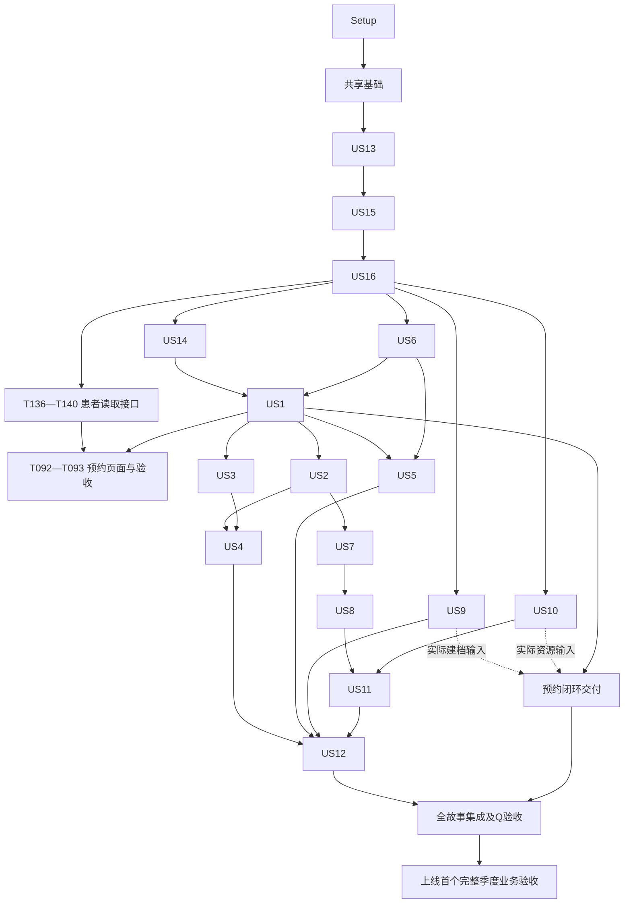

# Tasks: Andrew's Dental Chain（安德鲁牙科连锁管理系统）

创建日期：2026-11-07；依赖修订日期：2026-11-09。当前阶段（2026-11-10）：Implement 已获负责人明确授权并开始执行；任务完成状态以勾选及实际证据为准。当前记录见 [实施状态](../../docs/verification/implementation-status.md)及[授权输入指纹](implementation-authorization.json)。

**Input**：[Spec](spec.md)、[获批 Plan](plan.md)、[研究](research.md)、[业务模型](data-model.md)、[独立技术模型](technical-data-model.md)、[接口](contracts/api.md)、[身份](contracts/identity.md)、[操作目录](contracts/operations.md)、[OpenAPI](contracts/openapi.json)、[验证指南](quickstart.md)及[Constitution](../../.specify/memory/constitution.md)。原始资料导航沿用[既有追踪矩阵](traceability.md)。

**基线**：ADC-PLAN-20261107-01。原批准记录及其指纹保留；当前文档已按后续授权同步状态，并按 [ADC-PLAN-20261109-DEP01](plan-dependency-amendment.md) 更新依赖版本。变更前后指纹独立登记，不将现行Plan声明为与最初批准文件逐字相同。既有批准记录中的“未生成 Tasks”是批准时点记录，不改写历史。系统范围是 UC01—UC08（保留 UC01-S1—S5）、SF01—SF04、Q01—Q09；MVP 只定义交付顺序，不删减系统范围。

**Tests**：Constitution 第 V 原则及 Spec 明确要求核心自动化和真实数据库验证，故包含契约、领域、MySQL 集成、E2E、安全、性能与恢复任务。所有数据虚构，环境隔离；代码路径为未来产物，当前未创建业务代码/DDL/部署文件，未执行业务测试。

## Format 与执行规则

每行格式为 `- [ ] Tnnn [P?] [USn?] 描述及精确路径`。编号是稳定追踪标识，文档仍按原优先级分组；依赖任务必须先完成，不能直接按编号执行。未标 [P] 的任务按下方实际执行顺序串行执行。标 [P] 的任务只有在所列前置均完成后才可同时执行，且不得并发修改同一文件；标记不是本轮启动代理或实施的授权。所有路径相对仓库根目录。

原优先级不变：先列 P1，再 P2，最后 P3；P1 可用受控测试夹具验证规则。真正可交付的预约闭环必须有 P2 的 US9/US10 提供患者/资源入口；并行实施时可在身份/权限就绪后提前执行这两个独立分支，不能把合法夹具当上线数据维护能力。

每个故事先完成测试编写，再实现领域→应用→接口→前端→验收。完成实现任务不等于完成故事验收；仅在相应证据真实通过后勾选验证任务。C-03 是必要工具验证；C-04 身份架构已批准，真实配置联调是实施工作；C-05 是云资源、性能、恢复实施/验收。C-01 已完成、C-06 非产品课程事项已移出，不再形成待办。TD-01 仅在生产治理/清理启用前确认既有未定期限，不能编造政策。

## 阶段门禁

按 Constitution 第 VI 原则及批准 Plan 执行 **Tasks → Analyze → 项目负责人对具体版本审核 → Implement**。

- 生成时点：2026-11-07 生成 Tasks 时未执行 Analyze；下文任务生成阶段的 Constitution 检查属于该时点的历史记录。
- 已完成的分析：2026-11-09 已完成依赖修订后的只读 Analyze，I1（预约页面/验收的 PatientView 前置）与 I2（真实微信联调的 HTTPS 环境前置）均已关闭。该次复核对应修订后 Tasks SHA-256：`11d82847c1ad69a17b4789f4b15ecbb693f073932b10bfc7e163653c8b2b33d6`；本次仅同步状态描述，任务内容及依赖不变。
- 历史状态（2026-11-09）：**等待项目负责人对具体版本审核，尚未授权 Implement**。当时 Plan 批准、任务修订授权及 Analyze 完成均不替代实施审核；全部实施任务尚未开始。
- 当前状态（2026-11-10）：负责人已明确要求启动并继续 `speckit-implement`。按 [implementation-authorization.json](implementation-authorization.json) 中冻结的输入指纹执行；本次授权不构成生产发布许可，不将既有 Analyze 记录改写为新的分析。T001 起按实际依赖顺序验证，未经实际验收不勾选。

数据库表计数严格分离：adc_business 19表/163字段/30FK；adc_identity 13技术表、adc_audit 1技术表，共14表/110字段/19纯技术FK/12项APP引用；原ERD仅为业务ERD。原业务图不加技术表，原 adc_control/meta 职责归 RequestReceipt/Flyway 历史，不增独立schema。对已批准设计发现实际冲突须报告并走变更流程，不能借任务实现静默修表。

## Phase 1 — Setup：项目初始化

目标：按已批准的版本建立可重复构建、隔离开发环境、契约校验和虚构测试数据工具；本清单中的代码路径均为未来产物。

- [X] T001 锁定 Java 21、Spring Boot 4.1.2、MyBatis Starter 4.1.0（传递依赖 MyBatis-Spring 4.1.0、MyBatis 核心 3.5.19）、Maven 3.9.16；配置 Wrapper 与 BOM 管理的 Security、Connector/J、Flyway、JUnit、Testcontainers，执行依赖解析和最小构建，保存准确版本及兼容证据；失败记录问题，不静默替换获批技术栈。 按 ADC-PLAN-20261109-DEP01，使用 Spring Boot 4.1.2 parent/BOM 管理 Spring 依赖；核对 effective POM、dependency tree 中 MyBatis-Spring 4.1.0/MyBatis 3.5.19 及 Spring 依赖无版本混配，记录依赖解析、最小启动和映射器加载结果。Java 21 的发行版补丁及镜像摘要在本任务锁定。官方版本线支持不代替本项目实测。 文件：`backend/pom.xml`、`backend/mvnw`、`backend/mvnw.cmd`、`docs/verification/build-environment.md`。

- [X] T002 配置 Windows/JDK 或 WSL2 与 Docker Desktop Linux 容器开发入口；验证 Docker 服务端、Testcontainers 连通性，初始化 MySQL 8.4/InnoDB、lower_case_table_names=0、UTC，隔离持久卷和虚构数据；不得把仅发现客户端当作可运行。 文件：`ops/compose/compose.dev.yaml`、`ops/runbooks/local-development.md`。 依赖：T001。

- [X] T003 [P] 初始化 Vue 3.5、TypeScript 5.9、Vite 8.3、Node 24 LTS（≥24.12）、Router、Pinia、Element Plus 2、Vitest 5/Playwright 1；锁文件、类型检查、构建及路由壳可运行。 文件：`apps/admin/package.json`、`apps/admin/package-lock.json`、`apps/admin/src/main.ts`。 依赖：T001。

- [X] T004 [P] 初始化原生微信 TypeScript/WXML/WXSS 小程序、开发工具配置和类型检查；环境配置只含公开标识，AppSecret 始终在服务端。 文件：`apps/patient-miniprogram/project.config.json`、`apps/patient-miniprogram/miniprogram/app.ts`、`apps/patient-miniprogram/tsconfig.json`。 依赖：T001。

- [X] T005 为已批准 OpenAPI 3.1.1 建立标准验证器、引用/载荷/错误语义校验与双端 DTO 生成及漂移检查，覆盖全部 81 operations；ID/DECIMAL 用字符串，If-Match/请求键/错误码严格继承契约；输出到 packages/contracts，不修改冻结的契约源。 文件：`packages/contracts/package.json`、`packages/contracts/src/generated.ts`、`packages/contracts/scripts/validate.mjs`。 依赖：T003, T004。

- [X] T006 建立 JUnit/Testcontainers MySQL 8.4、前端测试与证据约定；虚构患者、独立员工身份/岗位/诊所及各状态夹具，夹具仅在隔离测试使用；定义 AC→步骤→预期/实际→环境/版本/核验人记录格式。 文件：`backend/src/test/resources/fixtures/adc-fictional.json`、`backend/src/test/java/com/adc/support/MySqlFixture.java`、`tests/e2e/fixtures.ts`、`docs/verification/README.md`。 依赖：T002, T005。

- [X] T007 完成 C-03：用专用工具解析/渲染既有 PlantUML、Mermaid、DBML 及技术模型，检查图面和语义并与正式 Word 嵌图核对；保存工具版本、差异和采用结论；输出到独立证据目录，不覆盖正式图或据重建图改需求。 文件：`docs/verification/models/c03-validation.md`、`tools/verification/check-models.ps1`。 依赖：T006。

**Checkpoint**：本阶段任务和适用验证完成，并保存实际证据；任何失败保持对应任务未完成。

## Phase 2 — Foundational：共享数据与安全基础

阻塞门禁：本阶段全部完成后再开始用户故事。DDL、映射器及只读仓储先建立；各业务写流程仍归相应故事。跨故事独立验证使用测试夹具，不将夹具入口部署至生产。字段引用按原字典逐字保留；组合唯一成员不得各自建单列唯一。

- [ ] T008 先建立真实 MySQL 结构与权限验收：逐字段比较原 Word 审核清单/schema.json、PK/UK/30 FK/CHECK 及 19/163 基线；技术 14 表/110 字段/19 FK/12 APP 引用逐项核对；检查无隐式框架表、业务隐藏列、adc_control/adc_meta schema；迁移历史按 Flyway 版本核验。 本任务只编写结构/权限测试、基线断言和测试夹具定义；数据库尚未建立时不要求运行测试通过，未建表的预期失败不构成实现阻塞。完成条件为测试准备就绪；实际迁移与结构/权限运行验收在 T043 执行。 文件：`backend/src/test/java/com/adc/infrastructure/SchemaBaselineIT.java`、`backend/src/test/java/com/adc/infrastructure/DatabasePrivilegesIT.java`。 依赖：T007。 验收：AC-G04。

- [ ] T009 实现独立迁移容器入口、三个 schema 初始化与最小权限；defaultSchema=adc_identity、createSchemas=false、cleanDisabled=true，业务 DDL 全限定表名，运行时禁自动 DDL/Flyway；runtime 审计仅 INSERT/SELECT，迁移历史只读；说明 MySQL DDL 非事务回滚及失败恢复。 文件：`ops/compose/compose.migrate.yaml`、`ops/compose/mysql/bootstrap.sql`、`ops/runbooks/database-migrations.md`、`backend/src/main/resources/application.yaml`。 依赖：T008。

- [ ] T010 建立 adc_business.Patient 的原样建表迁移及显式 Java/MyBatis 字段映射和只读仓储；外键统一在所有目标表创建后由后续任务添加。原字段六元组（字段/类型/PK/FK/可空/唯一）逐字引用：`| patient_id | BIGINT | Yes | No | NOT NULL | UNIQUE |`；`| patient_number | VARCHAR(30) | No | No | NOT NULL | UNIQUE |`；`| full_name | VARCHAR(100) | No | No | NOT NULL | - |`；`| date_of_birth | DATE | No | No | NOT NULL | - |`；`| billing_address | VARCHAR(255) | No | No | NOT NULL | - |`；`| phone | VARCHAR(30) | No | No | NOT NULL | - |`；`| email | VARCHAR(254) | No | No | NULL | - |`；`| emergency_contact_name | VARCHAR(100) | No | No | NOT NULL | - |`；`| emergency_contact_phone | VARCHAR(30) | No | No | NOT NULL | - |`；`| created_at | TIMESTAMP | No | No | NOT NULL | - |`；`| updated_at | TIMESTAMP | No | No | NOT NULL | - |`；`| allergy_review_status | VARCHAR(20) | No | No | NOT NULL | - |`。原模型规则引用：适用：UC01、UC05；SF02 只核验读取。长期患者身份、联系资料及过敏确认。patient_number 为业务编号，patient_id 为存储主键；phone 不是唯一身份键。姓名、出生日期、账单地址、电话及紧急联系人姓名/电话必填，邮箱可空。 文件：`backend/src/main/resources/db/migration/V001__create_Patient.sql`、`backend/src/main/java/com/adc/domain/model/Patient.java`、`backend/src/main/resources/mappers/PatientMapper.xml`。 依赖：T009。

- [ ] T011 建立 adc_business.Allergy 的原样建表迁移及显式 Java/MyBatis 字段映射和只读仓储；外键统一在所有目标表创建后由后续任务添加。原字段六元组（字段/类型/PK/FK/可空/唯一）逐字引用：`| allergy_id | BIGINT | Yes | No | NOT NULL | UNIQUE |`；`| allergy_name | VARCHAR(100) | No | No | NOT NULL | UNIQUE |`；`| description | VARCHAR(255) | No | No | NULL | - |`；`| is_active | BOOLEAN | No | No | NOT NULL | - |`。原模型规则引用：适用：UC06 写目录；UC01/UC05 读取。总部维护共享过敏目录；前台只选择合法目录项或提新增申请。停用不删除历史关联。 文件：`backend/src/main/resources/db/migration/V002__create_Allergy.sql`、`backend/src/main/java/com/adc/domain/model/Allergy.java`、`backend/src/main/resources/mappers/AllergyMapper.xml`。 依赖：T009。

- [ ] T012 建立 adc_business.PatientAllergy 的原样建表迁移及显式 Java/MyBatis 字段映射和只读仓储；外键统一在所有目标表创建后由后续任务添加。原字段六元组（字段/类型/PK/FK/可空/唯一）逐字引用：`| patient_id | BIGINT | Yes | Patient.patient_id | NOT NULL | UNIQUE(组合) |`；`| allergy_id | BIGINT | Yes | Allergy.allergy_id | NOT NULL | UNIQUE(组合) |`；`| noted_at | TIMESTAMP | No | No | NOT NULL | - |`；`| severity_note | VARCHAR(100) | No | No | NULL | - |`；`| clinical_note | VARCHAR(255) | No | No | NULL | - |`；`| is_retracted | BOOLEAN | No | No | NOT NULL | - |`；`| audit_history | JSON | No | No | NOT NULL | - |`；`| updated_at | TIMESTAMP | No | No | NOT NULL | - |`。原模型规则引用：适用：UC05；UC01/UC03 风险资料读取。患者与过敏症的复合关联；当前程度、临床备注和撤销状态支持临床查阅，audit_history 追加原值、新值、核实人、时间与原因。撤销误记不物理删除。 复合主键及组合唯一为 (patient_id,allergy_id)。 文件：`backend/src/main/resources/db/migration/V003__create_PatientAllergy.sql`、`backend/src/main/java/com/adc/domain/model/PatientAllergy.java`、`backend/src/main/resources/mappers/PatientAllergyMapper.xml`。 依赖：T009。

- [ ] T013 建立 adc_business.Clinic 的原样建表迁移及显式 Java/MyBatis 字段映射和只读仓储；外键统一在所有目标表创建后由后续任务添加。原字段六元组（字段/类型/PK/FK/可空/唯一）逐字引用：`| clinic_id | BIGINT | Yes | No | NOT NULL | UNIQUE |`；`| clinic_code | VARCHAR(20) | No | No | NOT NULL | UNIQUE |`；`| postal_address | VARCHAR(255) | No | No | NOT NULL | - |`；`| manager_name | VARCHAR(100) | No | No | NULL | - |`；`| phone | VARCHAR(30) | No | No | NOT NULL | - |`；`| email | VARCHAR(254) | No | No | NULL | - |`；`| office_area_sqm | DECIMAL(8,2) | No | No | NULL | - |`；`| is_active | BOOLEAN | No | No | NOT NULL | - |`；`| created_at | TIMESTAMP | No | No | NOT NULL | - |`。原模型规则引用：适用：UC06；UC01/UC02/UC07/UC08 读取。统一诊所资料和地点范围。诊所业务资料不存员工角色、授权、支付渠道或季度封账新字段。 文件：`backend/src/main/resources/db/migration/V004__create_Clinic.sql`、`backend/src/main/java/com/adc/domain/model/Clinic.java`、`backend/src/main/resources/mappers/ClinicMapper.xml`。 依赖：T009。

- [ ] T014 建立 adc_business.Dentist 的原样建表迁移及显式 Java/MyBatis 字段映射和只读仓储；外键统一在所有目标表创建后由后续任务添加。原字段六元组（字段/类型/PK/FK/可空/唯一）逐字引用：`| dentist_id | BIGINT | Yes | No | NOT NULL | UNIQUE |`；`| employee_number | VARCHAR(30) | No | No | NOT NULL | UNIQUE |`；`| full_name | VARCHAR(100) | No | No | NOT NULL | - |`；`| date_of_birth | DATE | No | No | NOT NULL | - |`；`| home_address | VARCHAR(255) | No | No | NULL | - |`；`| phone | VARCHAR(30) | No | No | NOT NULL | - |`；`| email | VARCHAR(254) | No | No | NULL | - |`；`| hire_date | DATE | No | No | NOT NULL | - |`；`| is_active | BOOLEAN | No | No | NOT NULL | - |`；`| created_at | TIMESTAMP | No | No | NOT NULL | - |`；`| termination_date | DATE | No | No | NULL | - |`。原模型规则引用：适用：UC06；UC01/UC02/UC03/UC07/UC08 读取。牙医业务身份、联系方式及任职资料。员工号与存储主键分离；非牙医前台、收费和总部员工不为登录写入本表。hire_date/termination_date 决定核算任职范围，离职日计入。 文件：`backend/src/main/resources/db/migration/V005__create_Dentist.sql`、`backend/src/main/java/com/adc/domain/model/Dentist.java`、`backend/src/main/resources/mappers/DentistMapper.xml`。 依赖：T009。

- [ ] T015 建立 adc_business.Qualification 的原样建表迁移及显式 Java/MyBatis 字段映射和只读仓储；外键统一在所有目标表创建后由后续任务添加。原字段六元组（字段/类型/PK/FK/可空/唯一）逐字引用：`| qualification_id | BIGINT | Yes | No | NOT NULL | UNIQUE |`；`| qualification_name | VARCHAR(120) | No | No | NOT NULL | UNIQUE |`；`| description | VARCHAR(255) | No | No | NULL | - |`；`| is_active | BOOLEAN | No | No | NOT NULL | - |`。原模型规则引用：适用：UC06；UC01/UC03/UC08 读取。统一专业资质目录；目录名称唯一。目录是否可用不能替代牙医证书核验和具体日期有效性。 文件：`backend/src/main/resources/db/migration/V006__create_Qualification.sql`、`backend/src/main/java/com/adc/domain/model/Qualification.java`、`backend/src/main/resources/mappers/QualificationMapper.xml`。 依赖：T009。

- [ ] T016 建立 adc_business.DentistQualification 的原样建表迁移及显式 Java/MyBatis 字段映射和只读仓储；外键统一在所有目标表创建后由后续任务添加。原字段六元组（字段/类型/PK/FK/可空/唯一）逐字引用：`| dentist_id | BIGINT | Yes | Dentist.dentist_id | NOT NULL | UNIQUE(组合) |`；`| qualification_id | BIGINT | Yes | Qualification.qualification_id | NOT NULL | UNIQUE(组合) |`；`| certificate_number | VARCHAR(60) | No | No | NOT NULL | - |`；`| granted_date | DATE | No | No | NOT NULL | - |`；`| expiry_date | DATE | No | No | NULL | - |`；`| verification_status | VARCHAR(20) | No | No | NOT NULL | - |`。原模型规则引用：适用：UC06 写；UC01/UC03/UC08 读取。牙医资质关联及证书事实。只有 VERIFIED 且在业务当日有效的必需资质满足匹配；证书续期的旧日期及核验依据追加到独立审计，不新增业务历史表或字段。 复合主键及组合唯一为 (dentist_id,qualification_id)。 文件：`backend/src/main/resources/db/migration/V007__create_DentistQualification.sql`、`backend/src/main/java/com/adc/domain/model/DentistQualification.java`、`backend/src/main/resources/mappers/DentistQualificationMapper.xml`。 依赖：T009。

- [ ] T017 建立 adc_business.DentistClinicAssignment 的原样建表迁移及显式 Java/MyBatis 字段映射和只读仓储；外键统一在所有目标表创建后由后续任务添加。原字段六元组（字段/类型/PK/FK/可空/唯一）逐字引用：`| assignment_id | BIGINT | Yes | No | NOT NULL | UNIQUE |`；`| dentist_id | BIGINT | No | Dentist.dentist_id | NOT NULL | - |`；`| clinic_id | BIGINT | No | Clinic.clinic_id | NOT NULL | - |`；`| start_date | DATE | No | No | NOT NULL | - |`；`| end_date | DATE | No | No | NULL | - |`；`| availability_note | VARCHAR(255) | No | No | NULL | - |`；`| is_active | BOOLEAN | No | No | NOT NULL | - |`。原模型规则引用：适用：UC06；UC02/UC01/UC03/UC07/UC08 读取。以起止日期表达随时间变化的牙医—诊所执业关系；保留 is_active 原字段，但不得只看布尔值而忽略日期。 文件：`backend/src/main/resources/db/migration/V008__create_DentistClinicAssignment.sql`、`backend/src/main/java/com/adc/domain/model/DentistClinicAssignment.java`、`backend/src/main/resources/mappers/DentistClinicAssignmentMapper.xml`。 依赖：T009。

- [ ] T018 建立 adc_business.DentistSchedule 的原样建表迁移及显式 Java/MyBatis 字段映射和只读仓储；外键统一在所有目标表创建后由后续任务添加。原字段六元组（字段/类型/PK/FK/可空/唯一）逐字引用：`| schedule_id | BIGINT | Yes | No | NOT NULL | UNIQUE |`；`| dentist_id | BIGINT | No | Dentist.dentist_id | NOT NULL | UNIQUE(条件组合) |`；`| clinic_id | BIGINT | No | Clinic.clinic_id | NOT NULL | - |`；`| schedule_date | DATE | No | No | NOT NULL | UNIQUE(条件组合) |`；`| start_time | TIME | No | No | NOT NULL | UNIQUE(条件组合) |`；`| end_time | TIME | No | No | NOT NULL | - |`；`| slot_minutes | SMALLINT | No | No | NOT NULL | - |`；`| schedule_status | VARCHAR(20) | No | No | NOT NULL | - |`；`| note | VARCHAR(255) | No | No | NULL | - |`；`| created_at | TIMESTAMP | No | No | NOT NULL | - |`。原模型规则引用：适用：UC02；UC01/UC07/UC08 读取。牙医在诊所某日的半开班次及固定时隙粒度。仅 NORMAL 的 (dentist_id,schedule_date,start_time) 条件唯一；SUSPENDED 历史可有多版，不参与该唯一与重叠校验。被引用后只挂起，不覆盖归属、日期、时段或粒度。 仅 schedule_status=NORMAL 时，(dentist_id,schedule_date,start_time) 唯一；SUSPENDED 历史不受该条件约束。 文件：`backend/src/main/resources/db/migration/V009__create_DentistSchedule.sql`、`backend/src/main/java/com/adc/domain/model/DentistSchedule.java`、`backend/src/main/resources/mappers/DentistScheduleMapper.xml`。 依赖：T009。

- [ ] T019 建立 adc_business.Treatment 的原样建表迁移及显式 Java/MyBatis 字段映射和只读仓储；外键统一在所有目标表创建后由后续任务添加。原字段六元组（字段/类型/PK/FK/可空/唯一）逐字引用：`| treatment_id | BIGINT | Yes | No | NOT NULL | UNIQUE |`；`| treatment_code | VARCHAR(30) | No | No | NOT NULL | UNIQUE |`；`| treatment_name | VARCHAR(120) | No | No | NOT NULL | - |`；`| description | VARCHAR(255) | No | No | NULL | - |`；`| default_unit_price | DECIMAL(12,2) | No | No | NOT NULL | - |`；`| is_active | BOOLEAN | No | No | NOT NULL | - |`。原模型规则引用：适用：UC06 写目录；UC01/UC03/UC04/UC08 读取。统一检查、咨询及治疗目录与默认单位价。零价实际项目允许；调价只影响之后新建实际治疗，原表不增加货币浮点值或单位扩展字段。 文件：`backend/src/main/resources/db/migration/V010__create_Treatment.sql`、`backend/src/main/java/com/adc/domain/model/Treatment.java`、`backend/src/main/resources/mappers/TreatmentMapper.xml`。 依赖：T009。

- [ ] T020 建立 adc_business.TreatmentQualification 的原样建表迁移及显式 Java/MyBatis 字段映射和只读仓储；外键统一在所有目标表创建后由后续任务添加。原字段六元组（字段/类型/PK/FK/可空/唯一）逐字引用：`| treatment_id | BIGINT | Yes | Treatment.treatment_id | NOT NULL | UNIQUE(组合) |`；`| qualification_id | BIGINT | Yes | Qualification.qualification_id | NOT NULL | UNIQUE(组合) |`；`| is_mandatory | BOOLEAN | No | No | NOT NULL | - |`。原模型规则引用：适用：UC06；UC01/UC03/UC08 读取。治疗所需资质的复合关联，is_mandatory 区分必需及展示性资质；至少缺一项必需资质即不匹配。 复合主键及组合唯一为 (treatment_id,qualification_id)。 文件：`backend/src/main/resources/db/migration/V011__create_TreatmentQualification.sql`、`backend/src/main/java/com/adc/domain/model/TreatmentQualification.java`、`backend/src/main/resources/mappers/TreatmentQualificationMapper.xml`。 依赖：T009。

- [ ] T021 建立 adc_business.Appointment 的原样建表迁移及显式 Java/MyBatis 字段映射和只读仓储；外键统一在所有目标表创建后由后续任务添加。原字段六元组（字段/类型/PK/FK/可空/唯一）逐字引用：`| appointment_id | BIGINT | Yes | No | NOT NULL | UNIQUE |`；`| patient_id | BIGINT | No | Patient.patient_id | NOT NULL | - |`；`| clinic_id | BIGINT | No | Clinic.clinic_id | NOT NULL | - |`；`| dentist_id | BIGINT | No | Dentist.dentist_id | NOT NULL | - |`；`| schedule_id | BIGINT | No | DentistSchedule.schedule_id | NOT NULL | - |`；`| scheduled_at | TIMESTAMP | No | No | NOT NULL | - |`；`| status | VARCHAR(20) | No | No | NOT NULL | - |`；`| problems_or_special_needs | TEXT | No | No | NULL | - |`；`| completed_at | TIMESTAMP | No | No | NULL | - |`；`| created_at | TIMESTAMP | No | No | NOT NULL | - |`；`| updated_at | TIMESTAMP | No | No | NOT NULL | - |`；`| attended_at | TIMESTAMP | No | No | NULL | - |`；`| cancelled_at | TIMESTAMP | No | No | NULL | - |`；`| cancellation_reason | VARCHAR(255) | No | No | NULL | - |`；`| cancellation_kind | VARCHAR(30) | No | No | NULL | - |`；`| rescheduled_from_id | BIGINT | No | Appointment.appointment_id | NULL | UNIQUE |`。原模型规则引用：适用：UC01-S1—S5、UC03、UC04；UC08 读取。同一次预约/到诊/诊疗/开票的生命周期载体。创建时 patient_id、clinic_id、dentist_id、schedule_id 与班次一致并冻结归属；attended_at 派生到诊标记。取消分类独立于五状态，改约通过 rescheduled_from_id 新建后继，不恢复旧对象。 文件：`backend/src/main/resources/db/migration/V012__create_Appointment.sql`、`backend/src/main/java/com/adc/domain/model/Appointment.java`、`backend/src/main/resources/mappers/AppointmentMapper.xml`。 依赖：T009。

- [ ] T022 建立 adc_business.AppointmentRequestedTreatment 的原样建表迁移及显式 Java/MyBatis 字段映射和只读仓储；外键统一在所有目标表创建后由后续任务添加。原字段六元组（字段/类型/PK/FK/可空/唯一）逐字引用：`| appointment_id | BIGINT | Yes | Appointment.appointment_id | NOT NULL | UNIQUE(组合) |`；`| treatment_id | BIGINT | Yes | Treatment.treatment_id | NOT NULL | UNIQUE(组合) |`；`| request_note | VARCHAR(255) | No | No | NULL | - |`。原模型规则引用：适用：UC01-S1/S5。预约时的期望项目集合及备注，仅表达意向，不可替代实际治疗、费用明细或收入。 复合主键及组合唯一为 (appointment_id,treatment_id)。 文件：`backend/src/main/resources/db/migration/V013__create_AppointmentRequestedTreatment.sql`、`backend/src/main/java/com/adc/domain/model/AppointmentRequestedTreatment.java`、`backend/src/main/resources/mappers/AppointmentRequestedTreatmentMapper.xml`。 依赖：T009。

- [ ] T023 建立 adc_business.AppliedTreatment 的原样建表迁移及显式 Java/MyBatis 字段映射和只读仓储；外键统一在所有目标表创建后由后续任务添加。原字段六元组（字段/类型/PK/FK/可空/唯一）逐字引用：`| applied_treatment_id | BIGINT | Yes | No | NOT NULL | UNIQUE |`；`| appointment_id | BIGINT | No | Appointment.appointment_id | NOT NULL | - |`；`| treatment_id | BIGINT | No | Treatment.treatment_id | NOT NULL | - |`；`| dentist_id | BIGINT | No | Dentist.dentist_id | NOT NULL | - |`；`| standard_units | DECIMAL(10,2) | No | No | NOT NULL | - |`；`| unit_price | DECIMAL(12,2) | No | No | NOT NULL | - |`；`| subtotal | DECIMAL(14,2) | No | No | NOT NULL | - |`；`| performed_at | TIMESTAMP | No | No | NOT NULL | - |`。原模型规则引用：适用：UC03 写；UC04/UC07/UC08 读取。实际诊疗事实：实际实施者、实施时间、正标准单位数及冻结历史单位价。实施牙医可不同于预约责任牙医；收入经开票明细逐项归本项实施者。 文件：`backend/src/main/resources/db/migration/V014__create_AppliedTreatment.sql`、`backend/src/main/java/com/adc/domain/model/AppliedTreatment.java`、`backend/src/main/resources/mappers/AppliedTreatmentMapper.xml`。 依赖：T009。

- [ ] T024 建立 adc_business.Invoice 的原样建表迁移及显式 Java/MyBatis 字段映射和只读仓储；外键统一在所有目标表创建后由后续任务添加。原字段六元组（字段/类型/PK/FK/可空/唯一）逐字引用：`| invoice_id | BIGINT | Yes | No | NOT NULL | UNIQUE |`；`| invoice_number | VARCHAR(40) | No | No | NOT NULL | UNIQUE |`；`| appointment_id | BIGINT | No | Appointment.appointment_id | NOT NULL | UNIQUE |`；`| issued_at | TIMESTAMP | No | No | NOT NULL | - |`；`| total_amount | DECIMAL(14,2) | No | No | NOT NULL | - |`；`| invoice_status | VARCHAR(20) | No | No | NOT NULL | - |`；`| created_at | TIMESTAMP | No | No | NOT NULL | - |`。原模型规则引用：适用：UC04 写；UC07/UC08 读取。每次完成就诊至多一张费用凭据，appointment_id 与 invoice_number 分别唯一。issued_at 决定开票收入归季，不代表收款或付款成功。 文件：`backend/src/main/resources/db/migration/V015__create_Invoice.sql`、`backend/src/main/java/com/adc/domain/model/Invoice.java`、`backend/src/main/resources/mappers/InvoiceMapper.xml`。 依赖：T009。

- [ ] T025 建立 adc_business.InvoiceItem 的原样建表迁移及显式 Java/MyBatis 字段映射和只读仓储；外键统一在所有目标表创建后由后续任务添加。原字段六元组（字段/类型/PK/FK/可空/唯一）逐字引用：`| invoice_item_id | BIGINT | Yes | No | NOT NULL | UNIQUE |`；`| invoice_id | BIGINT | No | Invoice.invoice_id | NOT NULL | UNIQUE(组合) |`；`| applied_treatment_id | BIGINT | No | AppliedTreatment.applied_treatment_id | NOT NULL | UNIQUE |`；`| line_number | INT | No | No | NOT NULL | UNIQUE(组合) |`；`| treatment_name | VARCHAR(120) | No | No | NOT NULL | - |`；`| standard_units | DECIMAL(10,2) | No | No | NOT NULL | - |`；`| unit_price | DECIMAL(12,2) | No | No | NOT NULL | - |`；`| subtotal | DECIMAL(14,2) | No | No | NOT NULL | - |`。原模型规则引用：适用：UC04 写；UC07/UC08 读取。逐项开票快照；每项实际治疗最多引用一次，每单行号唯一，且治疗属于该单的同次就诊。名称、单位数、历史价及小计随开票冻结。 组合唯一为 (invoice_id,line_number)；applied_treatment_id 另有非空单列唯一。 文件：`backend/src/main/resources/db/migration/V016__create_InvoiceItem.sql`、`backend/src/main/java/com/adc/domain/model/InvoiceItem.java`、`backend/src/main/resources/mappers/InvoiceItemMapper.xml`。 依赖：T009。

- [ ] T026 建立 adc_business.CostEntry 的原样建表迁移及显式 Java/MyBatis 字段映射和只读仓储；外键统一在所有目标表创建后由后续任务添加。原字段六元组（字段/类型/PK/FK/可空/唯一）逐字引用：`| cost_entry_id | BIGINT | Yes | No | NOT NULL | UNIQUE |`；`| dentist_id | BIGINT | No | Dentist.dentist_id | NULL | - |`；`| clinic_id | BIGINT | No | Clinic.clinic_id | NOT NULL | - |`；`| appointment_id | BIGINT | No | Appointment.appointment_id | NULL | - |`；`| applied_treatment_id | BIGINT | No | AppliedTreatment.applied_treatment_id | NULL | - |`；`| cost_type | VARCHAR(30) | No | No | NOT NULL | - |`；`| amount | DECIMAL(14,2) | No | No | NOT NULL | - |`；`| incurred_at | TIMESTAMP | No | No | NOT NULL | - |`；`| description | VARCHAR(255) | No | No | NULL | - |`；`| source_reference | VARCHAR(100) | No | No | NOT NULL | UNIQUE |`；`| source_batch | VARCHAR(60) | No | No | NOT NULL | - |`；`| confirmed_at | TIMESTAMP | No | No | NOT NULL | - |`；`| confirmed_by | VARCHAR(100) | No | No | NOT NULL | - |`；`| reversal_of_id | BIGINT | No | CostEntry.cost_entry_id | NULL | UNIQUE |`。原模型规则引用：适用：UC07 成本资料准备及核算。已核验的交易级医疗用品/运营成本事实。source_reference 防来源重复；确认后不覆盖，使用唯一等额反号冲销再补正确记录。普通零额凭证须说明已确认零成本范围。 文件：`backend/src/main/resources/db/migration/V017__create_CostEntry.sql`、`backend/src/main/java/com/adc/domain/model/CostEntry.java`、`backend/src/main/resources/mappers/CostEntryMapper.xml`。 依赖：T009。

- [ ] T027 建立 adc_business.QuarterlyPerformance 的原样建表迁移及显式 Java/MyBatis 字段映射和只读仓储；外键统一在所有目标表创建后由后续任务添加。原字段六元组（字段/类型/PK/FK/可空/唯一）逐字引用：`| quarterly_performance_id | BIGINT | Yes | No | NOT NULL | UNIQUE |`；`| dentist_id | BIGINT | No | Dentist.dentist_id | NOT NULL | UNIQUE(组合) |`；`| quarter_start | DATE | No | No | NOT NULL | UNIQUE(组合) |`；`| quarter_end | DATE | No | No | NOT NULL | UNIQUE(组合) |`；`| revenue | DECIMAL(14,2) | No | No | NULL | - |`；`| medical_supply_cost | DECIMAL(14,2) | No | No | NULL | - |`；`| operating_expense | DECIMAL(14,2) | No | No | NULL | - |`；`| net_profit | DECIMAL(14,2) | No | No | NULL | - |`；`| incentive_rate | DECIMAL(5,4) | No | No | NOT NULL | - |`；`| incentive_amount | DECIMAL(14,2) | No | No | NULL | - |`；`| calculation_status | VARCHAR(20) | No | No | NOT NULL | - |`；`| calculated_at | TIMESTAMP | No | No | NULL | - |`；`| calculation_version | INT | No | No | NOT NULL | UNIQUE(组合) |`；`| source_snapshot | JSON | No | No | NOT NULL | - |`；`| input_hash | CHAR(64) | No | No | NOT NULL | - |`；`| published_at | TIMESTAMP | No | No | NULL | - |`。原模型规则引用：适用：UC07；UC08 只读取合规版本。每牙医每季度的准备/计算及发布版本；金额可空不等于零。source_snapshot 保存原有封账确认、来源凭证、名单、R1 及完整分摊依据。input_hash 对输入而非结果计算。同人同季至多一个当前 PUBLISHED。 组合唯一为 (dentist_id,quarter_start,quarter_end,calculation_version)；它不等于当前 PUBLISHED 唯一，后者由发布事务另行保障。 文件：`backend/src/main/resources/db/migration/V018__create_QuarterlyPerformance.sql`、`backend/src/main/java/com/adc/domain/model/QuarterlyPerformance.java`、`backend/src/main/resources/mappers/QuarterlyPerformanceMapper.xml`。 依赖：T009。

- [ ] T028 建立 adc_business.AppointmentEvent 的原样建表迁移及显式 Java/MyBatis 字段映射和只读仓储；外键统一在所有目标表创建后由后续任务添加。原字段六元组（字段/类型/PK/FK/可空/唯一）逐字引用：`| appointment_event_id | BIGINT | Yes | No | NOT NULL | UNIQUE |`；`| appointment_id | BIGINT | No | Appointment.appointment_id | NOT NULL | UNIQUE(组合) |`；`| event_type | VARCHAR(30) | No | No | NOT NULL | UNIQUE(组合) |`；`| from_status | VARCHAR(20) | No | No | NULL | - |`；`| to_status | VARCHAR(20) | No | No | NOT NULL | - |`；`| occurred_at | TIMESTAMP | No | No | NOT NULL | - |`；`| actor_role | VARCHAR(30) | No | No | NOT NULL | - |`；`| actor_reference | VARCHAR(100) | No | No | NOT NULL | - |`；`| reason | VARCHAR(255) | No | No | NULL | - |`；`| request_key | VARCHAR(64) | No | No | NOT NULL | UNIQUE(组合) |`；`| details | JSON | No | No | NULL | - |`。原模型规则引用：适用：UC01-S1—S5、UC03 完成、UC04。只追加的生命周期事件；事件旧状态与主表实际旧状态一致，随主记录原子保存。事件组合唯一仅防同预约重复，不能单独覆盖首次创建幂等。 组合唯一为 (appointment_id,event_type,request_key)，不是跨预约的首次创建幂等键。 文件：`backend/src/main/resources/db/migration/V019__create_AppointmentEvent.sql`、`backend/src/main/java/com/adc/domain/model/AppointmentEvent.java`、`backend/src/main/resources/mappers/AppointmentEventMapper.xml`。 依赖：T009。

- [ ] T029 建立 adc_identity.Subject 迁移及显式技术记录映射；仅模型标为 FK 的关系随后添加数据库外键，APP 引用通过应用层校验，不加业务外键。逐字段约束原文（含类型/长度/可空/语义）：`{"name":"subject_id","type":"CHAR(36)","nullable":false,"foreign_key":null,"application_reference":null,"description":"服务端随机 UUID"}`；`{"name":"subject_type","type":"VARCHAR(16)","nullable":false,"foreign_key":null,"application_reference":null,"description":"PATIENT、STAFF、SYSTEM"}`；`{"name":"is_enabled","type":"BOOLEAN","nullable":false,"foreign_key":null,"application_reference":null,"description":"权威启用状态"}`；`{"name":"created_at","type":"TIMESTAMP(6)","nullable":false,"foreign_key":null,"application_reference":null,"description":"服务端创建时点"}`；`{"name":"disabled_at","type":"TIMESTAMP(6)","nullable":true,"foreign_key":null,"application_reference":null,"description":"停用时点"}`；primary_key=`["subject_id"]`；unique_keys=`[]`；constraints 原文：SYSTEM 仅内部受控作业/初始化上下文，不可通过公开登录接口取得；不是新增业务岗位。 文件：`backend/src/main/resources/db/migration/V101__create_Subject.sql`、`backend/src/main/java/com/adc/infrastructure/technical/SubjectRecord.java`。 依赖：T009。

- [ ] T030 建立 adc_identity.ExternalIdentity 迁移及显式技术记录映射；仅模型标为 FK 的关系随后添加数据库外键，APP 引用通过应用层校验，不加业务外键。逐字段约束原文（含类型/长度/可空/语义）：`{"name":"external_identity_id","type":"BIGINT","nullable":false,"foreign_key":null,"application_reference":null,"description":"技术代理主键"}`；`{"name":"subject_id","type":"CHAR(36)","nullable":false,"foreign_key":"FK:adc_identity.Subject.subject_id","application_reference":null,"description":"患者主体"}`；`{"name":"provider","type":"VARCHAR(32)","nullable":false,"foreign_key":null,"application_reference":null,"description":"首版固定 WECHAT_MINIPROGRAM"}`；`{"name":"appid","type":"VARBINARY(64)","nullable":false,"foreign_key":null,"application_reference":null,"description":"精确匹配服务端配置的 AppID"}`；`{"name":"openid","type":"VARBINARY(128)","nullable":false,"foreign_key":null,"application_reference":null,"description":"仅可信代码交换结果；精确字节匹配"}`；`{"name":"created_at","type":"TIMESTAMP(6)","nullable":false,"foreign_key":null,"application_reference":null,"description":"创建时点"}`；primary_key=`["external_identity_id"]`；unique_keys=`[["provider", "appid", "openid"], ["subject_id"]]`；constraints 原文：subject_id 单列唯一：首版一个患者主体只接一个真实小程序身份，避免把多个外部账号合并到同一主体绕过 Q1；同一外部账号换设备仍映射同一主体。不按 UnionID 自动合并。 文件：`backend/src/main/resources/db/migration/V102__create_ExternalIdentity.sql`、`backend/src/main/java/com/adc/infrastructure/technical/ExternalIdentityRecord.java`。 依赖：T009。

- [ ] T031 建立 adc_identity.StaffAccount 迁移及显式技术记录映射；仅模型标为 FK 的关系随后添加数据库外键，APP 引用通过应用层校验，不加业务外键。逐字段约束原文（含类型/长度/可空/语义）：`{"name":"subject_id","type":"CHAR(36)","nullable":false,"foreign_key":"FK:adc_identity.Subject.subject_id","application_reference":null,"description":"STAFF 主体"}`；`{"name":"username","type":"VARCHAR(100)","nullable":false,"foreign_key":null,"application_reference":null,"description":"个人登录名，技术库精确比较"}`；`{"name":"staff_reference","type":"VARCHAR(100)","nullable":false,"foreign_key":null,"application_reference":null,"description":"总部核实的工作人员依据"}`；`{"name":"dentist_id","type":"BIGINT","nullable":true,"foreign_key":null,"application_reference":"APP:adc_business.Dentist.dentist_id","description":"仅牙医身份适用；业务服务核实"}`；`{"name":"password_hash","type":"VARCHAR(255)","nullable":true,"foreign_key":null,"application_reference":null,"description":"成熟 Argon2id 编码含算法参数盐；无散列不能登录"}`；`{"name":"requires_reset","type":"BOOLEAN","nullable":false,"foreign_key":null,"application_reference":null,"description":"待安全设置凭据状态"}`；`{"name":"credential_changed_at","type":"TIMESTAMP(6)","nullable":true,"foreign_key":null,"application_reference":null,"description":"最近设置时点"}`；`{"name":"verification_reference","type":"VARCHAR(200)","nullable":false,"foreign_key":null,"application_reference":null,"description":"员工核验来源标识"}`；primary_key=`["subject_id"]`；unique_keys=`[["username"]]`；constraints 原文：username 明确使用大小写敏感的比较规则；初建无凭据时禁止登录，通过已授权 credential-recovery 设置。未规定每位 Dentist 的账号数量，不擅加 dentist_id UNIQUE。 文件：`backend/src/main/resources/db/migration/V103__create_StaffAccount.sql`、`backend/src/main/java/com/adc/infrastructure/technical/StaffAccountRecord.java`。 依赖：T009。

- [ ] T032 建立 adc_identity.Session 迁移及显式技术记录映射；仅模型标为 FK 的关系随后添加数据库外键，APP 引用通过应用层校验，不加业务外键。逐字段约束原文（含类型/长度/可空/语义）：`{"name":"session_id","type":"CHAR(36)","nullable":false,"foreign_key":null,"application_reference":null,"description":"会话主键"}`；`{"name":"subject_id","type":"CHAR(36)","nullable":false,"foreign_key":"FK:adc_identity.Subject.subject_id","application_reference":null,"description":"可信主体"}`；`{"name":"token_hash","type":"BINARY(32)","nullable":false,"foreign_key":null,"application_reference":null,"description":"32 随机字节令牌的 SHA-256 摘要"}`；`{"name":"client_type","type":"VARCHAR(16)","nullable":false,"foreign_key":null,"application_reference":null,"description":"服务端固定 WEB 或 WECHAT"}`；`{"name":"csrf_secret_hash","type":"BINARY(32)","nullable":true,"foreign_key":null,"application_reference":null,"description":"WEB 会话必须存在的防伪校验摘要"}`；`{"name":"created_at","type":"TIMESTAMP(6)","nullable":false,"foreign_key":null,"application_reference":null,"description":"绝对寿命起点"}`；`{"name":"last_activity_at","type":"TIMESTAMP(6)","nullable":false,"foreign_key":null,"application_reference":null,"description":"判过期后再刷新"}`；`{"name":"absolute_expires_at","type":"TIMESTAMP(6)","nullable":false,"foreign_key":null,"application_reference":null,"description":"创建后 8 小时"}`；`{"name":"revoked_at","type":"TIMESTAMP(6)","nullable":true,"foreign_key":null,"application_reference":null,"description":"注销/恢复/受控统一失效时点"}`；`{"name":"revoked_reason","type":"VARCHAR(128)","nullable":true,"foreign_key":null,"application_reference":null,"description":"失效原因"}`；primary_key=`["session_id"]`；unique_keys=`[["token_hash"]]`；constraints 原文：空闲达到30分钟或达到8小时绝对寿命拒绝；账号/绑定/授权不得从会话中的历史快照放行。 文件：`backend/src/main/resources/db/migration/V104__create_Session.sql`、`backend/src/main/java/com/adc/infrastructure/technical/SessionRecord.java`。 依赖：T009。

- [ ] T033 建立 adc_identity.LoginThrottle 迁移及显式技术记录映射；仅模型标为 FK 的关系随后添加数据库外键，APP 引用通过应用层校验，不加业务外键。逐字段约束原文（含类型/长度/可空/语义）：`{"name":"throttle_key","type":"BINARY(32)","nullable":false,"foreign_key":null,"application_reference":null,"description":"HMAC(认证域、规范化账号标识或服务端可信匿名来源)；不存明文错误凭据"}`；`{"name":"subject_id","type":"CHAR(36)","nullable":true,"foreign_key":"FK:adc_identity.Subject.subject_id","application_reference":null,"description":"账号可识别时关联；未知账号为空"}`；`{"name":"consecutive_failures","type":"INT","nullable":false,"foreign_key":null,"application_reference":null,"description":"未限制时连续有效认证失败次数"}`；`{"name":"blocked_until","type":"TIMESTAMP(6)","nullable":true,"foreign_key":null,"application_reference":null,"description":"第五次失败起15分钟"}`；`{"name":"last_failure_at","type":"TIMESTAMP(6)","nullable":true,"foreign_key":null,"application_reference":null,"description":"最近实际认证失败"}`；`{"name":"updated_at","type":"TIMESTAMP(6)","nullable":false,"foreign_key":null,"application_reference":null,"description":"计数更新时间"}`；primary_key=`["throttle_key"]`；unique_keys=`[]`；constraints 原文：计数>=0；成功认证清零；限制窗口内不验证/不延长窗口，到期后下一次尝试开启新计数。CSRF/格式拒绝不伪记密码失败。 文件：`backend/src/main/resources/db/migration/V105__create_LoginThrottle.sql`、`backend/src/main/java/com/adc/infrastructure/technical/LoginThrottleRecord.java`。 依赖：T009。

- [ ] T034 建立 adc_identity.BindingRequest 迁移及显式技术记录映射；仅模型标为 FK 的关系随后添加数据库外键，APP 引用通过应用层校验，不加业务外键。逐字段约束原文（含类型/长度/可空/语义）：`{"name":"request_id","type":"CHAR(36)","nullable":false,"foreign_key":null,"application_reference":null,"description":"服务端生成的申请标识"}`；`{"name":"applicant_subject_id","type":"CHAR(36)","nullable":false,"foreign_key":"FK:adc_identity.Subject.subject_id","application_reference":null,"description":"可信患者申请人"}`；`{"name":"patient_number_hint","type":"VARCHAR(30)","nullable":false,"foreign_key":null,"application_reference":null,"description":"申请人提交，核验前不可信"}`；`{"name":"date_of_birth_hint","type":"DATE","nullable":false,"foreign_key":null,"application_reference":null,"description":"最小核验线索，不是凭此自动绑定"}`；`{"name":"service_clinic_id","type":"BIGINT","nullable":false,"foreign_key":null,"application_reference":"APP:adc_business.Clinic.clinic_id","description":"申请服务点；不授前台或申请人任何范围"}`；`{"name":"candidate_patient_id","type":"BIGINT","nullable":true,"foreign_key":null,"application_reference":"APP:adc_business.Patient.patient_id","description":"授权前台核验时选择/确认"}`；`{"name":"status","type":"VARCHAR(16)","nullable":false,"foreign_key":null,"application_reference":null,"description":"PENDING、APPROVED；其他拒绝不造成功事实"}`；`{"name":"submitted_at","type":"TIMESTAMP(6)","nullable":false,"foreign_key":null,"application_reference":null,"description":"提交时点"}`；`{"name":"reviewed_by","type":"CHAR(36)","nullable":true,"foreign_key":"FK:adc_identity.Subject.subject_id","application_reference":null,"description":"核验前台"}`；`{"name":"reviewed_at","type":"TIMESTAMP(6)","nullable":true,"foreign_key":null,"application_reference":null,"description":"处理时点"}`；`{"name":"verification_basis","type":"JSON","nullable":true,"foreign_key":null,"application_reference":null,"description":"结构化核验结果、本人确认及本次服务依据"}`；`{"name":"reason","type":"VARCHAR(255)","nullable":true,"foreign_key":null,"application_reference":null,"description":"核验原因；不存身份证件影像"}`；primary_key=`["request_id"]`；unique_keys=`[]`；constraints 原文：PENDING 无核验结论；APPROVED 必须有目标患者/核验人/时点/依据。禁止 PATIENT 写 reviewed_by 或 verification_basis。拒绝接口仍返回失败并审计，不虚构未设计的拒绝待办路由。 文件：`backend/src/main/resources/db/migration/V106__create_BindingRequest.sql`、`backend/src/main/java/com/adc/infrastructure/technical/BindingRequestRecord.java`。 依赖：T009。

- [ ] T035 建立 adc_identity.CurrentPatientBinding 迁移及显式技术记录映射；仅模型标为 FK 的关系随后添加数据库外键，APP 引用通过应用层校验，不加业务外键。逐字段约束原文（含类型/长度/可空/语义）：`{"name":"subject_id","type":"CHAR(36)","nullable":false,"foreign_key":"FK:adc_identity.Subject.subject_id","application_reference":null,"description":"一主体至多一档案的 PK"}`；`{"name":"patient_id","type":"BIGINT","nullable":false,"foreign_key":null,"application_reference":"APP:adc_business.Patient.patient_id","description":"一档案至多一主体的 UNIQUE"}`；`{"name":"verified_by","type":"CHAR(36)","nullable":false,"foreign_key":"FK:adc_identity.Subject.subject_id","application_reference":null,"description":"实际人工核验前台"}`；`{"name":"verified_at","type":"TIMESTAMP(6)","nullable":false,"foreign_key":null,"application_reference":null,"description":"当前关系生效时点"}`；`{"name":"verification_reference","type":"VARCHAR(200)","nullable":false,"foreign_key":null,"application_reference":"APP:adc_identity.BindingRequest.request_id","description":"已批准申请；同事务建立批准事实"}`；primary_key=`["subject_id"]`；unique_keys=`[["patient_id"]]`；constraints 原文：双向至多一个有效绑定；新旧主体固定顺序锁、Patient 稳定行锁和 UNIQUE 冲突处理，禁止覆盖绑定。不物理删除 Patient 或 Subject。 文件：`backend/src/main/resources/db/migration/V107__create_CurrentPatientBinding.sql`、`backend/src/main/java/com/adc/infrastructure/technical/CurrentPatientBindingRecord.java`。 依赖：T009。

- [ ] T036 建立 adc_identity.BindingEvent 迁移及显式技术记录映射；仅模型标为 FK 的关系随后添加数据库外键，APP 引用通过应用层校验，不加业务外键。逐字段约束原文（含类型/长度/可空/语义）：`{"name":"event_id","type":"CHAR(36)","nullable":false,"foreign_key":null,"application_reference":null,"description":"历史事件"}`；`{"name":"action","type":"VARCHAR(16)","nullable":false,"foreign_key":null,"application_reference":null,"description":"BIND、REBIND、UNBIND"}`；`{"name":"patient_id","type":"BIGINT","nullable":false,"foreign_key":null,"application_reference":"APP:adc_business.Patient.patient_id","description":"被核验的业务患者"}`；`{"name":"old_subject_id","type":"CHAR(36)","nullable":true,"foreign_key":"FK:adc_identity.Subject.subject_id","application_reference":null,"description":"原主体"}`；`{"name":"new_subject_id","type":"CHAR(36)","nullable":true,"foreign_key":"FK:adc_identity.Subject.subject_id","application_reference":null,"description":"新主体"}`；`{"name":"operator_subject_id","type":"CHAR(36)","nullable":false,"foreign_key":"FK:adc_identity.Subject.subject_id","application_reference":null,"description":"可信前台"}`；`{"name":"binding_request_id","type":"CHAR(36)","nullable":true,"foreign_key":"FK:adc_identity.BindingRequest.request_id","application_reference":null,"description":"绑定/重绑必有；解绑可空"}`；`{"name":"occurred_at","type":"TIMESTAMP(6)","nullable":false,"foreign_key":null,"application_reference":null,"description":"可信时点"}`；`{"name":"reason","type":"VARCHAR(255)","nullable":false,"foreign_key":null,"application_reference":null,"description":"人工核验变更原因"}`；`{"name":"verification_basis","type":"JSON","nullable":false,"foreign_key":null,"application_reference":null,"description":"本人/原资料/服务依据核验结论"}`；`{"name":"request_key","type":"VARCHAR(64)","nullable":false,"foreign_key":null,"application_reference":"APP:adc_identity.RequestReceipt.request_key","description":"按主体与操作共同定位，不是单列 FK"}`；primary_key=`["event_id"]`；unique_keys=`[]`；constraints 原文：BIND 只有新主体；REBIND 新旧均有且不同；UNBIND 只有旧主体。只追加。不是 AppointmentEvent 的替代。 文件：`backend/src/main/resources/db/migration/V108__create_BindingEvent.sql`、`backend/src/main/java/com/adc/infrastructure/technical/BindingEventRecord.java`。 依赖：T009。

- [ ] T037 建立 adc_identity.AccessGrant 迁移及显式技术记录映射；仅模型标为 FK 的关系随后添加数据库外键，APP 引用通过应用层校验，不加业务外键。逐字段约束原文（含类型/长度/可空/语义）：`{"name":"grant_id","type":"CHAR(36)","nullable":false,"foreign_key":null,"application_reference":null,"description":"授权主键"}`；`{"name":"subject_id","type":"CHAR(36)","nullable":false,"foreign_key":"FK:adc_identity.Subject.subject_id","application_reference":null,"description":"被授权 STAFF"}`；`{"name":"role_code","type":"VARCHAR(24)","nullable":false,"foreign_key":null,"application_reference":null,"description":"RECEPTION、DENTIST、CASHIER、HEADQUARTERS"}`；`{"name":"granted_by","type":"CHAR(36)","nullable":false,"foreign_key":"FK:adc_identity.Subject.subject_id","application_reference":null,"description":"有权授予者"}`；`{"name":"valid_from","type":"TIMESTAMP(6)","nullable":false,"foreign_key":null,"application_reference":null,"description":"包含起点"}`；`{"name":"valid_until","type":"TIMESTAMP(6)","nullable":true,"foreign_key":null,"application_reference":null,"description":"不含终点；为空不表示免于撤权"}`；`{"name":"revoked_at","type":"TIMESTAMP(6)","nullable":true,"foreign_key":null,"application_reference":null,"description":"撤销事实"}`；`{"name":"revoked_by","type":"CHAR(36)","nullable":true,"foreign_key":"FK:adc_identity.Subject.subject_id","application_reference":null,"description":"撤销者"}`；`{"name":"reason","type":"VARCHAR(255)","nullable":false,"foreign_key":null,"application_reference":null,"description":"授权依据"}`；`{"name":"created_at","type":"TIMESTAMP(6)","nullable":false,"foreign_key":null,"application_reference":null,"description":"可信创建时点"}`；primary_key=`["grant_id"]`；unique_keys=`[]`；constraints 原文：结束晚于开始；revoked_at/revoked_by 同时存在或同时为空。无“诊所管理员”新角色；按原岗位和能力授予。 文件：`backend/src/main/resources/db/migration/V109__create_AccessGrant.sql`、`backend/src/main/java/com/adc/infrastructure/technical/AccessGrantRecord.java`。 依赖：T009。

- [ ] T038 建立 adc_identity.GrantClinicScope 迁移及显式技术记录映射；仅模型标为 FK 的关系随后添加数据库外键，APP 引用通过应用层校验，不加业务外键。逐字段约束原文（含类型/长度/可空/语义）：`{"name":"grant_id","type":"CHAR(36)","nullable":false,"foreign_key":"FK:adc_identity.AccessGrant.grant_id","application_reference":null,"description":"授权记录"}`；`{"name":"clinic_id","type":"BIGINT","nullable":false,"foreign_key":null,"application_reference":"APP:adc_business.Clinic.clinic_id","description":"应用验证真实诊所及可授范围"}`；primary_key=`["grant_id", "clinic_id"]`；unique_keys=`[]`；constraints 原文：逐项验证；无范围不能访问诊所业务。总部全链范围通过当前明确授予诊所集合表达；新增诊所不自动扩大旧授权。 文件：`backend/src/main/resources/db/migration/V110__create_GrantClinicScope.sql`、`backend/src/main/java/com/adc/infrastructure/technical/GrantClinicScopeRecord.java`。 依赖：T009。

- [ ] T039 建立 adc_identity.GrantCapability 迁移及显式技术记录映射；仅模型标为 FK 的关系随后添加数据库外键，APP 引用通过应用层校验，不加业务外键。逐字段约束原文（含类型/长度/可空/语义）：`{"name":"grant_id","type":"CHAR(36)","nullable":false,"foreign_key":"FK:adc_identity.AccessGrant.grant_id","application_reference":null,"description":"授权记录"}`；`{"name":"capability_code","type":"VARCHAR(80)","nullable":false,"foreign_key":null,"application_reference":null,"description":"服务端版本化能力注册表中的操作码"}`；primary_key=`["grant_id", "capability_code"]`；unique_keys=`[]`；constraints 原文：注册表属于代码配置，不增设动态角色/菜单管理业务；未知能力拒绝。角色相容性和操作者可授范围由应用验证。 文件：`backend/src/main/resources/db/migration/V111__create_GrantCapability.sql`、`backend/src/main/java/com/adc/infrastructure/technical/GrantCapabilityRecord.java`。 依赖：T009。

- [ ] T040 建立 adc_identity.RequestReceipt 迁移及显式技术记录映射；仅模型标为 FK 的关系随后添加数据库外键，APP 引用通过应用层校验，不加业务外键。逐字段约束原文（含类型/长度/可空/语义）：`{"name":"subject_id","type":"CHAR(36)","nullable":false,"foreign_key":"FK:adc_identity.Subject.subject_id","application_reference":null,"description":"可信主体"}`；`{"name":"operation_id","type":"VARCHAR(80)","nullable":false,"foreign_key":null,"application_reference":null,"description":"固定接口操作码"}`；`{"name":"request_key","type":"VARCHAR(64)","nullable":false,"foreign_key":null,"application_reference":null,"description":"调用方幂等键，不能作为身份"}`；`{"name":"content_hash","type":"BINARY(32)","nullable":false,"foreign_key":null,"application_reference":null,"description":"规范请求摘要，包含 If-Match"}`；`{"name":"request_id","type":"CHAR(36)","nullable":false,"foreign_key":null,"application_reference":null,"description":"服务端相关标识"}`；`{"name":"result_refs","type":"JSON","nullable":false,"foreign_key":null,"application_reference":"APP:adc_business.*","description":"受控类型化对象引用；也可指身份技术对象"}`；`{"name":"response_summary","type":"JSON","nullable":false,"foreign_key":null,"application_reference":null,"description":"最小结果；禁止凭据、令牌、完整临床内容"}`；`{"name":"response_status","type":"SMALLINT","nullable":false,"foreign_key":null,"application_reference":null,"description":"原成功响应状态"}`；`{"name":"created_at","type":"TIMESTAMP(6)","nullable":false,"foreign_key":null,"application_reference":null,"description":"请求建立时点"}`；`{"name":"completed_at","type":"TIMESTAMP(6)","nullable":false,"foreign_key":null,"application_reference":null,"description":"成功提交时点"}`；primary_key=`["subject_id", "operation_id", "request_key"]`；unique_keys=`[]`；constraints 原文：只持久化成功回执，与事实/事件/审计同事务；不预先独立提交 PENDING。先当前授权，再回执重放，再首次执行 If-Match/状态检查。同键不同内容拒绝。 文件：`backend/src/main/resources/db/migration/V112__create_RequestReceipt.sql`、`backend/src/main/java/com/adc/infrastructure/technical/RequestReceiptRecord.java`。 依赖：T009。

- [ ] T041 由获批 Flyway 工具创建并管理 adc_identity.flyway_schema_history，不手写替代表迁移；核对工具实际字段/索引与技术模型，记录版本；发现差异暂停相应迁移验收并走变更审核。逐字段约束原文（含类型/长度/可空/语义）：`{"name":"installed_rank","type":"INT","nullable":false,"foreign_key":null,"application_reference":null,"description":"工具序号 PK"}`；`{"name":"version","type":"VARCHAR(50)","nullable":true,"foreign_key":null,"application_reference":null,"description":"迁移版本"}`；`{"name":"description","type":"VARCHAR(200)","nullable":false,"foreign_key":null,"application_reference":null,"description":"迁移描述"}`；`{"name":"type","type":"VARCHAR(20)","nullable":false,"foreign_key":null,"application_reference":null,"description":"迁移类型"}`；`{"name":"script","type":"VARCHAR(1000)","nullable":false,"foreign_key":null,"application_reference":null,"description":"脚本标识"}`；`{"name":"checksum","type":"INT","nullable":true,"foreign_key":null,"application_reference":null,"description":"工具校验值"}`；`{"name":"installed_by","type":"VARCHAR(100)","nullable":false,"foreign_key":null,"application_reference":null,"description":"迁移账号"}`；`{"name":"installed_on","type":"TIMESTAMP","nullable":false,"foreign_key":null,"application_reference":null,"description":"工具默认 CURRENT_TIMESTAMP"}`；`{"name":"execution_time","type":"INT","nullable":false,"foreign_key":null,"application_reference":null,"description":"工具执行时间"}`；`{"name":"success","type":"BOOLEAN","nullable":false,"foreign_key":null,"application_reference":null,"description":"工具结果"}`；primary_key=`["installed_rank"]`；unique_keys=`[]`；constraints 原文：结构按 Flyway MySQL 官方实现核实；版本随已选 Boot BOM 锁定后以该版本工具输出再次核对，不手写/更改历史表。success 普通索引不是唯一键。运行账号无写入权限。 文件：`backend/src/test/java/com/adc/infrastructure/FlywayHistoryIT.java`。 依赖：T009。

- [ ] T042 建立 adc_audit.AuditEvent 迁移及显式技术记录映射；仅模型标为 FK 的关系随后添加数据库外键，APP 引用通过应用层校验，不加业务外键。逐字段约束原文（含类型/长度/可空/语义）：`{"name":"audit_id","type":"BIGINT","nullable":false,"foreign_key":null,"application_reference":null,"description":"技术代理主键"}`；`{"name":"subject_id","type":"CHAR(36)","nullable":true,"foreign_key":"FK:adc_identity.Subject.subject_id","application_reference":null,"description":"可识别主体；匿名认证失败为空"}`；`{"name":"actor_kind","type":"VARCHAR(16)","nullable":false,"foreign_key":null,"application_reference":null,"description":"SUBJECT、ANONYMOUS、SYSTEM"}`；`{"name":"action","type":"VARCHAR(80)","nullable":false,"foreign_key":null,"application_reference":null,"description":"动作码"}`；`{"name":"object_kind","type":"VARCHAR(48)","nullable":false,"foreign_key":null,"application_reference":null,"description":"业务或身份对象类型"}`；`{"name":"object_id","type":"VARCHAR(100)","nullable":true,"foreign_key":null,"application_reference":"APP:adc_business.*","description":"按 object_kind 解析的对象引用；可指技术对象"}`；`{"name":"clinic_scope","type":"JSON","nullable":false,"foreign_key":null,"application_reference":"APP:adc_business.Clinic.clinic_id","description":"可信诊所范围数组；不由客户自报"}`；`{"name":"occurred_at","type":"TIMESTAMP(6)","nullable":false,"foreign_key":null,"application_reference":null,"description":"可信发生时间"}`；`{"name":"request_id","type":"CHAR(36)","nullable":false,"foreign_key":null,"application_reference":"APP:adc_identity.RequestReceipt.request_id","description":"请求相关；拒绝/读取审计可能没有成功回执"}`；`{"name":"result","type":"VARCHAR(24)","nullable":false,"foreign_key":null,"application_reference":null,"description":"成功、拒绝或失败分类"}`；`{"name":"reason","type":"VARCHAR(255)","nullable":true,"foreign_key":null,"application_reference":null,"description":"必要原因，不能复制秘密"}`；`{"name":"change_summary","type":"JSON","nullable":true,"foreign_key":null,"application_reference":null,"description":"最小脱敏变更差异"}`；`{"name":"verification_reference","type":"VARCHAR(200)","nullable":true,"foreign_key":null,"application_reference":null,"description":"必要人工依据"}`；primary_key=`["audit_id"]`；unique_keys=`[]`；constraints 原文：仅审计授权总部读取；运行账号只按需 INSERT/SELECT，不能 UPDATE/DELETE。敏感读先持久化审计；规定成功写与事实同事务；失败审计在业务回滚后独立短事务。 文件：`backend/src/main/resources/db/migration/V114__create_AuditEvent.sql`、`backend/src/main/java/com/adc/infrastructure/technical/AuditEventRecord.java`。 依赖：T009。

- [ ] T043 在所有表就绪后添加原 30 条业务 FK、19 条纯技术 FK、普通及组合唯一/CHECK；逐条落实 D22—D24 和技术表约束，保留 12 项 APP 引用清单。DentistSchedule 的 NORMAL 条件唯一/不重叠、当前发布唯一交领域锁验证；不建立全局条件键、不新增生成列/业务表。运行结构与权限测试并导出 INFORMATION_SCHEMA/SHOW CREATE TABLE 比较结果。 先确认 T009 迁移入口与 T010—T042 的建表迁移/映射准备完成；在隔离 MySQL 实例实际执行全量建表及约束迁移，再运行 T008 编写的结构和权限测试。只有迁移成功且运行测试通过、证据保存后才能完成本任务；不得以 SQL 文件存在代替建表成功。 文件：`backend/src/main/resources/db/migration/V200__add_constraints.sql`、`docs/verification/database/baseline-comparison.json`。 依赖：T010, T011, T012, T013, T014, T015, T016, T017, T018, T019, T020, T021, T022, T023, T024, T025, T026, T027, T028, T029, T030, T031, T032, T033, T034, T035, T036, T037, T038, T039, T040, T041, T042。 验收：AC-G04。

- [ ] T044 建立精确金额、标识及业务时间映射：DECIMAL(p,s) 原精度、BigDecimal 及十进制字符串，超界/超精度拒绝；DATE/TIME 保持业务语义、时间点 UTC、Asia/Shanghai 半开季度；JSON 三字段原用途，NULL 不补零；真实 MySQL 验证大 ID、半分舍入、边界及时间往返。 文件：`backend/src/main/java/com/adc/domain/shared/Money.java`、`backend/src/main/java/com/adc/domain/shared/BusinessTime.java`、`backend/src/main/java/com/adc/infrastructure/mybatis/ExactValueTypeHandlers.java`、`backend/src/test/java/com/adc/infrastructure/ExactValueRoundTripIT.java`。 依赖：T043。 验收：AC-G06, AC-G07。

- [ ] T045 实现可信 Subject/会话及授权上下文读取、受保护写入口当前读稳定化、Subject 升序和绑定 Patient 锁；对象/本人/诊所/能力最小披露及默认拒绝；仅建立共享安全机制，账号/授权/绑定业务分别在 SF 完成。 文件：`backend/src/main/java/com/adc/identity/CurrentIdentityService.java`、`backend/src/main/java/com/adc/identity/AuthorizationService.java`、`backend/src/main/java/com/adc/identity/IdentityLockCoordinator.java`。 依赖：T044。

- [ ] T046 先编写真实 MySQL 多连接测试：统一锁序、首次空集合竞争、跨 schema 同连接提交、所有步骤故障注入、权限撤销竞态、命名锁提交后释放与连接池逐出；同键同内容/不同内容、超时未知及 If-Match 重放顺序不可退化为进程锁。 文件：`backend/src/test/java/com/adc/infrastructure/AtomicCommandIT.java`、`backend/src/test/java/com/adc/infrastructure/RequestReceiptIT.java`。 依赖：T045。 验收：AC-G03, AC-Q04。

- [ ] T047 实现追加审计和授权最小查询 searchAuditEvents；可信主体/对象/范围/时点/键/结果/原因，规定成功写与事实同事务，回滚后的拒绝审计独立事务；只允许总部 audit.read 查阅、普通无改删，无认证秘密和无关完整临床；审计保留 1 年。 文件：`backend/src/main/java/com/adc/audit/AuditService.java`、`backend/src/main/java/com/adc/interfaces/AuditController.java`、`backend/src/test/java/com/adc/audit/AuditContractIT.java`。 依赖：T046。 验收：AC-Q08。

- [ ] T048 实现受保护命令执行器：同物理连接 GET_LOCK，当前权限→原键内容摘要（含 If-Match）→回执重放→首次执行前置校验；READ COMMITTED、全部异常回滚，Subject/Patient 身份锁在业务锁之前，Dentist→Schedule→Appointment→明细升序，锁集合变化回滚重开。回执/业务/审计同提交；完成回调真提交或回滚后、归池前释放命名锁，失败逐出连接；不持久化独立 PENDING。 文件：`backend/src/main/java/com/adc/application/AtomicCommandExecutor.java`、`backend/src/main/java/com/adc/infrastructure/locking/BusinessLockCoordinator.java`、`backend/src/main/java/com/adc/infrastructure/locking/ConnectionNamedLock.java`。 依赖：T047。 验收：AC-G03, AC-Q04。

- [ ] T049 实现统一 /api/v1 错误协议、分页/投影、If-Match 及 getRequestResult：查询/重放均复核当前权限，仅返回有权结果引用；参数不能替代可信身份，不泄露凭据；执行共同契约及事务测试，并建立两端保留原键查询/重试的 HTTP 客户端。 文件：`backend/src/main/java/com/adc/interfaces/RequestResultController.java`、`backend/src/main/java/com/adc/interfaces/ApiExceptionHandler.java`、`apps/admin/src/api/http.ts`、`apps/patient-miniprogram/miniprogram/services/http.ts`。 依赖：T048。 验收：AC-G02, AC-G03。

- [ ] T050 运行数据库基线、映射、权限、原子事务测试；记录预期/实际，确认 19/163/30、14/110/19 及 APP 引用边界，生产配置无测试身份/夹具/通用 SQL 写入口；任一失败阻止故事进入实施。 本任务是基础设施最终验收门禁：T043 的实际数据库建表、约束及权限测试已通过，T044—T049 映射/身份基础/事务已实现后，运行适用基础集成测试并汇总证据；不在未建库或尚未实现基础组件时要求通过，不把后续故事业务验收提前到此阶段。 文件：`docs/verification/foundation-gate.md`。 依赖：T049。 验收：AC-G04。

**Checkpoint**：共享基础门禁通过后才能进入故事。

## Phase 3 — User Story 13：SF01 登录与退出（P1）

**Goal**：登录与退出。原需求 SF01 / FR-013，原优先级 P1 不变。

**实体/边界**：Subject、ExternalIdentity、StaffAccount、Session、LoginThrottle。

**Independent Test**：真实提供方边界用可控测试适配器覆盖成功/拒绝/超时，生产配置拒绝模拟；虚构员工与患者会话验证全部时限、5 错限流、旧令牌注销及无越权。真实微信证据另由 C-04 联调任务完成。 必须逐条执行 AC-SF01-01, AC-SF01-02 的 Given / When / Then，记录合法对照、异常路径和数据库后置事实。

**前置**：共享基础及 隔离测试账号/资源夹具。P1 领域/数据库验证可预置合法患者/资源；US1 页面和端到端验证必须先完成 US9 的 T140 真实 PatientView 接口。真实可交付闭环另依赖 US9、US10 完成，不能将夹具当生产功能。

先编写下列契约与规则/数据库测试并确认未实现时失败，再实现并验证。

- [ ] T051 [P] [US13] 先编写对应 operations 的认证、请求/响应、错误、幂等/If-Match 与最小字段契约测试：initializeWebCsrf, createWechatSession, createStaffSession, logout, getCurrentIdentity；绑定原验收编号，不修改已批准契约。 文件：`backend/src/test/java/com/adc/interfaces/AuthenticationContractIT.java`。 依赖：T050。 验收：AC-SF01-01, AC-SF01-02。

- [ ] T052 [P] [US13] 先编写领域边界及真实 MySQL 集成测试，逐条使用验收 Given/When/Then，覆盖拒绝/历史保护/锁竞争/故障回滚及合法对照：真实提供方边界用可控测试适配器覆盖成功/拒绝/超时，生产配置拒绝模拟；虚构员工与患者会话验证全部时限、5 错限流、旧令牌注销及无越权。真实微信证据另由 C-04 联调任务完成。 文件：`backend/src/test/java/com/adc/domain/AuthenticationRulesTest.java`、`backend/src/test/java/com/adc/application/AuthenticationIT.java`。 依赖：T050。 验收：AC-SF01-01, AC-SF01-02。

- [ ] T053 [US13] 实现故事领域规则和模型验证（复用原样字段映射，不扩表）：真实 wx.login code 由服务端 code2Session 换取受信 provider/appid/openid，VARBINARY 精确匹配；同账号换设备同 Subject，首次不取得患者档案。代码交换在业务事务外，失败不降级。32 随机字节 ADC 令牌只存 SHA-256；员工成熟 Argon2id，禁止明文和共享口令。WEB Secure/HttpOnly/SameSite=Lax Cookie，预认证签名 CSRF Cookie/Origin，认证后轮换；小程序 opaque token。先检查空闲 30 分钟/绝对 8 小时再刷新，第 5 次失败限制 15 分钟，未知账号不枚举且不信任客户端来源 IP；退出/停用/撤权下次请求立即拒绝。 文件：`backend/src/main/java/com/adc/domain/authentication/AuthenticationRules.java`。 依赖：T051, T052。 验收：AC-SF01-01, AC-SF01-02。

- [ ] T054 [US13] 实现真实微信适配器、员工认证、限流、令牌签发/失效和当前身份投影；不信客户端 OpenID、UnionID/手机号自动合并或角色，不保存/回传 session_key；生产缺配置或使用测试适配器启动失败。所有规定写操作复用原子执行器、当前授权、审计和回执；只读操作遵守范围/最小披露。 文件：`backend/src/main/java/com/adc/application/AuthenticationService.java`、`backend/src/main/resources/mappers/AuthenticationCommands.xml`。 依赖：T053。 验收：AC-SF01-01, AC-SF01-02。

- [ ] T055 [US13] 实现并逐项对照已批准操作：initializeWebCsrf, createWechatSession, createStaffSession, logout, getCurrentIdentity；路径/DTO/错误/权限与 OpenAPI 一致，运行本故事契约和 MySQL 集成测试。 文件：`backend/src/main/java/com/adc/interfaces/AuthenticationController.java`。 依赖：T054。 验收：AC-SF01-01, AC-SF01-02。

- [ ] T056 [US13] 实现 Web 个人登录/退出及小程序 wx.login/退出，超时重新认证，安全处理 CSRF 与网络未知结果，页面不泄露认证秘密。前端只做交互/输入提示，最终规则由统一后端验证；展示原业务状态与精确金额。 文件：`apps/admin/src/views/authentication/index.vue`、`apps/admin/src/views/authentication/index.spec.ts`、`apps/patient-miniprogram/miniprogram/pages/authentication/index.ts`、`apps/patient-miniprogram/miniprogram/pages/authentication/index.wxml`、`apps/patient-miniprogram/miniprogram/pages/authentication/index.wxss`。 依赖：T055。 验收：AC-SF01-01, AC-SF01-02。

- [ ] T057 [US13] 执行本故事端到端与异常验收并保存证据：真实提供方边界用可控测试适配器覆盖成功/拒绝/超时，生产配置拒绝模拟；虚构员工与患者会话验证全部时限、5 错限流、旧令牌注销及无越权。真实微信证据另由 C-04 联调任务完成。测试结果逐项关联上述全部 AC；未满足的实际环境验证单独标未执行，不以测试适配器宣称真实接入通过。 文件：`tests/e2e/authentication.spec.ts`、`docs/verification/stories/authentication.md`。 依赖：T056。 验收：AC-SF01-01, AC-SF01-02。

**Checkpoint**：本阶段任务和适用验证完成，并保存实际证据；任何失败保持对应任务未完成。

## Phase 4 — User Story 15：SF03 管理员工账号（P1）

**Goal**：管理员工账号。原需求 SF03 / FR-015，原优先级 P1 不变。

**实体/边界**：Subject、StaffAccount、Session；Dentist 仅为可选 APP 引用。

**Independent Test**：总部合法账号可办理，其他岗位及未核实身份均拒绝；新账号无业务权限，停用/恢复后旧会话不可复用，不生成虚假 Dentist。 必须逐条执行 AC-SF03-01, AC-SF03-02 的 Given / When / Then，记录合法对照、异常路径和数据库后置事实。

**前置**：共享基础及 US13。P1 领域/数据库验证可预置合法患者/资源；US1 页面和端到端验证必须先完成 US9 的 T140 真实 PatientView 接口。真实可交付闭环另依赖 US9、US10 完成，不能将夹具当生产功能。

先编写下列契约与规则/数据库测试并确认未实现时失败，再实现并验证。

- [ ] T058 [P] [US15] 先编写对应 operations 的认证、请求/响应、错误、幂等/If-Match 与最小字段契约测试：createStaffAccount, listStaffAccounts, activateStaffAccount, deactivateStaffAccount, credentialrecoveryStaffAccount；绑定原验收编号，不修改已批准契约。 文件：`backend/src/test/java/com/adc/interfaces/StaffAccountContractIT.java`。 依赖：T050, T057。 验收：AC-SF03-01, AC-SF03-02。

- [ ] T059 [P] [US15] 先编写领域边界及真实 MySQL 集成测试，逐条使用验收 Given/When/Then，覆盖拒绝/历史保护/锁竞争/故障回滚及合法对照：总部合法账号可办理，其他岗位及未核实身份均拒绝；新账号无业务权限，停用/恢复后旧会话不可复用，不生成虚假 Dentist。 文件：`backend/src/test/java/com/adc/domain/StaffAccountRulesTest.java`、`backend/src/test/java/com/adc/application/StaffAccountIT.java`。 依赖：T050, T057。 验收：AC-SF03-01, AC-SF03-02。

- [ ] T060 [US15] 实现故事领域规则和模型验证（复用原样字段映射，不扩表）：仅总部 account.manage 核实员工身份后办理；独立 StaffAccount/Subject，非牙医不写 Dentist，dentist_id 不擅加 UNIQUE。新账号不自动有岗位或总部权限，空凭据不能登录；用户名精确比较。受控首个总部初始化不提供公开注册或内置共享密码。 文件：`backend/src/main/java/com/adc/domain/staffaccounts/StaffAccountRules.java`。 依赖：T058, T059。 验收：AC-SF03-01, AC-SF03-02。

- [ ] T061 [US15] 实现账号列表/建立/启用/停用及经核验 credential-recovery；旧会话按协议撤销，口令不进入日志、审计或幂等回执；引入受控 bootstrap 命令从秘密输入创建首位经负责人核实的管理员并留下依据。所有规定写操作复用原子执行器、当前授权、审计和回执；只读操作遵守范围/最小披露。 文件：`backend/src/main/java/com/adc/application/StaffAccountService.java`、`backend/src/main/resources/mappers/StaffAccountCommands.xml`。 依赖：T060。 验收：AC-SF03-01, AC-SF03-02。

- [ ] T062 [US15] 实现首次总部账号的受控运维命令及核验运行手册，秘密从受控输入注入，不写命令日志/文档；最初授权与账号同事务，已初始化时拒绝重建，验证非公开入口、无共享默认密码，记录真实初始化前提。 文件：`backend/src/main/java/com/adc/identity/bootstrap/HeadquartersBootstrap.java`、`ops/runbooks/initial-administrator.md`。 依赖：T061。 验收：AC-SF03-01, AC-SF03-02。

- [ ] T063 [US15] 实现并逐项对照已批准操作：createStaffAccount, listStaffAccounts, activateStaffAccount, deactivateStaffAccount, credentialrecoveryStaffAccount；路径/DTO/错误/权限与 OpenAPI 一致，运行本故事契约和 MySQL 集成测试。 文件：`backend/src/main/java/com/adc/interfaces/StaffAccountController.java`。 依赖：T062。 验收：AC-SF03-01, AC-SF03-02。

- [ ] T064 [US15] 实现总部账号维护、身份核验、停启用及安全恢复页面；无 account.manage 不展示操作且后端拒绝，账号与牙医资源分离显示。前端只做交互/输入提示，最终规则由统一后端验证；展示原业务状态与精确金额。 文件：`apps/admin/src/views/staff-accounts/index.vue`、`apps/admin/src/views/staff-accounts/index.spec.ts`。 依赖：T063。 验收：AC-SF03-01, AC-SF03-02。

- [ ] T065 [US15] 执行本故事端到端与异常验收并保存证据：总部合法账号可办理，其他岗位及未核实身份均拒绝；新账号无业务权限，停用/恢复后旧会话不可复用，不生成虚假 Dentist。测试结果逐项关联上述全部 AC；未满足的实际环境验证单独标未执行，不以测试适配器宣称真实接入通过。 文件：`tests/e2e/staff-accounts.spec.ts`、`docs/verification/stories/staff-accounts.md`。 依赖：T064。 验收：AC-SF03-01, AC-SF03-02。

**Checkpoint**：本阶段任务和适用验证完成，并保存实际证据；任何失败保持对应任务未完成。

## Phase 5 — User Story 16：SF04 分配诊所权限（P1）

**Goal**：分配诊所权限。原需求 SF04 / FR-016，原优先级 P1 不变。

**实体/边界**：AccessGrant、GrantClinicScope、GrantCapability、Subject；Clinic APP 引用。

**Independent Test**：跨诊所、越可授范围、过期、撤销及敏感能力不足均拒绝；合法范围通过；不能借客户端修改角色或 scope。 必须逐条执行 AC-SF04-01, AC-SF04-02 的 Given / When / Then，记录合法对照、异常路径和数据库后置事实。

**前置**：共享基础及 US15。P1 领域/数据库验证可预置合法患者/资源；US1 页面和端到端验证必须先完成 US9 的 T140 真实 PatientView 接口。真实可交付闭环另依赖 US9、US10 完成，不能将夹具当生产功能。

先编写下列契约与规则/数据库测试并确认未实现时失败，再实现并验证。

- [ ] T066 [P] [US16] 先编写对应 operations 的认证、请求/响应、错误、幂等/If-Match 与最小字段契约测试：createClinicGrant, listClinicGrants, revokeClinicGrant；绑定原验收编号，不修改已批准契约。 文件：`backend/src/test/java/com/adc/interfaces/ClinicGrantContractIT.java`。 依赖：T050, T065。 验收：AC-SF04-01, AC-SF04-02。

- [ ] T067 [P] [US16] 先编写领域边界及真实 MySQL 集成测试，逐条使用验收 Given/When/Then，覆盖拒绝/历史保护/锁竞争/故障回滚及合法对照：跨诊所、越可授范围、过期、撤销及敏感能力不足均拒绝；合法范围通过；不能借客户端修改角色或 scope。 文件：`backend/src/test/java/com/adc/domain/ClinicGrantRulesTest.java`、`backend/src/test/java/com/adc/application/ClinicGrantIT.java`。 依赖：T050, T065。 验收：AC-SF04-01, AC-SF04-02。

- [ ] T068 [US16] 实现故事领域规则和模型验证（复用原样字段映射，不扩表）：仅总部 authorization.manage 在自身可授范围内配置 RECEPTION/DENTIST/CASHIER/HEADQUARTERS、诊所、有效期及能力；诊所管理员是授权员工使用场景，不新增角色。资源、成本核验、绩效发布、敏感下钻、账号、授权、审计能力分别校验；当前数据库授权每次复核，不能用历史会话快照放行。 文件：`backend/src/main/java/com/adc/domain/clinicgrants/ClinicGrantRules.java`。 依赖：T066, T067。 验收：AC-SF04-01, AC-SF04-02。

- [ ] T069 [US16] 实现授权建立、查询及撤销，验证 Clinic 存在和调用者可授范围/期限；撤权与当前命令按主体锁序串行化，撤销后下次受保护请求拒绝旧范围，保留历史授权和审计。所有规定写操作复用原子执行器、当前授权、审计和回执；只读操作遵守范围/最小披露。 文件：`backend/src/main/java/com/adc/application/ClinicGrantService.java`、`backend/src/main/resources/mappers/ClinicGrantCommands.xml`。 依赖：T068。 验收：AC-SF04-01, AC-SF04-02。

- [ ] T070 [US16] 实现并逐项对照已批准操作：createClinicGrant, listClinicGrants, revokeClinicGrant；路径/DTO/错误/权限与 OpenAPI 一致，运行本故事契约和 MySQL 集成测试。 文件：`backend/src/main/java/com/adc/interfaces/ClinicGrantController.java`。 依赖：T069。 验收：AC-SF04-01, AC-SF04-02。

- [ ] T071 [US16] 实现总部角色/诊所/能力/期限授权页面，明确可授范围和独立能力，撤销后更新页面投影。前端只做交互/输入提示，最终规则由统一后端验证；展示原业务状态与精确金额。 文件：`apps/admin/src/views/clinic-grants/index.vue`、`apps/admin/src/views/clinic-grants/index.spec.ts`。 依赖：T070。 验收：AC-SF04-01, AC-SF04-02。

- [ ] T072 [US16] 执行本故事端到端与异常验收并保存证据：跨诊所、越可授范围、过期、撤销及敏感能力不足均拒绝；合法范围通过；不能借客户端修改角色或 scope。测试结果逐项关联上述全部 AC；未满足的实际环境验证单独标未执行，不以测试适配器宣称真实接入通过。 文件：`tests/e2e/clinic-grants.spec.ts`、`docs/verification/stories/clinic-grants.md`。 依赖：T071。 验收：AC-SF04-01, AC-SF04-02。

**Checkpoint**：本阶段任务和适用验证完成，并保存实际证据；任何失败保持对应任务未完成。

## Phase 6 — User Story 14：SF02 绑定本人档案（P1）

**Goal**：绑定本人档案。原需求 SF02 / FR-014，原优先级 P1 不变。

**实体/边界**：BindingRequest、CurrentPatientBinding、BindingEvent、Subject；Patient/Clinic APP 引用。

**Independent Test**：用两个微信主体/同一患者并发批准仅一有效；双向冲突、错误核验、跨诊所和缺依据拒绝；故障完整回滚，重绑后旧会话访问立即拒绝且历史保留。 必须逐条执行 AC-SF02-01, AC-SF02-02 的 Given / When / Then，记录合法对照、异常路径和数据库后置事实。

**前置**：共享基础及 US16。P1 领域/数据库验证可预置合法患者/资源；US1 页面和端到端验证必须先完成 US9 的 T140 真实 PatientView 接口。真实可交付闭环另依赖 US9、US10 完成，不能将夹具当生产功能。

先编写下列契约与规则/数据库测试并确认未实现时失败，再实现并验证。

- [ ] T073 [P] [US14] 先编写对应 operations 的认证、请求/响应、错误、幂等/If-Match 与最小字段契约测试：requestPatientBinding, getPatientBinding, listBindingRequests, approvePatientBinding, rebindPatient, revokePatientBinding；绑定原验收编号，不修改已批准契约。 文件：`backend/src/test/java/com/adc/interfaces/PatientBindingContractIT.java`。 依赖：T050, T072。 验收：AC-SF02-01, AC-SF02-02。

- [ ] T074 [P] [US14] 先编写领域边界及真实 MySQL 集成测试，逐条使用验收 Given/When/Then，覆盖拒绝/历史保护/锁竞争/故障回滚及合法对照：用两个微信主体/同一患者并发批准仅一有效；双向冲突、错误核验、跨诊所和缺依据拒绝；故障完整回滚，重绑后旧会话访问立即拒绝且历史保留。 文件：`backend/src/test/java/com/adc/domain/PatientBindingRulesTest.java`、`backend/src/test/java/com/adc/application/PatientBindingIT.java`。 依赖：T050, T072。 验收：AC-SF02-01, AC-SF02-02。

- [ ] T075 [US14] 实现故事领域规则和模型验证（复用原样字段映射，不扩表）：落实 Clarify Q1：一个登录身份仅绑定一个本人档案，一个患者档案同时仅有一个有效登录身份；换设备不算新身份。patient_number/date_of_birth/clinic_id 只是申请线索；前台人工核实档案与本人，保存可信 actor/time、诊所和 service_basis，以及 patient_number_checked/date_of_birth_checked/person_confirmed。无姓名/电话自动绑定。 文件：`backend/src/main/java/com/adc/domain/patientbindings/PatientBindingRules.java`。 依赖：T073, T074。 验收：AC-SF02-01, AC-SF02-02。

- [ ] T076 [US14] 实现申请/本人查询/授权前台待办、批准、换号重绑、撤销；重绑必须引用新 Subject 的 PENDING request 与同一 Patient；Subject 升序后 Patient 锁，旧失效/新有效/申请处理/历史/审计/回执原子提交。核验依据验证不信任客户端完成标志；verification_reference 按 APP 关联校验，不擅改 FK。旧会话仍存在也失去本人访问依据。所有规定写操作复用原子执行器、当前授权、审计和回执；只读操作遵守范围/最小披露。 文件：`backend/src/main/java/com/adc/application/PatientBindingService.java`、`backend/src/main/resources/mappers/PatientBindingCommands.xml`。 依赖：T075。 验收：AC-SF02-01, AC-SF02-02。

- [ ] T077 [US14] 实现并逐项对照已批准操作：requestPatientBinding, getPatientBinding, listBindingRequests, approvePatientBinding, rebindPatient, revokePatientBinding；路径/DTO/错误/权限与 OpenAPI 一致，运行本故事契约和 MySQL 集成测试。 文件：`backend/src/main/java/com/adc/interfaces/PatientBindingController.java`。 依赖：T076。 验收：AC-SF02-01, AC-SF02-02。

- [ ] T078 [US14] 小程序提交申请及查看当前绑定；Web 前台核验、冲突提示、重绑/解绑留因，核验诊所是实际服务上下文而非患者永久归属。前端只做交互/输入提示，最终规则由统一后端验证；展示原业务状态与精确金额。 文件：`apps/admin/src/views/patient-bindings/index.vue`、`apps/admin/src/views/patient-bindings/index.spec.ts`、`apps/patient-miniprogram/miniprogram/pages/patient-bindings/index.ts`、`apps/patient-miniprogram/miniprogram/pages/patient-bindings/index.wxml`、`apps/patient-miniprogram/miniprogram/pages/patient-bindings/index.wxss`。 依赖：T077。 验收：AC-SF02-01, AC-SF02-02。

- [ ] T079 [US14] 执行本故事端到端与异常验收并保存证据：用两个微信主体/同一患者并发批准仅一有效；双向冲突、错误核验、跨诊所和缺依据拒绝；故障完整回滚，重绑后旧会话访问立即拒绝且历史保留。测试结果逐项关联上述全部 AC；未满足的实际环境验证单独标未执行，不以测试适配器宣称真实接入通过。 文件：`tests/e2e/patient-bindings.spec.ts`、`docs/verification/stories/patient-bindings.md`。 依赖：T078。 验收：AC-SF02-01, AC-SF02-02。

**Checkpoint**：本阶段任务和适用验证完成，并保存实际证据；任何失败保持对应任务未完成。

## Phase 7 — User Story 6：UC02 管理出诊排班（P1）

**Goal**：管理出诊排班。原需求 UC02 / FR-006，原优先级 P1 不变。

**实体/边界**：DentistSchedule、Dentist、DentistQualification、DentistClinicAssignment、Clinic。

**Independent Test**：跨诊所并发创建冲突仅一成功，空集合首次排班也受父锁保护；相邻正常班次成功，已引用资料冻结，停诊不改变预约状态。 必须逐条执行 AC-UC02-01, AC-UC02-02, AC-UC02-03 的 Given / When / Then，记录合法对照、异常路径和数据库后置事实。

**前置**：共享基础及 US16。P1 领域/数据库验证可预置合法患者/资源；US1 页面和端到端验证必须先完成 US9 的 T140 真实 PatientView 接口。真实可交付闭环另依赖 US9、US10 完成，不能将夹具当生产功能。

先编写下列契约与规则/数据库测试并确认未实现时失败，再实现并验证。

- [ ] T080 [P] [US6] 先编写对应 operations 的认证、请求/响应、错误、幂等/If-Match 与最小字段契约测试：listSchedules, createSchedule, suspendSchedule；绑定原验收编号，不修改已批准契约。 文件：`backend/src/test/java/com/adc/interfaces/ScheduleContractIT.java`。 依赖：T050, T072。 验收：AC-UC02-01, AC-UC02-02, AC-UC02-03。

- [ ] T081 [P] [US6] 先编写领域边界及真实 MySQL 集成测试，逐条使用验收 Given/When/Then，覆盖拒绝/历史保护/锁竞争/故障回滚及合法对照：跨诊所并发创建冲突仅一成功，空集合首次排班也受父锁保护；相邻正常班次成功，已引用资料冻结，停诊不改变预约状态。 文件：`backend/src/test/java/com/adc/domain/ScheduleRulesTest.java`、`backend/src/test/java/com/adc/application/ScheduleIT.java`。 依赖：T050, T072。 验收：AC-UC02-01, AC-UC02-02, AC-UC02-03。

- [ ] T082 [US6] 实现故事领域规则和模型验证（复用原样字段映射，不扩表）：班次 [start_time,end_time)，开始早于结束，slot_minutes>0 且整除长度；稳定 Dentist 父行锁内核对同牙医跨诊所 NORMAL 不重叠及条件唯一，允许相邻半开边界和 SUSPENDED 历史版本；已引用班次归属、日期、时间及粒度冻结。 文件：`backend/src/main/java/com/adc/domain/schedules/ScheduleRules.java`。 依赖：T080, T081。 验收：AC-UC02-01, AC-UC02-02, AC-UC02-03。

- [ ] T083 [US6] 实现授权前台范围内排班创建/列表及挂起，核验任职/执业和原字典约束；挂起只改变班次并列出受影响预约，不取消预约，后续处理指向 UC01-S5。相关变更与预约提交遵守同一锁协议。所有规定写操作复用原子执行器、当前授权、审计和回执；只读操作遵守范围/最小披露。 文件：`backend/src/main/java/com/adc/application/ScheduleService.java`、`backend/src/main/resources/mappers/ScheduleCommands.xml`。 依赖：T082。 验收：AC-UC02-01, AC-UC02-02, AC-UC02-03。

- [ ] T084 [US6] 实现并逐项对照已批准操作：listSchedules, createSchedule, suspendSchedule；路径/DTO/错误/权限与 OpenAPI 一致，运行本故事契约和 MySQL 集成测试。 文件：`backend/src/main/java/com/adc/interfaces/ScheduleController.java`。 依赖：T083。 验收：AC-UC02-01, AC-UC02-02, AC-UC02-03。

- [ ] T085 [US6] 实现授权诊所排班创建、冲突定位、停诊和影响列表，提示待处理预约，禁止以页面隐藏代替服务端守卫。前端只做交互/输入提示，最终规则由统一后端验证；展示原业务状态与精确金额。 文件：`apps/admin/src/views/schedules/index.vue`、`apps/admin/src/views/schedules/index.spec.ts`。 依赖：T084。 验收：AC-UC02-01, AC-UC02-02, AC-UC02-03。

- [ ] T086 [US6] 执行本故事端到端与异常验收并保存证据：跨诊所并发创建冲突仅一成功，空集合首次排班也受父锁保护；相邻正常班次成功，已引用资料冻结，停诊不改变预约状态。测试结果逐项关联上述全部 AC；未满足的实际环境验证单独标未执行，不以测试适配器宣称真实接入通过。 文件：`tests/e2e/schedules.spec.ts`、`docs/verification/stories/schedules.md`。 依赖：T085。 验收：AC-UC02-01, AC-UC02-02, AC-UC02-03。

**Checkpoint**：本阶段任务和适用验证完成，并保存实际证据；任何失败保持对应任务未完成。

## Phase 8 — User Story 1：UC01-S1 创建预约（P1）

**Goal**：创建预约。原需求 UC01-S1 / FR-001，原优先级 P1 不变。

**实体/边界**：Appointment、AppointmentRequestedTreatment、AppointmentEvent、Patient、PatientAllergy、DentistSchedule、资源只读模型。

**Independent Test**：有合法患者和排班夹具，且已接入 T140 真实 PatientView 后可完成预约端到端验证，分别覆盖缺资料/过敏未确认/资质失效/占位/同键重试/超时；保存后仅预约和期望项目，无治疗或单据。 必须逐条执行 AC-UC01-S1-01, AC-UC01-S1-02, AC-UC01-S1-03, AC-UC01-S1-04, AC-UC01-S1-05, AC-UC01-S1-06 的 Given / When / Then，记录合法对照、异常路径和数据库后置事实。

**前置**：共享基础及 US14、US6。P1 领域/数据库验证可预置合法患者/资源；US1 页面和端到端验证必须先完成 US9 的 T140 真实 PatientView 接口。真实可交付闭环另依赖 US9、US10 完成，不能将夹具当生产功能。

先编写下列契约与规则/数据库测试并确认未实现时失败，再实现并验证。

- [ ] T087 [P] [US1] 先编写对应 operations 的认证、请求/响应、错误、幂等/If-Match 与最小字段契约测试：searchAppointmentCandidates, listAppointments, createAppointment, getAppointment；绑定原验收编号，不修改已批准契约。 文件：`backend/src/test/java/com/adc/interfaces/AppointmentBookingContractIT.java`。 依赖：T050, T079, T086。 验收：AC-UC01-S1-01, AC-UC01-S1-02, AC-UC01-S1-03, AC-UC01-S1-04, AC-UC01-S1-05, AC-UC01-S1-06。

- [ ] T088 [P] [US1] 先编写领域边界及真实 MySQL 集成测试，逐条使用验收 Given/When/Then，覆盖拒绝/历史保护/锁竞争/故障回滚及合法对照：有合法患者和排班夹具，且已接入 T140 真实 PatientView 后可完成预约端到端验证，分别覆盖缺资料/过敏未确认/资质失效/占位/同键重试/超时；保存后仅预约和期望项目，无治疗或单据。 文件：`backend/src/test/java/com/adc/domain/AppointmentBookingRulesTest.java`、`backend/src/test/java/com/adc/application/AppointmentBookingIT.java`。 依赖：T050, T079, T086。 验收：AC-UC01-S1-01, AC-UC01-S1-02, AC-UC01-S1-03, AC-UC01-S1-04, AC-UC01-S1-05, AC-UC01-S1-06。

- [ ] T089 [US1] 实现故事领域规则和模型验证（复用原样字段映射，不扩表）：已核验本人/合法代办且 patient_details 原必填资料、allergy_declaration 全部已知过敏及本次确认齐全；使用 PatientView 的服务器生成过敏确认引用，受保护档案冲突转前台，不用自助声明覆盖。候选满足全部必需资质的 VERIFIED/日期有效、执业关系、NORMAL、对齐时隙及未占位；SCHEDULED/IN_PROGRESS/COMPLETED/INVOICED 保留占位，CANCELLED 不占位。可选资质只展示；预约期望治疗不生成实际治疗。预约使用 appointment_id，不添加 appointment_number；BOOK 和初始 SCHEDULED 保留原定义。 文件：`backend/src/main/java/com/adc/domain/appointmentbooking/AppointmentBookingRules.java`。 依赖：T087, T088。 验收：AC-UC01-S1-01, AC-UC01-S1-02, AC-UC01-S1-03, AC-UC01-S1-04, AC-UC01-S1-05, AC-UC01-S1-06。

- [ ] T090 [US1] 实现候选、授权预约列表/明细和创建；提交再锁牙医/班次复核资格、占位/过敏/授权，Appointment/期望治疗/BOOK/审计/回执原子提交；同键不同内容拒绝、未知结果原键查重试，有效占位并发最多一份。所有规定写操作复用原子执行器、当前授权、审计和回执；只读操作遵守范围/最小披露。 文件：`backend/src/main/java/com/adc/application/AppointmentBookingService.java`、`backend/src/main/resources/mappers/AppointmentBookingCommands.xml`。 依赖：T089。 验收：AC-UC01-S1-01, AC-UC01-S1-02, AC-UC01-S1-03, AC-UC01-S1-04, AC-UC01-S1-05, AC-UC01-S1-06。

- [ ] T091 [US1] 实现并逐项对照已批准操作：searchAppointmentCandidates, listAppointments, createAppointment, getAppointment；路径/DTO/错误/权限与 OpenAPI 一致，运行本故事契约和 MySQL 集成测试。 文件：`backend/src/main/java/com/adc/interfaces/AppointmentBookingController.java`。 依赖：T090。 验收：AC-UC01-S1-01, AC-UC01-S1-02, AC-UC01-S1-03, AC-UC01-S1-04, AC-UC01-S1-05, AC-UC01-S1-06。

- [ ] T092 [US1] 小程序本人预约及 Web 前台代办流程，返回可定位的资格/过敏/占位冲突；原键保存与查询；按 Q01 预约≤4 次业务操作设计并记录前端测试。前端只做交互/输入提示，最终规则由统一后端验证；展示原业务状态与精确金额。 接入前必须完成 T140 的真实 getPatient/PatientView 接口及其契约验证，取得服务器生成的 allergy_confirmation_reference；数据夹具或接口 Mock 不替代该前置。 文件：`apps/admin/src/views/appointment-booking/index.vue`、`apps/admin/src/views/appointment-booking/index.spec.ts`、`apps/patient-miniprogram/miniprogram/pages/appointment-booking/index.ts`、`apps/patient-miniprogram/miniprogram/pages/appointment-booking/index.wxml`、`apps/patient-miniprogram/miniprogram/pages/appointment-booking/index.wxss`。 依赖：T091, T140。 验收：AC-UC01-S1-01, AC-UC01-S1-02, AC-UC01-S1-03, AC-UC01-S1-04, AC-UC01-S1-05, AC-UC01-S1-06。

- [ ] T093 [US1] 执行本故事端到端与异常验收并保存证据：有合法患者和排班夹具，且已接入 T140 真实 PatientView 后可完成预约端到端验证，分别覆盖缺资料/过敏未确认/资质失效/占位/同键重试/超时；保存后仅预约和期望项目，无治疗或单据。测试结果逐项关联上述全部 AC；未满足的实际环境验证单独标未执行，不以测试适配器宣称真实接入通过。 端到端必须通过 T140 的真实 PatientView 获取过敏确认引用，再调用预约创建；领域测试可使用夹具，但不得据此提前勾选端到端验收。 文件：`tests/e2e/appointment-booking.spec.ts`、`docs/verification/stories/appointment-booking.md`。 依赖：T092, T140。 验收：AC-UC01-S1-01, AC-UC01-S1-02, AC-UC01-S1-03, AC-UC01-S1-04, AC-UC01-S1-05, AC-UC01-S1-06。

**Checkpoint**：本阶段任务和适用验证完成，并保存实际证据；任何失败保持对应任务未完成。

## Phase 9 — User Story 2：UC01-S2 确认到诊（P1）

**Goal**：确认到诊。原需求 UC01-S2 / FR-002，原优先级 P1 不变。

**实体/边界**：Appointment、AppointmentEvent、DentistSchedule。

**Independent Test**：合法核验只产生一次 ATTEND；错误身份、停诊及非法旧状态拒绝，与取消/爽约并发无互相覆盖。 必须逐条执行 AC-UC01-S2-01, AC-UC01-S2-02, AC-UC01-S2-03 的 Given / When / Then，记录合法对照、异常路径和数据库后置事实。

**前置**：共享基础及 US1。P1 领域/数据库验证可预置合法患者/资源；US1 页面和端到端验证必须先完成 US9 的 T140 真实 PatientView 接口。真实可交付闭环另依赖 US9、US10 完成，不能将夹具当生产功能。

先编写下列契约与规则/数据库测试并确认未实现时失败，再实现并验证。

- [ ] T094 [P] [US2] 先编写对应 operations 的认证、请求/响应、错误、幂等/If-Match 与最小字段契约测试：attendAppointment；绑定原验收编号，不修改已批准契约。 文件：`backend/src/test/java/com/adc/interfaces/AppointmentAttendanceContractIT.java`。 依赖：T050, T093。 验收：AC-UC01-S2-01, AC-UC01-S2-02, AC-UC01-S2-03。

- [ ] T095 [P] [US2] 先编写领域边界及真实 MySQL 集成测试，逐条使用验收 Given/When/Then，覆盖拒绝/历史保护/锁竞争/故障回滚及合法对照：合法核验只产生一次 ATTEND；错误身份、停诊及非法旧状态拒绝，与取消/爽约并发无互相覆盖。 文件：`backend/src/test/java/com/adc/domain/AppointmentAttendanceRulesTest.java`、`backend/src/test/java/com/adc/application/AppointmentAttendanceIT.java`。 依赖：T050, T093。 验收：AC-UC01-S2-01, AC-UC01-S2-02, AC-UC01-S2-03。

- [ ] T096 [US2] 实现故事领域规则和模型验证（复用原样字段映射，不扩表）：仅授权前台核实本人，NORMAL 且 SCHEDULED；写 attended_at 和 ATTEND，转 IN_PROGRESS；患者不能自助确认，不允许停诊/取消/已开始对象重复迁移。 文件：`backend/src/main/java/com/adc/domain/appointmentattendance/AppointmentAttendanceRules.java`。 依赖：T094, T095。 验收：AC-UC01-S2-01, AC-UC01-S2-02, AC-UC01-S2-03。

- [ ] T097 [US2] 实现到诊命令的当前状态/班次/身份校验、原子事件与审计回执；与取消、爽约和停诊并发时串行复核，失败不部分写入。所有规定写操作复用原子执行器、当前授权、审计和回执；只读操作遵守范围/最小披露。 文件：`backend/src/main/java/com/adc/application/AppointmentAttendanceService.java`、`backend/src/main/resources/mappers/AppointmentAttendanceCommands.xml`。 依赖：T096。 验收：AC-UC01-S2-01, AC-UC01-S2-02, AC-UC01-S2-03。

- [ ] T098 [US2] 实现并逐项对照已批准操作：attendAppointment；路径/DTO/错误/权限与 OpenAPI 一致，运行本故事契约和 MySQL 集成测试。 文件：`backend/src/main/java/com/adc/interfaces/AppointmentAttendanceController.java`。 依赖：T097。 验收：AC-UC01-S2-01, AC-UC01-S2-02, AC-UC01-S2-03。

- [ ] T099 [US2] 实现 Web 前台到诊核验及当前状态提示，重复提交显示原结果，状态冲突后刷新。前端只做交互/输入提示，最终规则由统一后端验证；展示原业务状态与精确金额。 文件：`apps/admin/src/views/appointment-attendance/index.vue`、`apps/admin/src/views/appointment-attendance/index.spec.ts`。 依赖：T098。 验收：AC-UC01-S2-01, AC-UC01-S2-02, AC-UC01-S2-03。

- [ ] T100 [US2] 执行本故事端到端与异常验收并保存证据：合法核验只产生一次 ATTEND；错误身份、停诊及非法旧状态拒绝，与取消/爽约并发无互相覆盖。测试结果逐项关联上述全部 AC；未满足的实际环境验证单独标未执行，不以测试适配器宣称真实接入通过。 文件：`tests/e2e/appointment-attendance.spec.ts`、`docs/verification/stories/appointment-attendance.md`。 依赖：T099。 验收：AC-UC01-S2-01, AC-UC01-S2-02, AC-UC01-S2-03。

**Checkpoint**：本阶段任务和适用验证完成，并保存实际证据；任何失败保持对应任务未完成。

## Phase 10 — User Story 3：UC01-S3 取消预约（P1）

**Goal**：取消预约。原需求 UC01-S3 / FR-003，原优先级 P1 不变。

**实体/边界**：Appointment、AppointmentEvent、DentistSchedule。

**Independent Test**：开始前、恰好开始、结束前、恰好结束及停诊样本分别验证权限；到诊后及他人预约不能取消。 必须逐条执行 AC-UC01-S3-01, AC-UC01-S3-02, AC-UC01-S3-03, AC-UC01-S3-04 的 Given / When / Then，记录合法对照、异常路径和数据库后置事实。

**前置**：共享基础及 US1。P1 领域/数据库验证可预置合法患者/资源；US1 页面和端到端验证必须先完成 US9 的 T140 真实 PatientView 接口。真实可交付闭环另依赖 US9、US10 完成，不能将夹具当生产功能。

先编写下列契约与规则/数据库测试并确认未实现时失败，再实现并验证。

- [ ] T101 [P] [US3] 先编写对应 operations 的认证、请求/响应、错误、幂等/If-Match 与最小字段契约测试：cancelAppointment；绑定原验收编号，不修改已批准契约。 文件：`backend/src/test/java/com/adc/interfaces/AppointmentCancellationContractIT.java`。 依赖：T050, T093。 验收：AC-UC01-S3-01, AC-UC01-S3-02, AC-UC01-S3-03, AC-UC01-S3-04。

- [ ] T102 [P] [US3] 先编写领域边界及真实 MySQL 集成测试，逐条使用验收 Given/When/Then，覆盖拒绝/历史保护/锁竞争/故障回滚及合法对照：开始前、恰好开始、结束前、恰好结束及停诊样本分别验证权限；到诊后及他人预约不能取消。 文件：`backend/src/test/java/com/adc/domain/AppointmentCancellationRulesTest.java`、`backend/src/test/java/com/adc/application/AppointmentCancellationIT.java`。 依赖：T050, T093。 验收：AC-UC01-S3-01, AC-UC01-S3-02, AC-UC01-S3-03, AC-UC01-S3-04。

- [ ] T103 [US3] 实现故事领域规则和模型验证（复用原样字段映射，不扩表）：仅 SCHEDULED 可取消；患者本人 NORMAL 且早于开始，开始≤now<结束仅前台核实代办；达到结束按 S4，停诊按 S5；到诊/完成/开票后不可取消。使用 PATIENT_CANCEL，CANCELLED 不恢复。 文件：`backend/src/main/java/com/adc/domain/appointmentcancellation/AppointmentCancellationRules.java`。 依赖：T101, T102。 验收：AC-UC01-S3-01, AC-UC01-S3-02, AC-UC01-S3-03, AC-UC01-S3-04。

- [ ] T104 [US3] 实现当前服务端时间及身份驱动的取消守卫、取消原因/事实时点/事件原子保存；拒绝客户端时间绕过，与到诊并发无双迁移。所有规定写操作复用原子执行器、当前授权、审计和回执；只读操作遵守范围/最小披露。 文件：`backend/src/main/java/com/adc/application/AppointmentCancellationService.java`、`backend/src/main/resources/mappers/AppointmentCancellationCommands.xml`。 依赖：T103。 验收：AC-UC01-S3-01, AC-UC01-S3-02, AC-UC01-S3-03, AC-UC01-S3-04。

- [ ] T105 [US3] 实现并逐项对照已批准操作：cancelAppointment；路径/DTO/错误/权限与 OpenAPI 一致，运行本故事契约和 MySQL 集成测试。 文件：`backend/src/main/java/com/adc/interfaces/AppointmentCancellationController.java`。 依赖：T104。 验收：AC-UC01-S3-01, AC-UC01-S3-02, AC-UC01-S3-03, AC-UC01-S3-04。

- [ ] T106 [US3] 小程序自助取消和 Web 核验代办，按边界解释拒绝及正确后续流程，网络未知保持原键。前端只做交互/输入提示，最终规则由统一后端验证；展示原业务状态与精确金额。 文件：`apps/admin/src/views/appointment-cancellation/index.vue`、`apps/admin/src/views/appointment-cancellation/index.spec.ts`、`apps/patient-miniprogram/miniprogram/pages/appointment-cancellation/index.ts`、`apps/patient-miniprogram/miniprogram/pages/appointment-cancellation/index.wxml`、`apps/patient-miniprogram/miniprogram/pages/appointment-cancellation/index.wxss`。 依赖：T105。 验收：AC-UC01-S3-01, AC-UC01-S3-02, AC-UC01-S3-03, AC-UC01-S3-04。

- [ ] T107 [US3] 执行本故事端到端与异常验收并保存证据：开始前、恰好开始、结束前、恰好结束及停诊样本分别验证权限；到诊后及他人预约不能取消。测试结果逐项关联上述全部 AC；未满足的实际环境验证单独标未执行，不以测试适配器宣称真实接入通过。 文件：`tests/e2e/appointment-cancellation.spec.ts`、`docs/verification/stories/appointment-cancellation.md`。 依赖：T106。 验收：AC-UC01-S3-01, AC-UC01-S3-02, AC-UC01-S3-03, AC-UC01-S3-04。

**Checkpoint**：本阶段任务和适用验证完成，并保存实际证据；任何失败保持对应任务未完成。

## Phase 11 — User Story 4：UC01-S4 登记爽约（P1）

**Goal**：登记爽约。原需求 UC01-S4 / FR-004，原优先级 P1 不变。

**实体/边界**：Appointment、AppointmentEvent、DentistSchedule。

**Independent Test**：未结束拒绝、结束后核实成功；到诊竞争后不覆盖，未处理仍保留原状态，没有定时自动 NO_SHOW。 必须逐条执行 AC-UC01-S4-01, AC-UC01-S4-02, AC-UC01-S4-03 的 Given / When / Then，记录合法对照、异常路径和数据库后置事实。

**前置**：共享基础及 US2、US3。P1 领域/数据库验证可预置合法患者/资源；US1 页面和端到端验证必须先完成 US9 的 T140 真实 PatientView 接口。真实可交付闭环另依赖 US9、US10 完成，不能将夹具当生产功能。

先编写下列契约与规则/数据库测试并确认未实现时失败，再实现并验证。

- [ ] T108 [P] [US4] 先编写对应 operations 的认证、请求/响应、错误、幂等/If-Match 与最小字段契约测试：markNoShow；绑定原验收编号，不修改已批准契约。 文件：`backend/src/test/java/com/adc/interfaces/AppointmentNoShowContractIT.java`。 依赖：T050, T100, T107。 验收：AC-UC01-S4-01, AC-UC01-S4-02, AC-UC01-S4-03。

- [ ] T109 [P] [US4] 先编写领域边界及真实 MySQL 集成测试，逐条使用验收 Given/When/Then，覆盖拒绝/历史保护/锁竞争/故障回滚及合法对照：未结束拒绝、结束后核实成功；到诊竞争后不覆盖，未处理仍保留原状态，没有定时自动 NO_SHOW。 文件：`backend/src/test/java/com/adc/domain/AppointmentNoShowRulesTest.java`、`backend/src/test/java/com/adc/application/AppointmentNoShowIT.java`。 依赖：T050, T100, T107。 验收：AC-UC01-S4-01, AC-UC01-S4-02, AC-UC01-S4-03。

- [ ] T110 [US4] 实现故事领域规则和模型验证（复用原样字段映射，不扩表）：时隙结束后由授权前台核实未到诊，当前仍 SCHEDULED 才登记；NO_SHOW 为取消分类，最终 CANCELLED，不新增第六状态，不运行自动爽约任务。 文件：`backend/src/main/java/com/adc/domain/appointmentnoshow/AppointmentNoShowRules.java`。 依赖：T108, T109。 验收：AC-UC01-S4-01, AC-UC01-S4-02, AC-UC01-S4-03。

- [ ] T111 [US4] 实现结束边界、未到诊核实及状态锁内复核；与 ATTEND 并发已有到诊不得覆盖，原键重试不重复事件。所有规定写操作复用原子执行器、当前授权、审计和回执；只读操作遵守范围/最小披露。 文件：`backend/src/main/java/com/adc/application/AppointmentNoShowService.java`、`backend/src/main/resources/mappers/AppointmentNoShowCommands.xml`。 依赖：T110。 验收：AC-UC01-S4-01, AC-UC01-S4-02, AC-UC01-S4-03。

- [ ] T112 [US4] 实现并逐项对照已批准操作：markNoShow；路径/DTO/错误/权限与 OpenAPI 一致，运行本故事契约和 MySQL 集成测试。 文件：`backend/src/main/java/com/adc/interfaces/AppointmentNoShowController.java`。 依赖：T111。 验收：AC-UC01-S4-01, AC-UC01-S4-02, AC-UC01-S4-03。

- [ ] T113 [US4] 实现 Web 前台结束时隙的未处理列表/核实爽约入口；未处理不默认计爽约。前端只做交互/输入提示，最终规则由统一后端验证；展示原业务状态与精确金额。 文件：`apps/admin/src/views/appointment-no-show/index.vue`、`apps/admin/src/views/appointment-no-show/index.spec.ts`。 依赖：T112。 验收：AC-UC01-S4-01, AC-UC01-S4-02, AC-UC01-S4-03。

- [ ] T114 [US4] 执行本故事端到端与异常验收并保存证据：未结束拒绝、结束后核实成功；到诊竞争后不覆盖，未处理仍保留原状态，没有定时自动 NO_SHOW。测试结果逐项关联上述全部 AC；未满足的实际环境验证单独标未执行，不以测试适配器宣称真实接入通过。 文件：`tests/e2e/appointment-no-show.spec.ts`、`docs/verification/stories/appointment-no-show.md`。 依赖：T113。 验收：AC-UC01-S4-01, AC-UC01-S4-02, AC-UC01-S4-03。

**Checkpoint**：本阶段任务和适用验证完成，并保存实际证据；任何失败保持对应任务未完成。

## Phase 12 — User Story 5：UC01-S5 停诊改约（P1）

**Goal**：停诊改约。原需求 UC01-S5 / FR-005，原优先级 P1 不变。

**实体/边界**：Appointment、AppointmentRequestedTreatment、AppointmentEvent、DentistSchedule。

**Independent Test**：合法改约同患者唯一后继；目标失效/已占/并发重试失败原子回滚；无可用不自动删除或误计 PATIENT_CANCEL。 必须逐条执行 AC-UC01-S5-01, AC-UC01-S5-02, AC-UC01-S5-03, AC-UC01-S5-04 的 Given / When / Then，记录合法对照、异常路径和数据库后置事实。

**前置**：共享基础及 US1、US6。P1 领域/数据库验证可预置合法患者/资源；US1 页面和端到端验证必须先完成 US9 的 T140 真实 PatientView 接口。真实可交付闭环另依赖 US9、US10 完成，不能将夹具当生产功能。

先编写下列契约与规则/数据库测试并确认未实现时失败，再实现并验证。

- [ ] T115 [P] [US5] 先编写对应 operations 的认证、请求/响应、错误、幂等/If-Match 与最小字段契约测试：rescheduleAppointment；绑定原验收编号，不修改已批准契约。 文件：`backend/src/test/java/com/adc/interfaces/AppointmentReschedulingContractIT.java`。 依赖：T050, T093, T086。 验收：AC-UC01-S5-01, AC-UC01-S5-02, AC-UC01-S5-03, AC-UC01-S5-04。

- [ ] T116 [P] [US5] 先编写领域边界及真实 MySQL 集成测试，逐条使用验收 Given/When/Then，覆盖拒绝/历史保护/锁竞争/故障回滚及合法对照：合法改约同患者唯一后继；目标失效/已占/并发重试失败原子回滚；无可用不自动删除或误计 PATIENT_CANCEL。 文件：`backend/src/test/java/com/adc/domain/AppointmentReschedulingRulesTest.java`、`backend/src/test/java/com/adc/application/AppointmentReschedulingIT.java`。 依赖：T050, T093, T086。 验收：AC-UC01-S5-01, AC-UC01-S5-02, AC-UC01-S5-03, AC-UC01-S5-04。

- [ ] T117 [US5] 实现故事领域规则和模型验证（复用原样字段映射，不扩表）：停诊旧约由授权前台处理，目标正常且全部预约资格满足；新旧同患者、rescheduled_from_id 至多一个直接后继、无环。成功旧约 CLINIC_RESCHEDULE 取消并新建预约；无可用时等待或核实 CLINIC_CANCEL，不能伪造患者取消。 文件：`backend/src/main/java/com/adc/domain/appointmentrescheduling/AppointmentReschedulingRules.java`。 依赖：T115, T116。 验收：AC-UC01-S5-01, AC-UC01-S5-02, AC-UC01-S5-03, AC-UC01-S5-04。

- [ ] T118 [US5] 实现 rescheduleAppointment 的 RESCHEDULE/CLINIC_CANCEL 两分支：RESCHEDULE 必须全部 new_*，CLINIC_CANCEL 禁止 new_*；患者意向及核验引用可查。预先确定新旧牙医/班次/旧预约锁集合；改约的旧取消、新预约/期望治疗/来源链、两端事件/审计/回执整体提交，目标竞争或故障保留旧待处理事实。所有规定写操作复用原子执行器、当前授权、审计和回执；只读操作遵守范围/最小披露。 文件：`backend/src/main/java/com/adc/application/AppointmentReschedulingService.java`、`backend/src/main/resources/mappers/AppointmentReschedulingCommands.xml`。 依赖：T117。 验收：AC-UC01-S5-01, AC-UC01-S5-02, AC-UC01-S5-03, AC-UC01-S5-04。

- [ ] T119 [US5] 实现并逐项对照已批准操作：rescheduleAppointment；路径/DTO/错误/权限与 OpenAPI 一致，运行本故事契约和 MySQL 集成测试。停诊取消沿用 Reschedule.action=CLINIC_CANCEL 契约，不混入 UC01-S3 的取消路由。 文件：`backend/src/main/java/com/adc/interfaces/AppointmentReschedulingController.java`。 依赖：T118。 验收：AC-UC01-S5-01, AC-UC01-S5-02, AC-UC01-S5-03, AC-UC01-S5-04。

- [ ] T120 [US5] 实现 Web 停诊待办、候选重选、等待及核实诊所取消，显示来源链；失败明确旧预约仍待处理。前端只做交互/输入提示，最终规则由统一后端验证；展示原业务状态与精确金额。 文件：`apps/admin/src/views/appointment-rescheduling/index.vue`、`apps/admin/src/views/appointment-rescheduling/index.spec.ts`。 依赖：T119。 验收：AC-UC01-S5-01, AC-UC01-S5-02, AC-UC01-S5-03, AC-UC01-S5-04。

- [ ] T121 [US5] 执行本故事端到端与异常验收并保存证据：合法改约同患者唯一后继；目标失效/已占/并发重试失败原子回滚；无可用不自动删除或误计 PATIENT_CANCEL。测试结果逐项关联上述全部 AC；未满足的实际环境验证单独标未执行，不以测试适配器宣称真实接入通过。 文件：`tests/e2e/appointment-rescheduling.spec.ts`、`docs/verification/stories/appointment-rescheduling.md`。 依赖：T120。 验收：AC-UC01-S5-01, AC-UC01-S5-02, AC-UC01-S5-03, AC-UC01-S5-04。

**Checkpoint**：本阶段任务和适用验证完成，并保存实际证据；任何失败保持对应任务未完成。

## Phase 13 — User Story 7：UC03 记录治疗（P1）

**Goal**：记录治疗。原需求 UC03 / FR-007，原优先级 P1 不变。

**实体/边界**：AppliedTreatment、Appointment、Treatment、DentistQualification、DentistClinicAssignment、AppointmentEvent。

**Independent Test**：替代实施牙医、半分金额/历史调价、无项目完成、资质无效、完成竞态及无改价权限分别验收；治疗不自动开票。 必须逐条执行 AC-UC03-01, AC-UC03-02, AC-UC03-03, AC-UC03-04, AC-UC03-05 的 Given / When / Then，记录合法对照、异常路径和数据库后置事实。

**前置**：共享基础及 US2。P1 领域/数据库验证可预置合法患者/资源；US1 页面和端到端验证必须先完成 US9 的 T140 真实 PatientView 接口。真实可交付闭环另依赖 US9、US10 完成，不能将夹具当生产功能。

先编写下列契约与规则/数据库测试并确认未实现时失败，再实现并验证。

- [ ] T122 [P] [US7] 先编写对应 operations 的认证、请求/响应、错误、幂等/If-Match 与最小字段契约测试：completeAppointment, updateClinicalNotes, recordAppliedTreatment, correctTreatmentPrice, getClinicalContext, getAppliedTreatment；绑定原验收编号，不修改已批准契约。 文件：`backend/src/test/java/com/adc/interfaces/ClinicalTreatmentContractIT.java`。 依赖：T050, T100。 验收：AC-UC03-01, AC-UC03-02, AC-UC03-03, AC-UC03-04, AC-UC03-05。

- [ ] T123 [P] [US7] 先编写领域边界及真实 MySQL 集成测试，逐条使用验收 Given/When/Then，覆盖拒绝/历史保护/锁竞争/故障回滚及合法对照：替代实施牙医、半分金额/历史调价、无项目完成、资质无效、完成竞态及无改价权限分别验收；治疗不自动开票。 文件：`backend/src/test/java/com/adc/domain/ClinicalTreatmentRulesTest.java`、`backend/src/test/java/com/adc/application/ClinicalTreatmentIT.java`。 依赖：T050, T100。 验收：AC-UC03-01, AC-UC03-02, AC-UC03-03, AC-UC03-04, AC-UC03-05。

- [ ] T124 [US7] 实现故事领域规则和模型验证（复用原样字段映射，不扩表）：仅 IN_PROGRESS 登记本人实际实施治疗；实施者可以不同于预约牙医，治疗日有效且经核验必需资质及执业关系；standard_units>0、unit_price>=0、小计 HALF_UP 到分，记录时目录价冻结。至少一个真实有效项目才可完成，实际零价咨询允许但不得虚构。牙医不可自行改价；另授 price.correct 只在开票前核验留旧新价。 文件：`backend/src/main/java/com/adc/domain/clinicaltreatment/ClinicalTreatmentRules.java`。 依赖：T122, T123。 验收：AC-UC03-01, AC-UC03-02, AC-UC03-03, AC-UC03-04, AC-UC03-05。

- [ ] T125 [US7] 实现临床最小风险上下文/实际治疗读取、问题备注、项目保存、授权价格纠错及完成命令；完成/新增在锁内互斥，完成后不新增，开票后只读；实际项目/状态/COMPLETE/审计回执按对应命令原子保存。所有规定写操作复用原子执行器、当前授权、审计和回执；只读操作遵守范围/最小披露。 文件：`backend/src/main/java/com/adc/application/ClinicalTreatmentService.java`、`backend/src/main/resources/mappers/ClinicalTreatmentCommands.xml`。 依赖：T124。 验收：AC-UC03-01, AC-UC03-02, AC-UC03-03, AC-UC03-04, AC-UC03-05。

- [ ] T126 [US7] 实现并逐项对照已批准操作：completeAppointment, updateClinicalNotes, recordAppliedTreatment, correctTreatmentPrice, getClinicalContext, getAppliedTreatment；路径/DTO/错误/权限与 OpenAPI 一致，运行本故事契约和 MySQL 集成测试。 文件：`backend/src/main/java/com/adc/interfaces/ClinicalTreatmentController.java`。 依赖：T125。 验收：AC-UC03-01, AC-UC03-02, AC-UC03-03, AC-UC03-04, AC-UC03-05。

- [ ] T127 [US7] 实现 Web 医生工作台的风险提示、备注、本人实施项目与完成；保存一项≤3 次业务操作，另授改价入口独立且保留原因。前端只做交互/输入提示，最终规则由统一后端验证；展示原业务状态与精确金额。 文件：`apps/admin/src/views/clinical-treatment/index.vue`、`apps/admin/src/views/clinical-treatment/index.spec.ts`。 依赖：T126。 验收：AC-UC03-01, AC-UC03-02, AC-UC03-03, AC-UC03-04, AC-UC03-05。

- [ ] T128 [US7] 执行本故事端到端与异常验收并保存证据：替代实施牙医、半分金额/历史调价、无项目完成、资质无效、完成竞态及无改价权限分别验收；治疗不自动开票。测试结果逐项关联上述全部 AC；未满足的实际环境验证单独标未执行，不以测试适配器宣称真实接入通过。 文件：`tests/e2e/clinical-treatment.spec.ts`、`docs/verification/stories/clinical-treatment.md`。 依赖：T127。 验收：AC-UC03-01, AC-UC03-02, AC-UC03-03, AC-UC03-04, AC-UC03-05。

**Checkpoint**：本阶段任务和适用验证完成，并保存实际证据；任何失败保持对应任务未完成。

## Phase 14 — User Story 8：UC04 结算就诊（P1）

**Goal**：结算就诊。原需求 UC04 / FR-008，原优先级 P1 不变。

**实体/边界**：Invoice、InvoiceItem、AppliedTreatment、Appointment、AppointmentEvent。

**Independent Test**：有效已完成就诊正确逐项开票；并发重复仅一单、故障无半单，后续目录调价不改历史金额，非法状态/关联拒绝。 必须逐条执行 AC-UC04-01, AC-UC04-02, AC-UC04-03, AC-UC04-04, AC-UC04-05 的 Given / When / Then，记录合法对照、异常路径和数据库后置事实。

**前置**：共享基础及 US7。P1 领域/数据库验证可预置合法患者/资源；US1 页面和端到端验证必须先完成 US9 的 T140 真实 PatientView 接口。真实可交付闭环另依赖 US9、US10 完成，不能将夹具当生产功能。

先编写下列契约与规则/数据库测试并确认未实现时失败，再实现并验证。

- [ ] T129 [P] [US8] 先编写对应 operations 的认证、请求/响应、错误、幂等/If-Match 与最小字段契约测试：invoiceAppointment, getInvoice；绑定原验收编号，不修改已批准契约。 文件：`backend/src/test/java/com/adc/interfaces/InvoiceContractIT.java`。 依赖：T050, T128。 验收：AC-UC04-01, AC-UC04-02, AC-UC04-03, AC-UC04-04, AC-UC04-05。

- [ ] T130 [P] [US8] 先编写领域边界及真实 MySQL 集成测试，逐条使用验收 Given/When/Then，覆盖拒绝/历史保护/锁竞争/故障回滚及合法对照：有效已完成就诊正确逐项开票；并发重复仅一单、故障无半单，后续目录调价不改历史金额，非法状态/关联拒绝。 文件：`backend/src/test/java/com/adc/domain/InvoiceRulesTest.java`、`backend/src/test/java/com/adc/application/InvoiceIT.java`。 依赖：T050, T128。 验收：AC-UC04-01, AC-UC04-02, AC-UC04-03, AC-UC04-04, AC-UC04-05。

- [ ] T131 [US8] 实现故事领域规则和模型验证（复用原样字段映射，不扩表）：仅授权收费在 COMPLETED 且有有效实际项目时开票；一就诊一 Invoice，每 AppliedTreatment 至多一 InvoiceItem，名称/单位/历史价/小计冻结、总价逐项求和，跨就诊关联拒绝；重复返回原单。INVOICED 是已结算，不是已付款；不引入支付/渠道/税费/折扣/退款。 文件：`backend/src/main/java/com/adc/domain/invoicing/InvoiceRules.java`。 依赖：T129, T130。 验收：AC-UC04-01, AC-UC04-02, AC-UC04-03, AC-UC04-04, AC-UC04-05。

- [ ] T132 [US8] 实现锁 Appointment 后复用旧单或形成全部费用快照，Invoice/InvoiceItem/INVOICED/INVOICE/审计/回执原子提交；查询仅授权最小结算投影，不披露无关临床资料。所有规定写操作复用原子执行器、当前授权、审计和回执；只读操作遵守范围/最小披露。 文件：`backend/src/main/java/com/adc/application/InvoiceService.java`、`backend/src/main/resources/mappers/InvoiceCommands.xml`。 依赖：T131。 验收：AC-UC04-01, AC-UC04-02, AC-UC04-03, AC-UC04-04, AC-UC04-05。

- [ ] T133 [US8] 实现并逐项对照已批准操作：invoiceAppointment, getInvoice；路径/DTO/错误/权限与 OpenAPI 一致，运行本故事契约和 MySQL 集成测试。 文件：`backend/src/main/java/com/adc/interfaces/InvoiceController.java`。 依赖：T132。 验收：AC-UC04-01, AC-UC04-02, AC-UC04-03, AC-UC04-04, AC-UC04-05。

- [ ] T134 [US8] 实现 Web 收费核定/生成唯一费用凭据和只读明细，网络未知沿原键查询，不显示收付款按钮或已付款文案。前端只做交互/输入提示，最终规则由统一后端验证；展示原业务状态与精确金额。 文件：`apps/admin/src/views/invoicing/index.vue`、`apps/admin/src/views/invoicing/index.spec.ts`。 依赖：T133。 验收：AC-UC04-01, AC-UC04-02, AC-UC04-03, AC-UC04-04, AC-UC04-05。

- [ ] T135 [US8] 执行本故事端到端与异常验收并保存证据：有效已完成就诊正确逐项开票；并发重复仅一单、故障无半单，后续目录调价不改历史金额，非法状态/关联拒绝。测试结果逐项关联上述全部 AC；未满足的实际环境验证单独标未执行，不以测试适配器宣称真实接入通过。 文件：`tests/e2e/invoicing.spec.ts`、`docs/verification/stories/invoicing.md`。 依赖：T134。 验收：AC-UC04-01, AC-UC04-02, AC-UC04-03, AC-UC04-04, AC-UC04-05。

**Checkpoint**：本阶段任务和适用验证完成，并保存实际证据；任何失败保持对应任务未完成。

## Phase 15 — User Story 9：UC05 维护患者资料（P2）

**Goal**：维护患者资料。原需求 UC05 / FR-009，原优先级 P2 不变。

**实体/边界**：Patient、PatientAllergy、Allergy。

**Independent Test**：完整建档可用、必填错误拒绝、同电话不同患者合法；本人外或无服务依据拒绝，过敏三状态与更正历史完整。 必须逐条执行 AC-UC05-01, AC-UC05-02, AC-UC05-03, AC-UC05-04 的 Given / When / Then，记录合法对照、异常路径和数据库后置事实。

**前置**：共享基础及 US16。P1 领域/数据库验证可预置合法患者/资源；US1 页面和端到端验证必须先完成 US9 的 T140 真实 PatientView 接口。真实可交付闭环另依赖 US9、US10 完成，不能将夹具当生产功能。

先编写下列契约与规则/数据库测试并确认未实现时失败，再实现并验证。

- [ ] T136 [P] [US9] 先编写对应 operations 的认证、请求/响应、错误、幂等/If-Match 与最小字段契约测试：createPatient, getPatient, updatePatient, reviewPatientAllergies, addPatientAllergy, listPatientAllergies, correctPatientAllergy, retractPatientAllergy；绑定原验收编号，不修改已批准契约。 文件：`backend/src/test/java/com/adc/interfaces/PatientContractIT.java`。 依赖：T050, T072。 验收：AC-UC05-01, AC-UC05-02, AC-UC05-03, AC-UC05-04。

- [ ] T137 [P] [US9] 先编写领域边界及真实 MySQL 集成测试，逐条使用验收 Given/When/Then，覆盖拒绝/历史保护/锁竞争/故障回滚及合法对照：完整建档可用、必填错误拒绝、同电话不同患者合法；本人外或无服务依据拒绝，过敏三状态与更正历史完整。 文件：`backend/src/test/java/com/adc/domain/PatientRulesTest.java`、`backend/src/test/java/com/adc/application/PatientIT.java`。 依赖：T050, T072。 验收：AC-UC05-01, AC-UC05-02, AC-UC05-03, AC-UC05-04。

- [ ] T138 [US9] 实现故事领域规则和模型验证（复用原样字段映射，不扩表）：姓名、出生日期、账单地址、电话、紧急联系人及电话必填，邮箱可空；patient_number 唯一、phone 不唯一，不按电话自动合并。过敏状态 NOT_REVIEWED/NO_KNOWN/RECORDED，空关联不能自动断言无过敏；确认、更正/撤回须核实并追加 audit_history，不抹除旧证据。 文件：`backend/src/main/java/com/adc/domain/patients/PatientRules.java`。 依赖：T136, T137。 验收：AC-UC05-01, AC-UC05-02, AC-UC05-03, AC-UC05-04。

- [ ] T139 [US9] 实现授权前台核实建档/更正、本人及合法服务范围查询、过敏核实/新增/更正/撤回；跨诊所复用需服务依据；字段长度、过敏关联复合键及 audit_history 语义按原字典，核实留痕同事务。所有规定写操作复用原子执行器、当前授权、审计和回执；只读操作遵守范围/最小披露。 文件：`backend/src/main/java/com/adc/application/PatientService.java`、`backend/src/main/resources/mappers/PatientCommands.xml`。 依赖：T138。 验收：AC-UC05-01, AC-UC05-02, AC-UC05-03, AC-UC05-04。

- [ ] T140 [US9] 实现并逐项对照已批准操作：createPatient, getPatient, updatePatient, reviewPatientAllergies, addPatientAllergy, listPatientAllergies, correctPatientAllergy, retractPatientAllergy；路径/DTO/错误/权限与 OpenAPI 一致，运行本故事契约和 MySQL 集成测试。 getPatient 返回的 PatientView 必须生成受控 allergy_confirmation_reference，验证本人/前台权限、确认引用及受保护资料冲突语义，供 T092/T093 接入。 文件：`backend/src/main/java/com/adc/interfaces/PatientController.java`。 依赖：T139。 验收：AC-UC05-01, AC-UC05-02, AC-UC05-03, AC-UC05-04。

- [ ] T141 [US9] 实现 Web 患者建档/查重线索/资料和过敏核验页面，小程序本人只读资料；不提供患者自改或电话自动合并。前端只做交互/输入提示，最终规则由统一后端验证；展示原业务状态与精确金额。 文件：`apps/admin/src/views/patients/index.vue`、`apps/admin/src/views/patients/index.spec.ts`、`apps/patient-miniprogram/miniprogram/pages/patients/index.ts`、`apps/patient-miniprogram/miniprogram/pages/patients/index.wxml`、`apps/patient-miniprogram/miniprogram/pages/patients/index.wxss`。 依赖：T140。 验收：AC-UC05-01, AC-UC05-02, AC-UC05-03, AC-UC05-04。

- [ ] T142 [US9] 执行本故事端到端与异常验收并保存证据：完整建档可用、必填错误拒绝、同电话不同患者合法；本人外或无服务依据拒绝，过敏三状态与更正历史完整。测试结果逐项关联上述全部 AC；未满足的实际环境验证单独标未执行，不以测试适配器宣称真实接入通过。 文件：`tests/e2e/patients.spec.ts`、`docs/verification/stories/patients.md`。 依赖：T141。 验收：AC-UC05-01, AC-UC05-02, AC-UC05-03, AC-UC05-04。

**Checkpoint**：本阶段任务和适用验证完成，并保存实际证据；任何失败保持对应任务未完成。

## Phase 16 — User Story 10：UC06 维护组织资源（P2）

**Goal**：维护组织资源。原需求 UC06 / FR-010，原优先级 P2 不变。

**实体/边界**：Clinic、Dentist、Qualification、DentistQualification、DentistClinicAssignment、Treatment、TreatmentQualification、Allergy。

**Independent Test**：各目录新增可被正常排班/预约使用，失效或未核验资质不能放行；被引用对象保护、调价后历史单价不变。 必须逐条执行 AC-UC06-01, AC-UC06-02, AC-UC06-03, AC-UC06-04 的 Given / When / Then，记录合法对照、异常路径和数据库后置事实。

**前置**：共享基础及 US16。P1 领域/数据库验证可预置合法患者/资源；US1 页面和端到端验证必须先完成 US9 的 T140 真实 PatientView 接口。真实可交付闭环另依赖 US9、US10 完成，不能将夹具当生产功能。

先编写下列契约与规则/数据库测试并确认未实现时失败，再实现并验证。

- [ ] T143 [P] [US10] 先编写对应 operations 的认证、请求/响应、错误、幂等/If-Match 与最小字段契约测试：listClinic, createClinic, getClinic, updateClinic, listDentist, createDentist, getDentist, updateDentist, listQualification, createQualification, getQualification, updateQualification, listTreatment, createTreatment, getTreatment, updateTreatment, listAllergy, createAllergy, getAllergy, updateAllergy, maintainDentistQualification, maintainDentistAssignment, setTreatmentRequirements；绑定原验收编号，不修改已批准契约。 文件：`backend/src/test/java/com/adc/interfaces/OrganizationResourceContractIT.java`。 依赖：T050, T072。 验收：AC-UC06-01, AC-UC06-02, AC-UC06-03, AC-UC06-04。

- [ ] T144 [P] [US10] 先编写领域边界及真实 MySQL 集成测试，逐条使用验收 Given/When/Then，覆盖拒绝/历史保护/锁竞争/故障回滚及合法对照：各目录新增可被正常排班/预约使用，失效或未核验资质不能放行；被引用对象保护、调价后历史单价不变。 文件：`backend/src/test/java/com/adc/domain/OrganizationResourceRulesTest.java`、`backend/src/test/java/com/adc/application/OrganizationResourceIT.java`。 依赖：T050, T072。 验收：AC-UC06-01, AC-UC06-02, AC-UC06-03, AC-UC06-04。

- [ ] T145 [US10] 实现故事领域规则和模型验证（复用原样字段映射，不扩表）：总部资源能力维护共享目录/牙医任职/资质及执业；资质经核实且日期有效，空到期日仅核实长期有效；start/end 日期原语义、is_active 不覆盖历史；全部必需资质要求保留。引用中的目录/班次及历史价不删除或覆盖，调价只影响未来，变更列出未来预约影响。 文件：`backend/src/main/java/com/adc/domain/organizationresources/OrganizationResourceRules.java`。 依赖：T143, T144。 验收：AC-UC06-01, AC-UC06-02, AC-UC06-03, AC-UC06-04。

- [ ] T146 [P] [US10] 实现诊所和牙医任职信息及已引用资料保护的应用服务/显式 SQL 与对应领域回归；禁止覆盖历史核验依据。 文件：`backend/src/main/java/com/adc/application/resources/ClinicDentistService.java`、`backend/src/main/resources/mappers/ClinicDentistCommands.xml`。 依赖：T145。 验收：AC-UC06-01, AC-UC06-02, AC-UC06-03, AC-UC06-04。

- [ ] T147 [P] [US10] 实现资质目录、证书核验/续期、执业有效区间和未来影响的应用服务/显式 SQL 与对应领域回归；禁止覆盖历史核验依据。 文件：`backend/src/main/java/com/adc/application/resources/QualificationsService.java`、`backend/src/main/resources/mappers/QualificationsCommands.xml`。 依赖：T145。 验收：AC-UC06-01, AC-UC06-02, AC-UC06-03, AC-UC06-04。

- [ ] T148 [P] [US10] 实现治疗/过敏目录、必需资质关联和未来价格生效的应用服务/显式 SQL 与对应领域回归；禁止覆盖历史核验依据。 文件：`backend/src/main/java/com/adc/application/resources/TreatmentCatalogService.java`、`backend/src/main/resources/mappers/TreatmentCatalogCommands.xml`。 依赖：T145。 验收：AC-UC06-01, AC-UC06-02, AC-UC06-03, AC-UC06-04。

- [ ] T149 [US10] 实现诊所/牙医、资质/执业、治疗/过敏及治疗资质关联维护；统一父行锁与预约/排班当前读互斥，受保护资料纠错保留原值及核实依据。所有规定写操作复用原子执行器、当前授权、审计和回执；只读操作遵守范围/最小披露。 文件：`backend/src/main/java/com/adc/application/OrganizationResourceService.java`、`backend/src/main/resources/mappers/OrganizationResourceCommands.xml`。 依赖：T146, T147, T148。 验收：AC-UC06-01, AC-UC06-02, AC-UC06-03, AC-UC06-04。

- [ ] T150 [US10] 实现并逐项对照已批准操作：listClinic, createClinic, getClinic, updateClinic, listDentist, createDentist, getDentist, updateDentist, listQualification, createQualification, getQualification, updateQualification, listTreatment, createTreatment, getTreatment, updateTreatment, listAllergy, createAllergy, getAllergy, updateAllergy, maintainDentistQualification, maintainDentistAssignment, setTreatmentRequirements；路径/DTO/错误/权限与 OpenAPI 一致，运行本故事契约和 MySQL 集成测试。 文件：`backend/src/main/java/com/adc/interfaces/OrganizationResourceController.java`。 依赖：T149。 验收：AC-UC06-01, AC-UC06-02, AC-UC06-03, AC-UC06-04。

- [ ] T151 [US10] 实现总部资源维护页面，区分任职/资质核验/执业/授权账号；历史引用保护、调价生效边界、未来预约影响可见。前端只做交互/输入提示，最终规则由统一后端验证；展示原业务状态与精确金额。 文件：`apps/admin/src/views/organization-resources/index.vue`、`apps/admin/src/views/organization-resources/index.spec.ts`。 依赖：T150。 验收：AC-UC06-01, AC-UC06-02, AC-UC06-03, AC-UC06-04。

- [ ] T152 [US10] 执行本故事端到端与异常验收并保存证据：各目录新增可被正常排班/预约使用，失效或未核验资质不能放行；被引用对象保护、调价后历史单价不变。测试结果逐项关联上述全部 AC；未满足的实际环境验证单独标未执行，不以测试适配器宣称真实接入通过。 文件：`tests/e2e/organization-resources.spec.ts`、`docs/verification/stories/organization-resources.md`。 依赖：T151。 验收：AC-UC06-01, AC-UC06-02, AC-UC06-03, AC-UC06-04。

**Checkpoint**：本阶段任务和适用验证完成，并保存实际证据；任何失败保持对应任务未完成。

## Phase 17 — User Story 11：UC07 核算季度绩效（P2）

**Goal**：核算季度绩效。原需求 UC07 / FR-011，原优先级 P2 不变。

**实体/边界**：CostEntry、QuarterlyPerformance 及 Invoice/InvoiceItem/AppliedTreatment/任职/执业/排班只读来源。

**Independent Test**：独立虚构季度覆盖 1000−100−200=700/激励70、100.01 等分钟尾差、负净额、跨季、离职名单、缺项、零/负利润、重复来源/冲销及并发首次/替换发布全部九场景。 必须逐条执行 AC-UC07-01, AC-UC07-02, AC-UC07-03, AC-UC07-04, AC-UC07-05, AC-UC07-06, AC-UC07-07, AC-UC07-08, AC-UC07-09 的 Given / When / Then，记录合法对照、异常路径和数据库后置事实。

**前置**：共享基础及 US8、US10。P1 领域/数据库验证可预置合法患者/资源；US1 页面和端到端验证必须先完成 US9 的 T140 真实 PatientView 接口。真实可交付闭环另依赖 US9、US10 完成，不能将夹具当生产功能。

先编写下列契约与规则/数据库测试并确认未实现时失败，再实现并验证。

- [ ] T153 [P] [US11] 先编写对应 operations 的认证、请求/响应、错误、幂等/If-Match 与最小字段契约测试：recordCostEntry, listCostEntries, reverseCostEntry, prepareQuarterPerformance, calculateQuarterPerformance, listQuarterPerformance, getQuarterPerformanceSources, publishQuarterPerformance, getCostEntry；绑定原验收编号，不修改已批准契约。 文件：`backend/src/test/java/com/adc/interfaces/QuarterlyPerformanceContractIT.java`。 依赖：T050, T135, T152。 验收：AC-UC07-01, AC-UC07-02, AC-UC07-03, AC-UC07-04, AC-UC07-05, AC-UC07-06, AC-UC07-07, AC-UC07-08, AC-UC07-09。

- [ ] T154 [P] [US11] 先编写领域边界及真实 MySQL 集成测试，逐条使用验收 Given/When/Then，覆盖拒绝/历史保护/锁竞争/故障回滚及合法对照：独立虚构季度覆盖 1000−100−200=700/激励70、100.01 等分钟尾差、负净额、跨季、离职名单、缺项、零/负利润、重复来源/冲销及并发首次/替换发布全部九场景。 文件：`backend/src/test/java/com/adc/domain/QuarterlyPerformanceRulesTest.java`、`backend/src/test/java/com/adc/application/QuarterlyPerformanceIT.java`。 依赖：T050, T135, T152。 验收：AC-UC07-01, AC-UC07-02, AC-UC07-03, AC-UC07-04, AC-UC07-05, AC-UC07-06, AC-UC07-07, AC-UC07-08, AC-UC07-09。

- [ ] T155 [US11] 实现故事领域规则和模型验证（复用原样字段映射，不扩表）：R1：按 Invoice.issued_at 和实际实施者计收入，CostEntry.incurred_at 计成本；Asia/Shanghai 半开季度，名单含任职相交、离职、零收入及其他有收入/成本者，离职日计入。公共 OPERATING 净额按有效任职/执业 NORMAL 分钟分摊，绝对值截分、余数降序/同余 dentist_id 升序补分后恢复符号，逐凭证及批次守恒。净利润=收入−医疗用品−运营费用，率 0.1000，激励 ROUND(MAX(净利润,0)×0.10,2)。 文件：`backend/src/main/java/com/adc/domain/quarterlyperformance/QuarterlyPerformanceRules.java`。 依赖：T153, T154。 验收：AC-UC07-01, AC-UC07-02, AC-UC07-03, AC-UC07-04, AC-UC07-05, AC-UC07-06, AC-UC07-07, AC-UC07-08, AC-UC07-09。

- [ ] T156 [US11] 实现已确认成本只增不改，source_reference 防重复；正额原凭证只能唯一等额反号冲销且同类型/归属，先冲销再补正确记录。冲销 incurred_at 使用经核实的实际发生时点，新来源/批次不照抄原凭证或任取系统时间。零额确认需可核实范围并检查原字段长度。 文件：`backend/src/main/java/com/adc/application/performance/CostEntryService.java`、`backend/src/test/java/com/adc/application/performance/CostEntryIT.java`。 依赖：T155。 验收：AC-UC07-08。

- [ ] T157 [US11] 实现用既有 CostEntry/QuarterlyPerformance 正 calculation_version、DRAFT/source_snapshot 承载封账/零成本/人员证据；不加封账表、不造牙医0或版本0；不信客户端资料齐备布尔值，核验全部来源，统一当轮确认依据。 文件：`backend/src/main/java/com/adc/application/performance/QuarterPreparationService.java`、`backend/src/test/java/com/adc/application/performance/QuarterPreparationIT.java`。 依赖：T155, T156。 验收：AC-UC07-02, AC-UC07-05。

- [ ] T158 [US11] 实现独立只读 REPEATABLE READ 取得统一截止来源快照，保存来源 ID/金额、完整人员/任职/执业/NORMAL分钟、封账/零成本/分摊批次与 R1 版本；规范化 input_hash 排除输出/新版本号，金额字符串。 文件：`backend/src/main/java/com/adc/application/performance/QuarterInputService.java`、`backend/src/test/java/com/adc/application/performance/QuarterInputIT.java`。 依赖：T155, T157。 验收：AC-UC07-02, AC-UC07-03。

- [ ] T159 [US11] 实现计算个人收入/用品/直接运营/公共分摊、尾差及10%非负激励；同人同季稳定 Dentist 锁下复用同摘要/产生新正版本，不覆盖旧依据，缺项 INCOMPLETE；配置季后受控内部作业只准备/计算，不自动发布，不添加爽约定时器。 文件：`backend/src/main/java/com/adc/application/performance/R1CalculationService.java`、`backend/src/test/java/com/adc/application/performance/R1CalculationIT.java`。 依赖：T155, T158。 验收：AC-UC07-01, AC-UC07-04, AC-UC07-05, AC-UC07-06。

- [ ] T160 [US11] 实现独立复核人员权限/来源汇总/分摊守恒及完整性，首次亦锁稳定 Dentist；旧 PUBLISHED→SUPERSEDED 和新版本→PUBLISHED 同事务，保留旧快照并确保每人每季最多一个当前发布，故障全回滚。 文件：`backend/src/main/java/com/adc/application/performance/PerformancePublicationService.java`、`backend/src/test/java/com/adc/application/performance/PerformancePublicationIT.java`。 依赖：T155, T159。 验收：AC-UC07-07, AC-UC07-09。

- [ ] T161 [US11] 实现成本准备→一致来源读取→确定性核算→独立复核发布编排，技术工作拆分如下；缺封账/零成本范围/用品实施者归属/非零待分摊无分钟保存 INCOMPLETE 及原因，金额未定可空，禁止发布；完整零/负利润可发布零激励。所有规定写操作复用原子执行器、当前授权、审计和回执；只读操作遵守范围/最小披露。 文件：`backend/src/main/java/com/adc/application/QuarterlyPerformanceService.java`、`backend/src/main/resources/mappers/QuarterlyPerformanceCommands.xml`。 依赖：T156, T157, T158, T159, T160。 验收：AC-UC07-01, AC-UC07-02, AC-UC07-03, AC-UC07-04, AC-UC07-05, AC-UC07-06, AC-UC07-07, AC-UC07-08, AC-UC07-09。

- [ ] T162 [US11] 实现并逐项对照已批准操作：recordCostEntry, listCostEntries, reverseCostEntry, prepareQuarterPerformance, calculateQuarterPerformance, listQuarterPerformance, getQuarterPerformanceSources, publishQuarterPerformance, getCostEntry；路径/DTO/错误/权限与 OpenAPI 一致，运行本故事契约和 MySQL 集成测试。 文件：`backend/src/main/java/com/adc/interfaces/QuarterlyPerformanceController.java`。 依赖：T161。 验收：AC-UC07-01, AC-UC07-02, AC-UC07-03, AC-UC07-04, AC-UC07-05, AC-UC07-06, AC-UC07-07, AC-UC07-08, AC-UC07-09。

- [ ] T163 [US11] 实现总部成本核验/冲销、季度准备缺项、来源分摊、计算及独立复核发布页面；分离计算/发布能力及步骤，记录可信操作主体，旧版本只读可追溯。前端只做交互/输入提示，最终规则由统一后端验证；展示原业务状态与精确金额。 文件：`apps/admin/src/views/quarterly-performance/index.vue`、`apps/admin/src/views/quarterly-performance/index.spec.ts`。 依赖：T162。 验收：AC-UC07-01, AC-UC07-02, AC-UC07-03, AC-UC07-04, AC-UC07-05, AC-UC07-06, AC-UC07-07, AC-UC07-08, AC-UC07-09。

- [ ] T164 [US11] 执行本故事端到端与异常验收并保存证据：独立虚构季度覆盖 1000−100−200=700/激励70、100.01 等分钟尾差、负净额、跨季、离职名单、缺项、零/负利润、重复来源/冲销及并发首次/替换发布全部九场景。测试结果逐项关联上述全部 AC；未满足的实际环境验证单独标未执行，不以测试适配器宣称真实接入通过。 文件：`tests/e2e/quarterly-performance.spec.ts`、`docs/verification/stories/quarterly-performance.md`。 依赖：T163。 验收：AC-UC07-01, AC-UC07-02, AC-UC07-03, AC-UC07-04, AC-UC07-05, AC-UC07-06, AC-UC07-07, AC-UC07-08, AC-UC07-09。

**Checkpoint**：本阶段任务和适用验证完成，并保存实际证据；任何失败保持对应任务未完成。

## Phase 18 — User Story 12：UC08 运营分析（P3）

**Goal**：运营分析。原需求 UC08 / FR-012，原优先级 P3 不变。

**实体/边界**：既有业务来源及授权审计，只读，不新增分析业务表。

**Independent Test**：验证 12→排除2→分母10 的20%/10%/30%，10/60 金额与1/3单位得17.50，技能6/10=60%不受4占用影响；当前发布、零分母、缺七要素及不可复现截止拒绝伪结果。 必须逐条执行 AC-UC08-01, AC-UC08-02, AC-UC08-03, AC-UC08-04, AC-UC08-05, AC-UC08-06 的 Given / When / Then，记录合法对照、异常路径和数据库后置事实。

**前置**：共享基础及 US4、US5、US9、US11。P1 领域/数据库验证可预置合法患者/资源；US1 页面和端到端验证必须先完成 US9 的 T140 真实 PatientView 接口。真实可交付闭环另依赖 US9、US10 完成，不能将夹具当生产功能。

先编写下列契约与规则/数据库测试并确认未实现时失败，再实现并验证。

- [ ] T165 [P] [US12] 先编写对应 operations 的认证、请求/响应、错误、幂等/If-Match 与最小字段契约测试：getAnalysis；绑定原验收编号，不修改已批准契约。 文件：`backend/src/test/java/com/adc/interfaces/AnalyticsContractIT.java`。 依赖：T050, T114, T121, T142, T164。 验收：AC-UC08-01, AC-UC08-02, AC-UC08-03, AC-UC08-04, AC-UC08-05, AC-UC08-06。

- [ ] T166 [P] [US12] 先编写领域边界及真实 MySQL 集成测试，逐条使用验收 Given/When/Then，覆盖拒绝/历史保护/锁竞争/故障回滚及合法对照：验证 12→排除2→分母10 的20%/10%/30%，10/60 金额与1/3单位得17.50，技能6/10=60%不受4占用影响；当前发布、零分母、缺七要素及不可复现截止拒绝伪结果。 文件：`backend/src/test/java/com/adc/domain/AnalyticsRulesTest.java`、`backend/src/test/java/com/adc/application/AnalyticsIT.java`。 依赖：T050, T114, T121, T142, T164。 验收：AC-UC08-01, AC-UC08-02, AC-UC08-03, AC-UC08-04, AC-UC08-05, AC-UC08-06。

- [ ] T167 [US12] 实现故事领域规则和模型验证（复用原样字段映射，不扩表）：按 A1a/B13 相同期间/可复现截止及口径版本，不能重建历史则返回不可用；结束时隙队列排除 CLINIC_CANCEL/CLINIC_RESCHEDULE，未处理单列并暂定；零分母/缺项不可算，不补0。治疗按 performed_at 同单位加权，技能覆盖为有效全部必需资质 NORMAL 时隙/全部 NORMAL 时隙，不是空闲比例；绩效只用当前 PUBLISHED，历史/敏感另授权。 文件：`backend/src/main/java/com/adc/domain/analytics/AnalyticsRules.java`。 依赖：T165, T166。 验收：AC-UC08-01, AC-UC08-02, AC-UC08-03, AC-UC08-04, AC-UC08-05, AC-UC08-06。

- [ ] T168 [US12] 实现取消三指标、治疗比较、技能覆盖、当前绩效对比、统一资料覆盖及有效治疗七要素追溯查询；一致只读快照，列明分子分母/排除/缺失/版本/截止，敏感查询审计、无来源写入。所有规定写操作复用原子执行器、当前授权、审计和回执；只读操作遵守范围/最小披露。 文件：`backend/src/main/java/com/adc/application/AnalyticsService.java`、`backend/src/main/resources/mappers/AnalyticsCommands.xml`。 依赖：T167。 验收：AC-UC08-01, AC-UC08-02, AC-UC08-03, AC-UC08-04, AC-UC08-05, AC-UC08-06。

- [ ] T169 [US12] 实现并逐项对照已批准操作：getAnalysis；路径/DTO/错误/权限与 OpenAPI 一致，运行本故事契约和 MySQL 集成测试。 文件：`backend/src/main/java/com/adc/interfaces/AnalyticsController.java`。 依赖：T168。 验收：AC-UC08-01, AC-UC08-02, AC-UC08-03, AC-UC08-04, AC-UC08-05, AC-UC08-06。

- [ ] T170 [US12] 实现总部分析筛选、暂定/不可算说明、样本分母和授权来源下钻；聚合默认最小披露，不能以图表掩盖缺项。前端只做交互/输入提示，最终规则由统一后端验证；展示原业务状态与精确金额。 文件：`apps/admin/src/views/analytics/index.vue`、`apps/admin/src/views/analytics/index.spec.ts`。 依赖：T169。 验收：AC-UC08-01, AC-UC08-02, AC-UC08-03, AC-UC08-04, AC-UC08-05, AC-UC08-06。

- [ ] T171 [US12] 执行本故事端到端与异常验收并保存证据：验证 12→排除2→分母10 的20%/10%/30%，10/60 金额与1/3单位得17.50，技能6/10=60%不受4占用影响；当前发布、零分母、缺七要素及不可复现截止拒绝伪结果。测试结果逐项关联上述全部 AC；未满足的实际环境验证单独标未执行，不以测试适配器宣称真实接入通过。 文件：`tests/e2e/analytics.spec.ts`、`docs/verification/stories/analytics.md`。 依赖：T170。 验收：AC-UC08-01, AC-UC08-02, AC-UC08-03, AC-UC08-04, AC-UC08-05, AC-UC08-06。

**Checkpoint**：本阶段任务和适用验证完成，并保存实际证据；任何失败保持对应任务未完成。

## Phase 19 — Polish：系统集成、质量与运行验收

目标：所有故事完成后形成真实业务闭环与 Q01—Q09/成功指标证据。此阶段明确区分实现、隔离演练、真实接入、生产资源就绪及上线后的业务验收；没有环境或数据时保留未完成状态，不虚报通过。

- [ ] T172 贯通总部组织资源→前台建档/过敏→真实绑定→排班→UC01 五场景→本人实施诊疗→费用凭据→成本/季度计算/独立发布→只读分析。复验全部允许/拒绝状态迁移、历史保护及职责分离；检查只有原 UC/SF、五状态与四取消分类，UI/API/存储中没有支付渠道或已付款语义。 文件：`tests/e2e/system-journey.spec.ts`、`backend/src/test/java/com/adc/application/LifecycleHistoryIT.java`、`docs/verification/system-journey.md`。 依赖：T057, T065, T072, T079, T086, T093, T100, T107, T114, T121, T128, T135, T142, T152, T164, T171。 验收：AC-G01, AC-G05, AC-G08。

- [ ] T173 直接调用所有操作执行患者甲/乙、诊所A/B前台、医生/收费/分权总部的允许及拒绝矩阵，含字段级敏感披露、会话到期/退出/停用/撤权、绑定替换；验证 csrf/Origin、真实可信来源限流、注入输入、日志无秘密及审计完整。 文件：`tests/e2e/security-matrix.spec.ts`、`backend/src/test/java/com/adc/identity/AuthorizationMatrixIT.java`、`docs/verification/security-matrix.md`。 依赖：T172。 验收：AC-G02, AC-Q06, AC-Q07, AC-Q08。

- [ ] T174 跨连接/多应用实例真实 MySQL 并发及逐步故障注入：排班首次/跨诊所、预约抢占、到诊取消爽约、停诊改约、治疗完成、同就诊开票、绑定双向唯一、成本冲销、绩效首次/替换发布；包含审计/回执失败、断连/回滚、命名锁释放失败及重试，不用 SQLite/Mock 替代。 文件：`backend/src/test/java/com/adc/system/ConcurrencyFailureIT.java`、`docs/verification/concurrency-faults.md`。 依赖：T172。 验收：AC-G03, AC-Q04。

- [ ] T175 执行 C-04 后续实施：通过受控配置取得真实 AppID/AppSecret、合法域名/HTTPS和微信开发工具环境，联调 wx.login→code2Session→ADC Session、人工绑定/换号/旧会话拒绝及失败路径。核实首位总部初始化和独立员工登录，保存脱敏步骤/期望/实际；真实配置缺失则标待实施，不重新选择身份架构。 使用 T178 已部署验证的隔离联调环境；开始前检查可从微信访问的合法 HTTPS 域名、证书、反向代理和健康检查均就绪，不以开发工具跳过域名校验作为通过证据。 文件：`ops/runbooks/wechat-integration.md`、`docs/verification/identity/pv-id01-05.md`。 依赖：T173, T178。 验收：AC-SF01-01, AC-SF02-01, AC-SF02-02, AC-Q06。

- [ ] T176 执行 Q01：患者、前台、牙医各3人，30分钟说明，每人2组指定预约/治疗任务；预约已登录且绑定完成，全部成功，预约≤4次、保存一项治疗≤3次，按原提交/确认计数规则记录原始操作及错误；不以开发者单次演示替代。 文件：`tests/usability/q01-protocol.md`、`docs/verification/quality/q01-results.md`。 依赖：T175。 验收：AC-Q01。

- [ ] T177 执行 Q02/Q09：通过正常授权功能各新增诊所/治疗/过敏/资质和合法班次，验证可选可录入及历史不变；从新诊所资料齐备计时至可排班预约≤1工作日；回归历史价、占位、个人提成及发布，新增核算公式须走规则变更流程。 文件：`tests/e2e/resource-extension.spec.ts`、`docs/verification/quality/q02-q09-results.md`。 依赖：T172。 验收：AC-Q02, AC-Q09。

- [ ] T178 落实 C-05 Linux x86_64 云资源、应用/数据库、独立备份介质、域名和 HTTPS 输入；编写后端/前端 Docker 构建、Compose、反向代理、非 root、健康检查/日志脱敏/秘密挂载及独立 migrator 顺序；准备发布/回滚手册并在隔离目标验证，不将本任务清单当作发布生产授权。 为 T175 交付隔离联调后端及可从微信访问的 HTTPS 地址，验证证书、代理转发与健康检查并记录就绪证据；此步骤不执行生产发布。 文件：`backend/Dockerfile`、`apps/admin/Dockerfile`、`ops/compose/compose.prod.yaml`、`ops/compose/nginx.conf`、`ops/runbooks/deployment.md`。 依赖：T172。

- [ ] T179 建立 Q03 虚构数据生成器与 k6 1 脚本：30诊所/100牙医/1万患者/10万预约/20万治疗，100并发完整20分钟，实际请求60%候选/20%治疗/20%结算；足量合法未开票就诊，分别统计各类P95、业务拒绝与非预期错误，不能用回执重放充新增负载。 文件：`tests/performance/seed-q03.sql`、`tests/performance/q03.js`。 依赖：T178, T174。

- [ ] T180 执行 C-05/Q03 基准，应用与数据库各4核8GB、RTT≤20ms，使用完整规模/窗口/实际请求配比；各类P95≤3秒且非预期服务错误率<1%，保存原始样本/资源/数据/版本。若需调优只用原字段普通查询索引并提交 EXPLAIN/写入成本证据，不改变唯一/字段边界；调优后重跑全基准，不降门槛。 文件：`docs/verification/performance/q03-results.md`、`tests/performance/results/README.md`。 依赖：T179。 验收：AC-Q03。

- [ ] T181 实现一致全备、连续binlog归档和清单校验：每天全量、最长未归档跨度≤15分钟、可恢复30天完整链，独立介质；覆盖三个schema含身份/回执/迁移历史/审计及同一位点、版本/摘要/配置秘密恢复途径。提供 verify-manifest.sh MANIFEST、restore-to-position.sh MANIFEST POSITION、verify-consistency.sh CONFIG 入口及告警，禁止打包活卷假冒备份。 文件：`ops/backup/full-backup.sh`、`ops/backup/archive-binlog.sh`、`ops/backup/verify-manifest.sh`、`ops/backup/restore-to-position.sh`、`ops/backup/verify-consistency.sh`、`ops/runbooks/backup-restore.md`。 依赖：T178。

- [ ] T182 执行 C-05/Q05 全新隔离目标恢复演练，运行清单校验→指定共同位点恢复→一致性核验；从取得备份开始计时RTO≤4小时、实际丢失跨度RPO≤15分钟，核对19/163/30、金额/分摊、状态事件、唯一开单/发布、绑定/授权/审计/回执及原键重试；恢复秘密配置并使恢复前会话受控失效，不覆盖原环境。失败保留证据修正后重演。 文件：`docs/verification/recovery/q05-drill.md`、`ops/backup/restore-drill.sh`。 依赖：T181, T173, T174。 验收：AC-Q05。

- [ ] T183 处理既有 TD-01：在生产治理/清理启用前将非审计 Session/LoginThrottle/BindingRequest/BindingEvent/RequestReceipt 等各类资料保留与清理方案提交负责人确认，明确历史核验、幂等窗口及外键引用影响；记录决定后才启用清理。审计1年与备份30天沿用既定要求，不能推断非审计期限或提前删除。 文件：`ops/runbooks/technical-record-retention.md`。 依赖：T181。

- [ ] T184 运行全部构建/契约/领域/MySQL/E2E及适用Q检查并记录结果；冻结候选版本，核查真实微信/云资源/秘密、备份监测/隔离演练及TD-01决定；输出逐项未完成清单供负责人审核，生产发布须按获准流程执行。模拟季度仅是演练，不能提前完成后续真实季度指标。 文件：`docs/verification/release-readiness.md`、`ops/runbooks/release-checklist.md`。 依赖：T175, T176, T177, T180, T182, T183。

- [ ] T185 上线后首个资料齐备完整自然季度执行 AC-SC-01：按 A1/A1a 工作日历记录全部资料齐备→全部可发布结果独立复核发布≤1工作日，资料等待单列；保存 R1、来源、人员、缺项和发布时间证据，未到该时点保持未完成，不以模拟时钟替代。 文件：`docs/verification/business/first-complete-quarter.md`。 依赖：T184。 验收：AC-SC-01。

- [ ] T186 在同一实际评价季度逐条核对所有营业诊所/接入记录及有效治疗：资料覆盖率100%、七项要素追溯率100%，列出任何缺项，不凭页面可打开判定通过；与季度绩效证据共同提交业务验收。 文件：`docs/verification/business/coverage-traceability.md`。 依赖：T185。 验收：AC-SC-02。

**Checkpoint**：本阶段任务和适用验证完成，并保存实际证据；任何失败保持对应任务未完成。

## Dependencies：故事完成顺序与交付边界

图为故事级摘要；每项任务的显式依赖为执行依据。共同基础会先建立患者/资源只读映射，故 P1 领域测试可独立注入合法夹具；US1 页面和端到端仍必须依赖 T140 的真实读取接口，不因夹具而免除接口前置。生产可用交付必须接入 US9/US10。季度规则和成本依赖实际诊疗开票来源；季度测试可用冻结虚构输入，实际季度成功指标只能上线后验证。

## 并行执行示例

所有例子均以共同依赖已完成为前提；不并发修改共享契约、迁移初始化或同一控制器。

| 故事 | 可同时编写的独立测试任务 | 之后的顺序 |
| --- | --- | --- |
| US13 SF01 | T051, T052 | T053 → 应用 → 接口 → UI → T057 |
| US15 SF03 | T058, T059 | T060 → 应用 → 接口 → UI → T065 |
| US16 SF04 | T066, T067 | T068 → 应用 → 接口 → UI → T072 |
| US14 SF02 | T073, T074 | T075 → 应用 → 接口 → UI → T079 |
| US6 UC02 | T080, T081 | T082 → 应用 → 接口 → UI → T086 |
| US1 UC01-S1 | T087, T088 | T089 → 应用 → 接口 → UI → T093 |
| US2 UC01-S2 | T094, T095 | T096 → 应用 → 接口 → UI → T100 |
| US3 UC01-S3 | T101, T102 | T103 → 应用 → 接口 → UI → T107 |
| US4 UC01-S4 | T108, T109 | T110 → 应用 → 接口 → UI → T114 |
| US5 UC01-S5 | T115, T116 | T117 → 应用 → 接口 → UI → T121 |
| US7 UC03 | T122, T123 | T124 → 应用 → 接口 → UI → T128 |
| US8 UC04 | T129, T130 | T131 → 应用 → 接口 → UI → T135 |
| US9 UC05 | T136, T137 | T138 → 应用 → 接口 → UI → T142 |
| US10 UC06 | T143, T144 | T145 → 应用 → 接口 → UI → T152 |
| US11 UC07 | T153, T154 | T155 → 应用 → 接口 → UI → T164 |
| US12 UC08 | T165, T166 | T167 → 应用 → 接口 → UI → T171 |

其他机会：T003, T004 可在后端构建配置就绪后并行；US10 的 T146, T147, T148 可在其领域规则就绪后分文件并行。US16 后，绑定、排班、患者资料、组织资源四个分支可分别推进；US5 在自身 rescheduleAppointment 路由使用 Reschedule.action=CLINIC_CANCEL，不扩展 US3 的取消路由。

## Implementation Strategy

1. 先建立环境、C-03、原样数据库/映射、可信身份、安全事务及证据基础。任何原结构差异、锁/回滚失败都阻塞后续。
2. 首个可交付预约闭环：US13/15/16 → US9/10（实际患者与资源入口）→ US14/6 → US1；US9/10 保持原 P2，只因输入依赖提前交付。首版仍执行相关本人隔离、字段/并发及幂等验证。
3. 完成到诊/取消/爽约/停诊改约、诊疗和费用凭据，使生命周期完整；随后落实 R1 成本准备/核算/独立发布及全部运营指标。
4. 所有故事汇合后完成真实微信、云端质量/安全/性能/恢复及发布就绪审核；生产运行首个完整季度补齐 SC-001/002 的真实业务证据。
5. 任务未通过或环境未取得时只记录实际状态。技术选型、结构或政策变更须沿既定治理流程，不在 Tasks 内重开 Plan 或填入假定结论。

## Constitution 检查（本轮仅任务文档检查）

| 原则 | 本清单落实 |
| --- | --- |
| I 来源与追踪 | 每故事保持原编号；独立 task-traceability.md 连接原追踪、FR、AC、operationId、数据表与任务；冻结来源指纹核验。 |
| II 业务与身份 | 五场景/五状态/四取消分类、双向唯一人工绑定、实时授权、治疗→结算→季度、R1 10%和只读指标均有任务；不引入支付。 |
| III 数据/历史/精度 | 原业务字段逐字引用；技术表独立；父行锁/事务/原始历史/BigDecimal/UTC及真实结构验证纳入基础和各故事。 |
| IV 架构与部署 | 两端共用统一服务；获批栈、Windows/Linux容器、真实微信与最小权限、迁移隔离均有具体文件任务。 |
| V 质量与证据 | 原83 AC全部有验证任务；Q01—Q09不降基准；模拟与实测、上线后指标分开记录。 |
| VI 顺序与审核 | 本轮止于Tasks；下一步正式Analyze，负责人具体版本审核后才Implement。 |

本检查不替代正式 speckit-analyze，不构成业务/安全/性能/恢复已通过的结论。

## 数量、独立验收与追踪

| 分组 | 优先级 | 任务数 | 独立验收入口 |
| --- | --- | ---: | --- |
| Setup | — | 7 | 工具、依赖及虚构数据环境 |
| Foundational | — | 43 | T050 |
| US13 SF01 | P1 | 7 | T057；该故事 Independent Test 和原 AC |
| US15 SF03 | P1 | 8 | T065；该故事 Independent Test 和原 AC |
| US16 SF04 | P1 | 7 | T072；该故事 Independent Test 和原 AC |
| US14 SF02 | P1 | 7 | T079；该故事 Independent Test 和原 AC |
| US6 UC02 | P1 | 7 | T086；该故事 Independent Test 和原 AC |
| US1 UC01-S1 | P1 | 7 | T093；该故事 Independent Test 和原 AC |
| US2 UC01-S2 | P1 | 7 | T100；该故事 Independent Test 和原 AC |
| US3 UC01-S3 | P1 | 7 | T107；该故事 Independent Test 和原 AC |
| US4 UC01-S4 | P1 | 7 | T114；该故事 Independent Test 和原 AC |
| US5 UC01-S5 | P1 | 7 | T121；该故事 Independent Test 和原 AC |
| US7 UC03 | P1 | 7 | T128；该故事 Independent Test 和原 AC |
| US8 UC04 | P1 | 7 | T135；该故事 Independent Test 和原 AC |
| US9 UC05 | P2 | 7 | T142；该故事 Independent Test 和原 AC |
| US10 UC06 | P2 | 10 | T152；该故事 Independent Test 和原 AC |
| US11 UC07 | P2 | 12 | T164；该故事 Independent Test 和原 AC |
| US12 UC08 | P3 | 7 | T171；该故事 Independent Test 和原 AC |
| Polish/质量/运行 | — | 15 | Q01—Q09、首季与覆盖指标 |
| 合计 | — | 186 | 全部未开始 |

逐项追踪见 [task-traceability.md](task-traceability.md)，机器任务依赖见 [tasks-catalog.json](tasks-catalog.json)，静态校验结果见 [tasks-validation.json](tasks-validation.json)。

## 2026-11-09 依赖修订与实际执行顺序

I1：T092/T093 明确依赖 T140，T140 必须生成并验证 PatientView 的服务器过敏确认引用。I2：T175 明确依赖 T178，就绪环境是已验证的隔离 HTTPS 联调环境。原任务编号和优先级不变，不增删任务；下列拓扑顺序优先于编号顺序。

`T001, T002, T003, T004, T005, T006, T007, T008, T009, T010, T011, T012, T013, T014, T015, T016, T017, T018, T019, T020, T021, T022, T023, T024, T025, T026, T027, T028, T029, T030, T031, T032, T033, T034, T035, T036, T037, T038, T039, T040, T041, T042, T043, T044, T045, T046, T047, T048, T049, T050, T051, T052, T053, T054, T055, T056, T057, T058, T059, T060, T061, T062, T063, T064, T065, T066, T067, T068, T069, T070, T071, T072, T073, T074, T075, T076, T077, T078, T079, T080, T081, T082, T083, T084, T085, T086, T087, T088, T089, T090, T091, T136, T137, T138, T139, T140, T092, T093, T094, T095, T096, T097, T098, T099, T100, T101, T102, T103, T104, T105, T106, T107, T108, T109, T110, T111, T112, T113, T114, T115, T116, T117, T118, T119, T120, T121, T122, T123, T124, T125, T126, T127, T128, T129, T130, T131, T132, T133, T134, T135, T141, T142, T143, T144, T145, T146, T147, T148, T149, T150, T151, T152, T153, T154, T155, T156, T157, T158, T159, T160, T161, T162, T163, T164, T165, T166, T167, T168, T169, T170, T171, T172, T173, T174, T177, T178, T175, T176, T179, T180, T181, T182, T183, T184, T185, T186`

关键顺序：T091 → T136—T140 → T092 → T093；T174 → T178 → T175 → T176。所有任务仍未开始，修订不是接口或环境已经实现的证据。

## 2026-11-09 实施前补充同步

数据库顺序：T008 编写测试（不要求未建表环境通过）→ T009 迁移入口及 T010—T042 建表准备 → T043 实际迁移后运行结构/权限测试 → T044—T049 基础组件 → T050 基础门禁。186项编号、依赖及业务验收标准保持。

事项登记：C-01案例归档已关闭；C-02 MySQL方案已批准并关闭待确认；C-03保留T007；C-04架构已批准、真实微信配置/联调转实施；C-05云资源/性能/恢复转实施验收；C-06非产品事项移出；TD-01仍须在生产治理启用前确定非审计技术记录保留期限。

## 2026-11-09 已批准依赖版本变更

**2026-11-09 依赖版本补充批准**：负责人已批准 [ADC-PLAN-20261109-DEP01](plan-dependency-amendment.md)。当前组合为 Java 21 LTS、Spring Boot 4.1.2、MyBatis Starter 4.1.0、MyBatis-Spring 4.1.0、MyBatis 核心 3.5.19、Maven 3.9.16。原批准记录保留；本次只批准该依赖变更，最终 Implement 授权审核仍待负责人指令。此前 Analyze 结论对应当时版本，本次未重新执行 Analyze，未进行构建或运行验证。

本次仅更新T001版本约束及未来验证步骤；186项任务、编号、依赖、原业务验收标准不变。正式版本组合和补充批准范围见变更记录；本次未重新生成Tasks。
