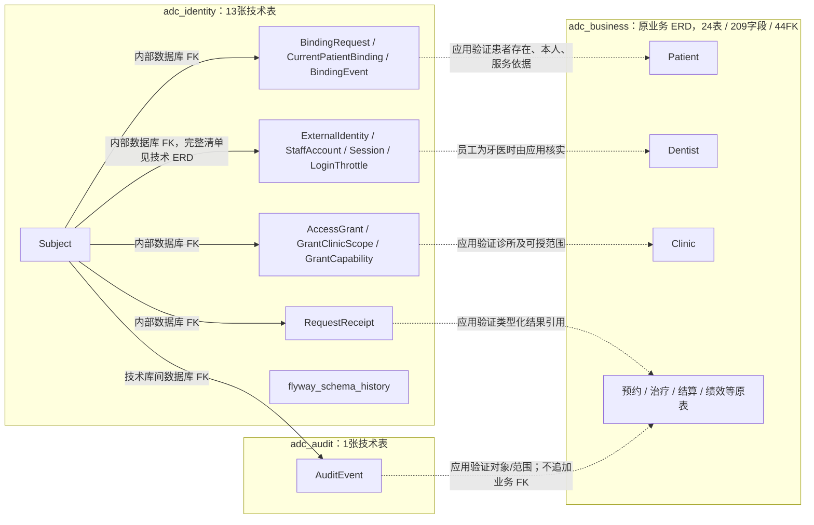

# 独立技术数据模型与存储边界

日期：2026-11-25。状态：当前技术存储与实现边界。D1及24张业务表字段保持既定定义，首次本人登记沿用现有技术表及JSON来源，字段和结构核对见[业务基线审核](business-baseline-audit.md)。

## 原 ERD 的覆盖范围

D1 与 D3—D24 描述业务库，覆盖预约→治疗→费用结算→季度绩效及人员/目录/事件等原业务关系。它不是本系统全部技术存储的完整 ERD。身份、核验、授权、会话、可信审计、请求防重和迁移历史属于技术支撑，不增加 UC/SF、不改 R1，不把已结算解释为已付款。演示费用属于业务库的挂号费策略、号源保留、账单、支付及退款表；技术身份模型不重复存业务支付事实。

## Schema 精简决策与确切表清单

首版从原 Plan 的五个 schema 精简为三个，同一 MySQL8.4/InnoDB 主实例。保留业务、身份技术、审计三个物理权限边界；control/meta 保留逻辑组件职责，不再创建对应物理 schema。

| 原 Plan 名称 | 本次物理落点 | 实际规划表 | 理由 |
| --- | --- | --- | --- |
| adc_business | adc_business | 24 表，见当前业务基线报告 | 与已批准ERD及V201后的字典保持一致 |
| adc_identity | adc_identity | Subject、ExternalIdentity、StaffAccount、Session、LoginThrottle、BindingRequest、CurrentPatientBinding、BindingEvent、AccessGrant、GrantClinicScope、GrantCapability | 身份/授权/人工核验实际表，不只有概念 |
| adc_audit | adc_audit | AuditEvent | 独立追加/保留/读取权限，至少 1 年 |
| adc_control | 并入 adc_identity | RequestReceipt | 只有请求控制职责，不需要单独建库；不得另增锁表 |
| adc_meta | 并入 adc_identity | flyway_schema_history | 迁移工具可配置历史表落点；运行账号表级权限隔离 |

计数：adc_identity 13 表（12 张应用技术表＋1 张工具历史表），adc_audit 1 表；合计 14 张技术表，系统物理表总数38，业务表为24。技术表间另有 19 条数据库外键，业务库44条外键；技术表到业务表不新增物理外键。结构定义与实际环境通过对应迁移及数据库验收证据核对。MySQL 自带系统库、binlog、备份文件、环境秘密不是应用业务表；不另建 Redis、Quartz、SPRING_SESSION、菜单权限、成本封账或分摊业务表。季度完备性/零成本确认仍放原 DRAFT/source_snapshot。

## 技术表字段、键与约束

所有自有技术表采用 InnoDB，时间点 UTC；业务日历仍 Asia/Shanghai。技术 UUID 使用相同字符集/大小写敏感规则以保证外键类型一致；外部标识 VARBINARY 精确比较。技术 FK 使用 RESTRICT，不级联删除历史主体。PK、单列/组合 UNIQUE 与非空由数据库保证，枚举和同一行的一致性用 CHECK，跨表主体类型/操作权限/业务事实用应用服务与事务验证。“APP:”明确表示逻辑引用，不应创建成数据库 FK。机器模型见 [technical-schema.json](technical-schema.json)。

### T01 adc_identity.Subject

长期可信主体；账号停用保留历史，不以患者/牙医主键代替身份。

PK：subject_id。附加 UNIQUE：无。

| 字段 | 类型 | 可空 | 关联保证 | 含义 |
| --- | --- | --- | --- | --- |
| subject_id | CHAR(36) | NOT NULL | — | 服务端随机 UUID |
| subject_type | VARCHAR(16) | NOT NULL | — | PATIENT、STAFF、SYSTEM |
| is_enabled | BOOLEAN | NOT NULL | — | 权威启用状态 |
| created_at | TIMESTAMP(6) | NOT NULL | — | 服务端创建时点 |
| disabled_at | TIMESTAMP(6) | NULL | — | 停用时点 |

SYSTEM 仅内部受控作业/初始化上下文，不可通过公开登录接口取得；不是新增业务岗位。

### T02 adc_identity.ExternalIdentity

真实微信身份到内部主体的映射；OpenID 不是患者本人核验结果。

PK：external_identity_id。附加 UNIQUE：(provider,appid,openid)；(subject_id)。

| 字段 | 类型 | 可空 | 关联保证 | 含义 |
| --- | --- | --- | --- | --- |
| external_identity_id | BIGINT | NOT NULL | — | 技术代理主键 |
| subject_id | CHAR(36) | NOT NULL | FK:adc_identity.Subject.subject_id | 患者主体 |
| provider | VARCHAR(32) | NOT NULL | — | 首版固定 WECHAT_MINIPROGRAM |
| appid | VARBINARY(64) | NOT NULL | — | 精确匹配服务端配置的 AppID |
| openid | VARBINARY(128) | NOT NULL | — | 仅可信代码交换结果；精确字节匹配 |
| created_at | TIMESTAMP(6) | NOT NULL | — | 创建时点 |

subject_id 单列唯一：首版一个患者主体只接一个真实小程序身份，避免把多个外部账号合并到同一主体绕过 Q1；同一外部账号换设备仍映射同一主体。不按 UnionID 自动合并。

### T03 adc_identity.StaffAccount

独立工作人员账号与密码散列；非牙医员工不写入 Dentist。

PK：subject_id。附加 UNIQUE：(username)。

| 字段 | 类型 | 可空 | 关联保证 | 含义 |
| --- | --- | --- | --- | --- |
| subject_id | CHAR(36) | NOT NULL | FK:adc_identity.Subject.subject_id | STAFF 主体 |
| username | VARCHAR(100) | NOT NULL | — | 个人登录名，技术库精确比较 |
| staff_reference | VARCHAR(100) | NOT NULL | — | 总部核实的工作人员依据 |
| dentist_id | BIGINT | NULL | APP:adc_business.Dentist.dentist_id | 仅牙医身份适用；业务服务核实 |
| password_hash | VARCHAR(255) | NULL | — | 成熟 Argon2id 编码含算法参数盐；无散列不能登录 |
| requires_reset | BOOLEAN | NOT NULL | — | 待安全设置凭据状态 |
| credential_changed_at | TIMESTAMP(6) | NULL | — | 最近设置时点 |
| verification_reference | VARCHAR(200) | NOT NULL | — | 员工核验来源标识 |

username 明确使用大小写敏感的比较规则；初建无凭据时禁止登录，通过已授权 credential-recovery 设置。未规定每位 Dentist 的账号数量，不擅加 dentist_id UNIQUE。

### T04 adc_identity.Session

ADC 自有权威会话；不启用另套框架 JDBC 会话表。

PK：session_id。附加 UNIQUE：(token_hash)。

| 字段 | 类型 | 可空 | 关联保证 | 含义 |
| --- | --- | --- | --- | --- |
| session_id | CHAR(36) | NOT NULL | — | 会话主键 |
| subject_id | CHAR(36) | NOT NULL | FK:adc_identity.Subject.subject_id | 可信主体 |
| token_hash | BINARY(32) | NOT NULL | — | 32 随机字节令牌的 SHA-256 摘要 |
| client_type | VARCHAR(16) | NOT NULL | — | 服务端固定 WEB 或 WECHAT |
| csrf_secret_hash | BINARY(32) | NULL | — | WEB 会话必须存在的防伪校验摘要 |
| created_at | TIMESTAMP(6) | NOT NULL | — | 绝对寿命起点 |
| last_activity_at | TIMESTAMP(6) | NOT NULL | — | 判过期后再刷新 |
| absolute_expires_at | TIMESTAMP(6) | NOT NULL | — | 创建后 8 小时 |
| revoked_at | TIMESTAMP(6) | NULL | — | 注销/恢复/受控统一失效时点 |
| revoked_reason | VARCHAR(128) | NULL | — | 失效原因 |

空闲达到30分钟或达到8小时绝对寿命拒绝；账号/绑定/授权不得从会话中的历史快照放行。

### T05 adc_identity.LoginThrottle

原子认证失败计数与限制窗口，包含不存在账号的不可枚举处理。

PK：throttle_key。附加 UNIQUE：无。

| 字段 | 类型 | 可空 | 关联保证 | 含义 |
| --- | --- | --- | --- | --- |
| throttle_key | BINARY(32) | NOT NULL | — | HMAC(认证域、规范化账号标识或服务端可信匿名来源)；不存明文错误凭据 |
| subject_id | CHAR(36) | NULL | FK:adc_identity.Subject.subject_id | 账号可识别时关联；未知账号为空 |
| consecutive_failures | INT | NOT NULL | — | 未限制时连续有效认证失败次数 |
| blocked_until | TIMESTAMP(6) | NULL | — | 第五次失败起15分钟 |
| last_failure_at | TIMESTAMP(6) | NULL | — | 最近实际认证失败 |
| updated_at | TIMESTAMP(6) | NOT NULL | — | 计数更新时间 |

计数>=0；成功认证清零；限制窗口内不验证/不延长窗口，到期后下一次尝试开启新计数。CSRF/格式拒绝不伪记密码失败。

### T06 adc_identity.BindingRequest

保存首次本人登记的系统接纳记录及已有档案的人工核验待办。PENDING线索不授患者访问权；首次登记与APPROVED当前映射同事务生效。

PK：request_id。附加 UNIQUE：无。

| 字段 | 类型 | 可空 | 关联保证 | 含义 |
| --- | --- | --- | --- | --- |
| request_id | CHAR(36) | NOT NULL | — | 服务端生成的申请标识 |
| applicant_subject_id | CHAR(36) | NOT NULL | FK:adc_identity.Subject.subject_id | 可信患者申请人 |
| patient_number_hint | VARCHAR(30) | NOT NULL | — | 已有档案由申请人提供线索；首次登记由服务器生成患者编号 |
| date_of_birth_hint | DATE | NOT NULL | — | 本人出生日期线索，不凭此认领已有档案 |
| service_clinic_id | BIGINT | NOT NULL | APP:adc_business.Clinic.clinic_id | 申请服务点；不授前台或申请人任何范围 |
| candidate_patient_id | BIGINT | NULL | APP:adc_business.Patient.patient_id | 首次为服务器新建Patient；已有档案由授权前台核实 |
| status | VARCHAR(16) | NOT NULL | — | PENDING待核实；APPROVED表示系统接纳首次登记或前台完成核验 |
| submitted_at | TIMESTAMP(6) | NOT NULL | — | 提交时点 |
| reviewed_by | CHAR(36) | NULL | FK:adc_identity.Subject.subject_id | 首次为可信登记主体；已有档案为核验前台 |
| reviewed_at | TIMESTAMP(6) | NULL | — | 处理时点 |
| verification_basis | JSON | NULL | — | 结构化核验结果、本人确认及本次服务依据 |
| reason | VARCHAR(255) | NULL | — | 核验原因；不存身份证件影像 |

PENDING不含处理结论；APPROVED须有目标患者、实际办理主体、时间和依据。首次分支由服务器写SELF_DECLARED、person_confirmed=false、allergy_reviewed=false及本人声明，表示自动接纳登记。客户端始终不得自报reviewed_by或verification_basis；已有档案批准仅允许授权前台核验。拒绝接口仍返回失败并审计，不虚构未设计的拒绝待办路由。

### T07 adc_identity.CurrentPatientBinding

仅当前有效本人关系；解绑删除当前映射，证据另存。

PK：subject_id。附加 UNIQUE：(patient_id)。

| 字段 | 类型 | 可空 | 关联保证 | 含义 |
| --- | --- | --- | --- | --- |
| subject_id | CHAR(36) | NOT NULL | FK:adc_identity.Subject.subject_id | 一主体至多一档案的 PK |
| patient_id | BIGINT | NOT NULL | APP:adc_business.Patient.patient_id | 一档案至多一主体的 UNIQUE |
| verified_by | CHAR(36) | NOT NULL | FK:adc_identity.Subject.subject_id | 实际登记主体或人工核验前台，按method区分 |
| verified_at | TIMESTAMP(6) | NOT NULL | — | 当前关系生效时点 |
| verification_reference | VARCHAR(200) | NOT NULL | APP:adc_identity.BindingRequest.request_id | 已批准申请；同事务建立批准事实 |

双向至多一个有效绑定；新旧主体固定顺序锁、Patient 稳定行锁和 UNIQUE 冲突处理，禁止覆盖绑定。不物理删除 Patient 或 Subject。

### T08 adc_identity.BindingEvent

追加的绑定/重绑/解绑证据历史。

PK：event_id。附加 UNIQUE：无。

| 字段 | 类型 | 可空 | 关联保证 | 含义 |
| --- | --- | --- | --- | --- |
| event_id | CHAR(36) | NOT NULL | — | 历史事件 |
| action | VARCHAR(16) | NOT NULL | — | BIND、REBIND、UNBIND |
| patient_id | BIGINT | NOT NULL | APP:adc_business.Patient.patient_id | 被核验的业务患者 |
| old_subject_id | CHAR(36) | NULL | FK:adc_identity.Subject.subject_id | 原主体 |
| new_subject_id | CHAR(36) | NULL | FK:adc_identity.Subject.subject_id | 新主体 |
| operator_subject_id | CHAR(36) | NOT NULL | FK:adc_identity.Subject.subject_id | 可信登记主体或授权前台 |
| binding_request_id | CHAR(36) | NULL | FK:adc_identity.BindingRequest.request_id | 绑定/重绑必有；解绑可空 |
| occurred_at | TIMESTAMP(6) | NOT NULL | — | 可信时点 |
| reason | VARCHAR(255) | NOT NULL | — | 本人登记或人工核验办理原因 |
| verification_basis | JSON | NOT NULL | — | method区分SELF_DECLARED与人工核验；含实际声明或核验证据 |
| request_key | VARCHAR(64) | NOT NULL | APP:adc_identity.RequestReceipt.request_key | 按主体与操作共同定位，不是单列 FK |

BIND 只有新主体；REBIND 新旧均有且不同；UNBIND 只有旧主体。只追加。不是 AppointmentEvent 的替代。

### T09 adc_identity.AccessGrant

工作人员岗位、有效期及撤销事实；能力和范围用实际子表。

PK：grant_id。附加 UNIQUE：无。

| 字段 | 类型 | 可空 | 关联保证 | 含义 |
| --- | --- | --- | --- | --- |
| grant_id | CHAR(36) | NOT NULL | — | 授权主键 |
| subject_id | CHAR(36) | NOT NULL | FK:adc_identity.Subject.subject_id | 被授权 STAFF |
| role_code | VARCHAR(24) | NOT NULL | — | RECEPTION、DENTIST、CASHIER、HEADQUARTERS |
| granted_by | CHAR(36) | NOT NULL | FK:adc_identity.Subject.subject_id | 有权授予者 |
| valid_from | TIMESTAMP(6) | NOT NULL | — | 包含起点 |
| valid_until | TIMESTAMP(6) | NULL | — | 不含终点；为空不表示免于撤权 |
| revoked_at | TIMESTAMP(6) | NULL | — | 撤销事实 |
| revoked_by | CHAR(36) | NULL | FK:adc_identity.Subject.subject_id | 撤销者 |
| reason | VARCHAR(255) | NOT NULL | — | 授权依据 |
| created_at | TIMESTAMP(6) | NOT NULL | — | 可信创建时点 |

结束晚于开始；revoked_at/revoked_by 同时存在或同时为空。无“诊所管理员”新角色；按原岗位和能力授予。

### T10 adc_identity.GrantClinicScope

授权实际诊所范围；非空清单不以 NULL 或 * 代表隐式全库。

PK：grant_id, clinic_id。附加 UNIQUE：无。

| 字段 | 类型 | 可空 | 关联保证 | 含义 |
| --- | --- | --- | --- | --- |
| grant_id | CHAR(36) | NOT NULL | FK:adc_identity.AccessGrant.grant_id | 授权记录 |
| clinic_id | BIGINT | NOT NULL | APP:adc_business.Clinic.clinic_id | 应用验证真实诊所及可授范围 |

逐项验证；无范围不能访问诊所业务。总部全链范围通过当前明确授予诊所集合表达；新增诊所不自动扩大旧授权。

### T11 adc_identity.GrantCapability

授权实际操作能力集合。

PK：grant_id, capability_code。附加 UNIQUE：无。

| 字段 | 类型 | 可空 | 关联保证 | 含义 |
| --- | --- | --- | --- | --- |
| grant_id | CHAR(36) | NOT NULL | FK:adc_identity.AccessGrant.grant_id | 授权记录 |
| capability_code | VARCHAR(80) | NOT NULL | — | 服务端版本化能力注册表中的操作码 |

注册表属于代码配置，不增设动态角色/菜单管理业务；未知能力拒绝。角色相容性和操作者可授范围由应用验证。

### T12 adc_identity.RequestReceipt

受保护写命令的技术防重和结果引用；原控制组件的实际表。

PK：subject_id, operation_id, request_key。附加 UNIQUE：无。

| 字段 | 类型 | 可空 | 关联保证 | 含义 |
| --- | --- | --- | --- | --- |
| subject_id | CHAR(36) | NOT NULL | FK:adc_identity.Subject.subject_id | 可信主体 |
| operation_id | VARCHAR(80) | NOT NULL | — | 固定接口操作码 |
| request_key | VARCHAR(64) | NOT NULL | — | 调用方幂等键，不能作为身份 |
| content_hash | BINARY(32) | NOT NULL | — | 规范请求摘要，包含 If-Match |
| request_id | CHAR(36) | NOT NULL | — | 服务端相关标识 |
| result_refs | JSON | NOT NULL | APP:adc_business.* | 受控类型化对象引用；也可指身份技术对象 |
| response_summary | JSON | NOT NULL | — | 最小结果；禁止凭据、令牌、完整临床内容 |
| response_status | SMALLINT | NOT NULL | — | 原成功响应状态 |
| created_at | TIMESTAMP(6) | NOT NULL | — | 请求建立时点 |
| completed_at | TIMESTAMP(6) | NOT NULL | — | 成功提交时点 |

只持久化成功回执，与事实/事件/审计同事务；不预先独立提交 PENDING。先当前授权，再回执重放，再首次执行 If-Match/状态检查。同键不同内容拒绝。

### T13 adc_identity.flyway_schema_history

工具实际迁移历史表；原元数据组件落点。

PK：installed_rank。附加 UNIQUE：无。

| 字段 | 类型 | 可空 | 关联保证 | 含义 |
| --- | --- | --- | --- | --- |
| installed_rank | INT | NOT NULL | — | 工具序号 PK |
| version | VARCHAR(50) | NULL | — | 迁移版本 |
| description | VARCHAR(200) | NOT NULL | — | 迁移描述 |
| type | VARCHAR(20) | NOT NULL | — | 迁移类型 |
| script | VARCHAR(1000) | NOT NULL | — | 脚本标识 |
| checksum | INT | NULL | — | 工具校验值 |
| installed_by | VARCHAR(100) | NOT NULL | — | 迁移账号 |
| installed_on | TIMESTAMP | NOT NULL | — | 工具默认 CURRENT_TIMESTAMP |
| execution_time | INT | NOT NULL | — | 工具执行时间 |
| success | BOOLEAN | NOT NULL | — | 工具结果 |

结构按 Flyway MySQL 官方实现核实；版本随已选 Boot BOM 锁定后以该版本工具输出再次核对，不手写/更改历史表。success 普通索引不是唯一键。运行账号无写入权限。

### T14 adc_audit.AuditEvent

可信追加审计，独立权限及至少一年保留边界。

PK：audit_id。附加 UNIQUE：无。

| 字段 | 类型 | 可空 | 关联保证 | 含义 |
| --- | --- | --- | --- | --- |
| audit_id | BIGINT | NOT NULL | — | 技术代理主键 |
| subject_id | CHAR(36) | NULL | FK:adc_identity.Subject.subject_id | 可识别主体；匿名认证失败为空 |
| actor_kind | VARCHAR(16) | NOT NULL | — | SUBJECT、ANONYMOUS、SYSTEM |
| action | VARCHAR(80) | NOT NULL | — | 动作码 |
| object_kind | VARCHAR(48) | NOT NULL | — | 业务或身份对象类型 |
| object_id | VARCHAR(100) | NULL | APP:adc_business.* | 按 object_kind 解析的对象引用；可指技术对象 |
| clinic_scope | JSON | NOT NULL | APP:adc_business.Clinic.clinic_id | 可信诊所范围数组；不由客户自报 |
| occurred_at | TIMESTAMP(6) | NOT NULL | — | 可信发生时间 |
| request_id | CHAR(36) | NOT NULL | APP:adc_identity.RequestReceipt.request_id | 请求相关；拒绝/读取审计可能没有成功回执 |
| result | VARCHAR(24) | NOT NULL | — | 成功、拒绝或失败分类 |
| reason | VARCHAR(255) | NULL | — | 必要原因，不能复制秘密 |
| change_summary | JSON | NULL | — | 最小脱敏变更差异 |
| verification_reference | VARCHAR(200) | NULL | — | 必要人工依据 |

仅审计授权总部读取；运行账号只按需 INSERT/SELECT，不能 UPDATE/DELETE。敏感读先持久化审计；规定成功写与事实同事务；失败审计在业务回滚后独立短事务。

## 数据库外键与应用引用清单

下列 19 条为新增技术 FK，均不进入原业务 30 FK 计数；只有 AuditEvent.subject_id 跨技术 schema。

| 技术子列 | 数据库父列 | 可空 |
| --- | --- | --- |
| adc_identity.ExternalIdentity.subject_id | adc_identity.Subject.subject_id | 否 |
| adc_identity.StaffAccount.subject_id | adc_identity.Subject.subject_id | 否 |
| adc_identity.Session.subject_id | adc_identity.Subject.subject_id | 否 |
| adc_identity.LoginThrottle.subject_id | adc_identity.Subject.subject_id | 是 |
| adc_identity.BindingRequest.applicant_subject_id | adc_identity.Subject.subject_id | 否 |
| adc_identity.BindingRequest.reviewed_by | adc_identity.Subject.subject_id | 是 |
| adc_identity.CurrentPatientBinding.subject_id | adc_identity.Subject.subject_id | 否 |
| adc_identity.CurrentPatientBinding.verified_by | adc_identity.Subject.subject_id | 否 |
| adc_identity.BindingEvent.old_subject_id | adc_identity.Subject.subject_id | 是 |
| adc_identity.BindingEvent.new_subject_id | adc_identity.Subject.subject_id | 是 |
| adc_identity.BindingEvent.operator_subject_id | adc_identity.Subject.subject_id | 否 |
| adc_identity.BindingEvent.binding_request_id | adc_identity.BindingRequest.request_id | 是 |
| adc_identity.AccessGrant.subject_id | adc_identity.Subject.subject_id | 否 |
| adc_identity.AccessGrant.granted_by | adc_identity.Subject.subject_id | 否 |
| adc_identity.AccessGrant.revoked_by | adc_identity.Subject.subject_id | 是 |
| adc_identity.GrantClinicScope.grant_id | adc_identity.AccessGrant.grant_id | 否 |
| adc_identity.GrantCapability.grant_id | adc_identity.AccessGrant.grant_id | 否 |
| adc_identity.RequestReceipt.subject_id | adc_identity.Subject.subject_id | 否 |
| adc_audit.AuditEvent.subject_id | adc_identity.Subject.subject_id | 是 |

下列逻辑引用不声明物理 FK，必须通过统一后端验证；既有业务库仍是患者、牙医、诊所及业务事实的权威来源。

| 技术列 | 应用验证的目标 | 可空 |
| --- | --- | --- |
| adc_identity.StaffAccount.dentist_id | adc_business.Dentist.dentist_id | 是 |
| adc_identity.BindingRequest.service_clinic_id | adc_business.Clinic.clinic_id | 否 |
| adc_identity.BindingRequest.candidate_patient_id | adc_business.Patient.patient_id | 是 |
| adc_identity.CurrentPatientBinding.patient_id | adc_business.Patient.patient_id | 否 |
| adc_identity.CurrentPatientBinding.verification_reference | adc_identity.BindingRequest.request_id | 否 |
| adc_identity.BindingEvent.patient_id | adc_business.Patient.patient_id | 否 |
| adc_identity.BindingEvent.request_key | adc_identity.RequestReceipt.request_key | 否 |
| adc_identity.GrantClinicScope.clinic_id | adc_business.Clinic.clinic_id | 否 |
| adc_identity.RequestReceipt.result_refs | adc_business.* | 否 |
| adc_audit.AuditEvent.object_id | adc_business.* | 是 |
| adc_audit.AuditEvent.clinic_scope | adc_business.Clinic.clinic_id | 否 |
| adc_audit.AuditEvent.request_id | adc_identity.RequestReceipt.request_id | 否 |

APP 引用的保证方式：写前当前读确认存在和可用范围；绑定还核验本人，员工牙医关联核验实际 Dentist，授权诊所逐项核验真实 Clinic 和可授范围；写入与必要审计同连接同事务。业务资源沿原流程停用/终止，运行账号不提供任意删除 Patient/Clinic/Dentist 的路径；上线前及恢复后执行逻辑引用巡检，发现悬空即拒绝受影响访问并修复，不自动创建假档案。多态审计对象可能描述已经被拒绝/不存在的目标，保留请求事实而不强行补造对象；成功回执引用则必须指向同次成功提交对象。Audit.request_id 是相关标识，失败/读取审计可以无回执，不能设伪外键。

## 并发、事务与证据生命周期

受保护写先取得原请求互斥，再按 subject_id 升序锁涉及主体；授权/会话变更遵守同一身份锁入口。绑定再锁实际 Patient 稳定行及当前映射，保证同患者争用和首次映射也可串行；需要牙医/班次/预约的原流程继续沿 Plan 固定业务锁序。任何流程不得在业务锁之后反向补取身份锁，新发现锁集合则回滚、扩充集合并重试。患者绑定读取和写命令入口必须复核当前关系。重绑中删除旧当前映射、插入新映射、批准新主体申请、追加 BindingEvent、AuditEvent 和成功 RequestReceipt 一次提交；失败全回滚。旧主体及旧历史保留，旧登录会话不能再凭旧关系访问。

Subject、绑定/授权/审计历史保留可追踪引用；停用/撤销不是物理删除。AuditEvent 至少保留 1 年，普通运行账号无 UPDATE/DELETE。RequestReceipt 不设擅自发明的短期重放截止，不在已有幂等保证存续时任意删除；一期不启用任何自动删除，仅通过会话失效、停用和撤权控制访问，保留账号、绑定、授权、限流和请求回执历史。TD-01已由负责人确认；后续物理清理须另行明确范围并获确认；不擅定新业务保留政策，不降低既有审计至少1年和业务历史保全要求。

## 迁移、权限与统一恢复

部署初始化显式创建三个 schema。单一受控迁移器配置 defaultSchema=adc_identity、schemas=[adc_identity,adc_business,adc_audit]、table=flyway_schema_history、createSchemas=false、cleanDisabled=true；业务 DDL 显式使用 adc_business 表全名。应用运行账号不开 DDL、不执行自动迁移；独立 migrator 管理结构并写工具历史。运行账号采用逐表权限，不能因历史表并入 identity 获得 flyway_schema_history 写权。迁移失败按工具状态与已执行 DDL 逐项处理，不宣称 MySQL DDL 可以随业务事务整体回滚。

Flyway defaultSchema 决定历史表位置，见 [官方配置](https://documentation.red-gate.com/flyway/reference/configuration/flyway-namespace/flyway-default-schema-setting)。工具表十列按 [官方 MySQL 实现](https://raw.githubusercontent.com/flyway/flyway/main/flyway-database/flyway-mysql/src/main/java/org/flywaydb/database/mysql/MySQLDatabase.java)核对；该 main 分支不是锁定依赖版本，实施时仍须核对已锁定版本输出。

同实例三 schema 使用同一 DataSource 物理连接保证业务/技术成功写原子性。统一全备＋同一 binlog 恢复位点覆盖三个 schema 和迁移历史；恢复后核对身份映射、授权/停用、审计、回执及原业务结构。移到不同实例即失去此本地事务前提，必须另作架构评审。

## 独立技术模型图

下图仅含 14 张技术表和技术 FK。Mermaid 的实线表示此图所列 FK；不把 ER 图的识别/非识别线型用作“应用关联”的暗示。完整字段与组合键以上方表及 JSON 为准。原业务表不会被画入这份技术 ERD，也不会反向改写原 D1。补充[技术存储边界概览 PNG](diagrams/technical-storage-overview.png)与[可缩放 SVG](diagrams/technical-storage-overview.svg)；该概览已本地绘制并查看，不代表完整Mermaid经过专用渲染器。

[技术 ERD 源文件](diagrams/technical-erd.mmd)

```mermaid
erDiagram
    Subject {
        CHAR_36 subject_id PK "NOT NULL"
        VARCHAR_16 subject_type "NOT NULL"
        BOOLEAN is_enabled "NOT NULL"
        TIMESTAMP_6 created_at "NOT NULL"
        TIMESTAMP_6 disabled_at "NULL"
    }
    ExternalIdentity {
        BIGINT external_identity_id PK "NOT NULL"
        CHAR_36 subject_id FK, UK "NOT NULL"
        VARCHAR_32 provider "NOT NULL"
        VARBINARY_64 appid "NOT NULL"
        VARBINARY_128 openid "NOT NULL"
        TIMESTAMP_6 created_at "NOT NULL"
    }
    StaffAccount {
        CHAR_36 subject_id PK, FK "NOT NULL"
        VARCHAR_100 username UK "NOT NULL"
        VARCHAR_100 staff_reference "NOT NULL"
        BIGINT dentist_id "NULL"
        VARCHAR_255 password_hash "NULL"
        BOOLEAN requires_reset "NOT NULL"
        TIMESTAMP_6 credential_changed_at "NULL"
        VARCHAR_200 verification_reference "NOT NULL"
    }
    Session {
        CHAR_36 session_id PK "NOT NULL"
        CHAR_36 subject_id FK "NOT NULL"
        BINARY_32 token_hash UK "NOT NULL"
        VARCHAR_16 client_type "NOT NULL"
        BINARY_32 csrf_secret_hash "NULL"
        TIMESTAMP_6 created_at "NOT NULL"
        TIMESTAMP_6 last_activity_at "NOT NULL"
        TIMESTAMP_6 absolute_expires_at "NOT NULL"
        TIMESTAMP_6 revoked_at "NULL"
        VARCHAR_128 revoked_reason "NULL"
    }
    LoginThrottle {
        BINARY_32 throttle_key PK "NOT NULL"
        CHAR_36 subject_id FK "NULL"
        INT consecutive_failures "NOT NULL"
        TIMESTAMP_6 blocked_until "NULL"
        TIMESTAMP_6 last_failure_at "NULL"
        TIMESTAMP_6 updated_at "NOT NULL"
    }
    BindingRequest {
        CHAR_36 request_id PK "NOT NULL"
        CHAR_36 applicant_subject_id FK "NOT NULL"
        VARCHAR_30 patient_number_hint "NOT NULL"
        DATE date_of_birth_hint "NOT NULL"
        BIGINT service_clinic_id "NOT NULL"
        BIGINT candidate_patient_id "NULL"
        VARCHAR_16 status "NOT NULL"
        TIMESTAMP_6 submitted_at "NOT NULL"
        CHAR_36 reviewed_by FK "NULL"
        TIMESTAMP_6 reviewed_at "NULL"
        JSON verification_basis "NULL"
        VARCHAR_255 reason "NULL"
    }
    CurrentPatientBinding {
        CHAR_36 subject_id PK, FK "NOT NULL"
        BIGINT patient_id UK "NOT NULL"
        CHAR_36 verified_by FK "NOT NULL"
        TIMESTAMP_6 verified_at "NOT NULL"
        VARCHAR_200 verification_reference "NOT NULL"
    }
    BindingEvent {
        CHAR_36 event_id PK "NOT NULL"
        VARCHAR_16 action "NOT NULL"
        BIGINT patient_id "NOT NULL"
        CHAR_36 old_subject_id FK "NULL"
        CHAR_36 new_subject_id FK "NULL"
        CHAR_36 operator_subject_id FK "NOT NULL"
        CHAR_36 binding_request_id FK "NULL"
        TIMESTAMP_6 occurred_at "NOT NULL"
        VARCHAR_255 reason "NOT NULL"
        JSON verification_basis "NOT NULL"
        VARCHAR_64 request_key "NOT NULL"
    }
    AccessGrant {
        CHAR_36 grant_id PK "NOT NULL"
        CHAR_36 subject_id FK "NOT NULL"
        VARCHAR_24 role_code "NOT NULL"
        CHAR_36 granted_by FK "NOT NULL"
        TIMESTAMP_6 valid_from "NOT NULL"
        TIMESTAMP_6 valid_until "NULL"
        TIMESTAMP_6 revoked_at "NULL"
        CHAR_36 revoked_by FK "NULL"
        VARCHAR_255 reason "NOT NULL"
        TIMESTAMP_6 created_at "NOT NULL"
    }
    GrantClinicScope {
        CHAR_36 grant_id PK, FK "NOT NULL"
        BIGINT clinic_id PK "NOT NULL"
    }
    GrantCapability {
        CHAR_36 grant_id PK, FK "NOT NULL"
        VARCHAR_80 capability_code PK "NOT NULL"
    }
    RequestReceipt {
        CHAR_36 subject_id PK, FK "NOT NULL"
        VARCHAR_80 operation_id PK "NOT NULL"
        VARCHAR_64 request_key PK "NOT NULL"
        BINARY_32 content_hash "NOT NULL"
        CHAR_36 request_id "NOT NULL"
        JSON result_refs "NOT NULL"
        JSON response_summary "NOT NULL"
        SMALLINT response_status "NOT NULL"
        TIMESTAMP_6 created_at "NOT NULL"
        TIMESTAMP_6 completed_at "NOT NULL"
    }
    flyway_schema_history {
        INT installed_rank PK "NOT NULL"
        VARCHAR_50 version "NULL"
        VARCHAR_200 description "NOT NULL"
        VARCHAR_20 type "NOT NULL"
        VARCHAR_1000 script "NOT NULL"
        INT checksum "NULL"
        VARCHAR_100 installed_by "NOT NULL"
        TIMESTAMP installed_on "NOT NULL"
        INT execution_time "NOT NULL"
        BOOLEAN success "NOT NULL"
    }
    AuditEvent {
        BIGINT audit_id PK "NOT NULL"
        CHAR_36 subject_id FK "NULL"
        VARCHAR_16 actor_kind "NOT NULL"
        VARCHAR_80 action "NOT NULL"
        VARCHAR_48 object_kind "NOT NULL"
        VARCHAR_100 object_id "NULL"
        JSON clinic_scope "NOT NULL"
        TIMESTAMP_6 occurred_at "NOT NULL"
        CHAR_36 request_id "NOT NULL"
        VARCHAR_24 result "NOT NULL"
        VARCHAR_255 reason "NULL"
        JSON change_summary "NULL"
        VARCHAR_200 verification_reference "NULL"
    }
    Subject ||--o| ExternalIdentity : "subject_id"
    Subject ||--o| StaffAccount : "subject_id"
    Subject ||--o{ Session : "subject_id"
    Subject o|--o{ LoginThrottle : "subject_id"
    Subject ||--o{ BindingRequest : "applicant_subject_id"
    Subject o|--o{ BindingRequest : "reviewed_by"
    Subject ||--o| CurrentPatientBinding : "subject_id"
    Subject ||--o{ CurrentPatientBinding : "verified_by"
    Subject o|--o{ BindingEvent : "old_subject_id"
    Subject o|--o{ BindingEvent : "new_subject_id"
    Subject ||--o{ BindingEvent : "operator_subject_id"
    BindingRequest o|--o{ BindingEvent : "binding_request_id"
    Subject ||--o{ AccessGrant : "subject_id"
    Subject ||--o{ AccessGrant : "granted_by"
    Subject o|--o{ AccessGrant : "revoked_by"
    AccessGrant ||--o{ GrantClinicScope : "grant_id"
    AccessGrant ||--o{ GrantCapability : "grant_id"
    Subject ||--o{ RequestReceipt : "subject_id"
    Subject o|--o{ AuditEvent : "subject_id"
```

### 技术存储与业务库的关系

[边界图源文件](diagrams/storage-boundaries.mmd)。实线为技术数据库 FK 的分组概览，虚线为应用层验证，不是原业务 ERD 的修改版；完整 FK/逻辑引用逐列清单见上。

## 验收与待验证

| ID | Given | When | Then | 原追踪 |
| --- | --- | --- | --- | --- |
| PV-DB01 | 原 Word、原 D1、schema.json | 逐行核对目标字典并查实际迁移结构 | 24/209/44 完整一致；差异明确阻断，不静默修改 | FR-020 / AC-G04 |
| PV-DB02 | 隔离 MySQL 及真实迁移器 | 执行迁移并列出全部应用表 | 业务24表，技术14表分布 13+1；无 adc_control/meta 或隐藏框架表 | FR-020 / AC-G04 |
| PV-ID01 | 真实 AppID 配置和有效 wx.login code | 后端交换代码并建立会话 | 精确外部身份映射到同一 Subject；未建立当前本人关联前无患者访问权；首次本人登记自动关联新档案，不认领历史资料 | SF01/SF02 / AC-SF01-01 / AC-SF02-01 |
| PV-ID02 | 同一 Patient 的两个不同真实主体申请 | 授权前台并发批准 | 至多一个 CurrentPatientBinding；失败不留成功回执/单边证据 | SF02 Q1 / AC-SF02-02 |
| PV-ID03 | 旧绑定及未过期旧会话、新主体待核验申请 | 核验重绑成功后用旧会话访问 | 旧关系失效；新唯一映射/核验/历史/审计/回执同事务 | SF02 / AC-SF02-02 / AC-G03 |
| PV-ID04 | 绑定/授权/业务成功写已准备 | 注入审计或回执持久化失败 | 事实整体回滚，原键可安全重试 | FR-019 / AC-G03 / AC-Q08 |
| PV-ID05 | 原键成功结果及当前撤权/停用 | 重放该原键 | 先拒绝当前无权主体，不返回旧敏感结果 | SF04 / AC-SF04-02 / AC-Q07 |
| PV-DB03 | 三 schema 一致备份和技术逻辑引用 | 恢复到共同位点并巡检 | 无悬空成功引用；旧失效/新唯一与权限一致 | Q05 / AC-Q05 |

PV 是 Plan 验证项，不重编号或新增 Spec 业务验收要求。真实MySQL约束、并发/故障、真实微信身份及恢复演练已按相应任务执行，具体结果和边界见任务与专题证据；当前文档结构本身不代替运行证明。C-04身份架构已批准，真实AppID/AppSecret、域名/TLS、初始化及联调转后续实施任务；C-05云资源、性能与恢复演练转后续实施及验收；TD-01已确认一期不启用自动删除，保留历史证据。不以状态代替运行证据，见[批准记录](plan-approval.md)。
